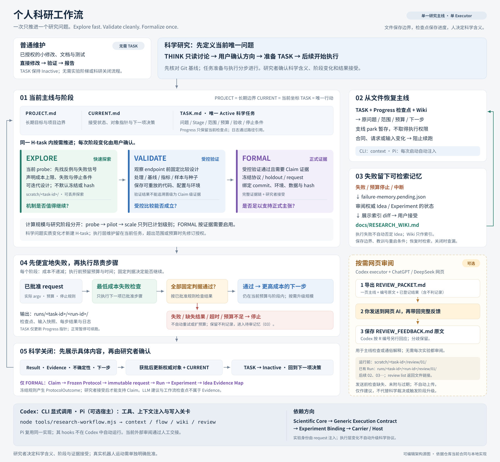

# 科研型 Codex 工作流模板

面向个人机器人研究者、ROS 2、Python、C++ 和真实机器人实验的轻量模板。

> 一次只推进一个研究问题；先构思，再激活一个有边界的任务；临时探索留在项目内但不进入
> 正式代码；正式实验无论结果是否有利都留下记录；Git 保存每次被接受的状态。

## V3.1 新增与改进

这一版让实验更早暴露失败、失败经验能够复用，也让跨会话执行和外部审阅有明确依据。

| 功能 | 怎么帮助你 |
|---|---|
| 先便宜地失败，再执行昂贵步骤 | 从最低成本检查开始，固定判据通过且预算足够才继续；失败即停止，不自动重试或扩大计算。 |
| Research Wiki 失败记忆 | 保存失败 Idea 和不利、无结论实验的索引，记录适用边界、教训和重启条件，供后续检索。执行失败先留待审记录，经你确认后再写入长期索引。 |
| 从文件恢复研究主线 | 从 TASK 和检查点恢复原问题、范围、预算与下一步；支线先暂存，合同、请求或输入变化时阻止沿旧 Run 继续。 |
| 按需交给网页 AI 审阅 | 导出 `REVIEW_PACKET.md`，附主线、引用原文和已登记结果（含不利记录），由你交给 ChatGPT / DeepSeek 网页；缺失或过期材料会明确提示。 |
| 保留外部反馈原文 | `REVIEW_FEEDBACK.md` 保存完整反馈，Codex 另行逐项回应。审阅用于主线检查或通俗解释，科学判断和阶段变化仍由你确认。 |
| 小修改直接处理 | 已授权的普通代码、文档和测试维护无需创建科研 TASK；科学任务仍按范围和预算执行。 |
| 严格性按阶段启用 | `EXPLORE → VALIDATE → FORMAL` 按需推进；阶段升级保留同一 H-task，完整冻结和审计只在需要正式证据时启用。 |

Codex 使用 `node tools/research-workflow.mjs`，Pi 可通过工具和上下文注入接入同一实现。
Pi 的 hooks 不会在 Codex 中自动运行。请求格式和命令见
[实验、失败记忆与主线恢复](docs/research_workflow.md)，长期记忆入口见
[Research Wiki](docs/RESEARCH_WIKI.md)。

科学 TASK 激活后，需要外部意见时，可以直接说“生成当前任务的审阅包”。运行前文件放在
`scratch/<task-id>/review/01/`，已有 Run 时放在 `runs/<task-id>/<run-id>/review/01/`；
后续审阅使用 `02、03…`，保留旧版，并直接返回文件链接。网页交接由你按需完成。

## 一分钟理解

整个模板是一条科研循环：

```text
PROJECT / Idea / Claim
        ↓
CURRENT：当前接受了什么？下一项需要决定什么？
        ↓
TASK [EXPLORE | VALIDATE | FORMAL]
        ↓
Codex 执行 + 检查
        ↓
展示关闭内容 + 用户确认
        ↓
更新知识 / 维护代码 / 保留证据 / 删除临时内容
        ↓
回到下一项研究决策
```



[可编辑 SVG](docs/attachment/workflow_architecture.svg) · [PNG 预览](docs/attachment/workflow_architecture.png)

## THINK：先构思，不执行

没有 Active 科学 TASK 时，可以让 Codex：

- 理解研究问题；
- 只读检查必要文档和代码；
- 比较理论或实现方案；
- 找反例和缺失约束；
- 把模糊目标整理成可落实的任务计划。

THINK 是科学研究的讨论状态，不执行科学任务。你确认计划后，再让 Codex 只修改
`state/TASK.md` 准备任务；下一条指令才开始执行。已授权的普通维护可以直接修改和验证，
TASK 保持 Inactive。

## 三个科研阶段

| Stage | 回答的问题 | 执行要求 | 结果用途 |
|---|---|---|---|
| `EXPLORE` | 机制是否合理、值得继续？ | 当前 probe 的预算和停止条件；探索默认放在 `scratch/<task-id>/` | 支持下一项研究决策，不是正式证据 |
| `VALIDATE` | 受控比较是否成立？ | 观察指标前固定比较设计，保存可重放的代码、配置与环境 | 受控验证，不能追溯晋级为 Claim 级证据 |
| `FORMAL` | 证据是否支持 Claim？ | 已通过受控验证，按冻结协议、不可变请求和完整环境绑定执行 holdout | 经完整证据链与研究者接受后才能支持 Claim |

`EXPLORE` 同时覆盖理论分析和最小临时计算，不再细分探索子类型。项目内的 `scratch/`
默认由 Git 忽略，可以跨对话和重启保留；它不是正式代码或证据。

## 人和 Codex 的分工

```text
你决定：Why / What / Valid
Codex 决定：How / Where / Check / Clean
```

| 研究者负责 | Codex 负责 |
|---|---|
| 研究价值、Claim 和成功标准 | 把目标整理为有边界的 TASK |
| 是否接受假设、阈值和近似 | 提出反例、实现计划和验证方式 |
| 是否切换科研阶段 | 选择 owner、接口、依赖方向和文件位置 |
| 是否接受正式证据 | 编写实现、测试、适配和实验入口 |
| 是否执行真实机器人运动 | 管理输出、证据身份和临时代码去向 |

用户不需要记忆 I/P/E/C/T 编号，也不需要先选择代码目录。Codex 从 `CURRENT.md` 和关联
文档解析；存在多个研究含义时讨论含义，不要求用户查编号。

## 最短使用方法

### 0. 第一次使用：建立 Git 基线

模板依赖 Git 来回滚被覆盖的 CURRENT、Idea 和 TASK，并保存每次被接受的关闭状态。复制模板
后先初始化仓库并创建初始提交；提交身份和默认分支由你决定。没有有效 Git 基线时，不开始
VALIDATE 或 FORMAL。

```bash
git init -b main
git add -A
git commit -m "chore: initialize research harness"
```

### 1. 先构思

```text
我想解决……；目前已知……；最终希望……。
请先检查必要上下文，和我一起形成可执行计划，不修改文件。
```

### 2. 准备任务

```text
我接受这个方案。准备当前 TASK，只修改 state/TASK.md，不执行。
```

### 3. 执行任务

```text
按照当前 TASK 执行。
```

### 4. 接受并关闭

```text
请展示关闭任务所需的具体内容和 diff，我确认后再执行关闭。
```

阶段升级需你确认，在同一 H-task 内更新 Stage 和合同。只有假设、处理、指标、研究群体、
推断单位或冻结科学规则等研究边界实质变化时，才准备新 H-task；执行层调整按当前授权处理。

## 文件地图

```text
.
├── AGENTS.md              # Codex 的硬规则和导航
├── README.md              # 人类快速入口
├── state/                 # 当前工作控制
│   ├── PROJECT.md         # 稳定目标与边界
│   ├── CURRENT.md         # 对象指针、一句话接受状态与下一决策
│   ├── TASK.md            # 当前唯一行动
│   ├── AGENTS.md          # Codex 的状态与任务规则
│   └── EXAMPLES.md        # 仅在构造格式时读取的完整示例
├── docs/                  # 长期研究知识
│   ├── ideas/             # 理论、Claims、Evidence Map
│   ├── protocols/         # 冻结协议与数据合同
│   ├── references/        # 实际使用的外部资料
│   ├── RESEARCH_WIKI.md    # 可检索的失败记忆索引
│   ├── research_workflow.md # 实验、记忆与手动审阅的使用说明
│   ├── attachment/        # 架构图 SVG 和 PNG
│   └── paper/             # 论文直接使用的材料
├── tools/research-workflow.mjs # Codex 使用的本地工作流 CLI
├── .pi/                   # Pi 扩展、共享工作流实现与测试
├── docker/                # 按需创建的可复现环境
├── src/                   # 已接受的 Python 参考实现
├── scratch/               # 项目内持久、Git 忽略的探索
└── reproductions/         # 其他论文实现和来源隔离
```

`ros2_ws/`、`experiments/`、`runs/` 和 `tests/` 按实际任务需要创建。
`ARCHITECTURE.md` 只在出现跨正式子系统的稳定依赖方向后创建；真实机器人形成具体运动边界
后再考虑 `SAFETY.md`。

根 README 是给人快速理解工作流的入口，不是 Codex 的任务指令。Codex 自动读取根
`AGENTS.md`；根 AGENTS 再要求它在写入某个子目录前读取最近的子目录 `AGENTS.md`，实现
渐进式披露。

目录中的 `README.md` 用于快速理解用途和文件去向，最近的 `AGENTS.md` 为 Codex 提供
局部执行规则。Codex 默认读取 AGENTS，按用户要求解释或维护 README 时再读取 README。

## 阶段与执行合同

EXPLORE 只需当前 probe 的预算和停止条件，不预填未计划的后续计算。

VALIDATE 使用 Validation Contract，在观察指标前固定比较设计：

```text
Treatment / Baseline / Endpoint / Population / Inferential Unit / Seeds
→ Code / Config Revision / Failure / Stop Rule
```

FORMAL 使用一个 Experiment Contract：

```text
Claim → Frozen Protocol → Holdout / Metric / Decision Rule
→ Immutable Request / Environment Binding → Evidence Location
```

任何阶段包含执行层工程时，在当前 TASK 增加 Execution Contract，说明需求、接口、
科学不变量和验证方式。阶段与合同的完整规则见 [`state/AGENTS.md`](state/AGENTS.md)。

## 结果去向与 Closeout

科学任务完成时，Codex 报告 `Result`、`Evidence`、`Remaining uncertainty` 和
`Next scientific action`，分别说明科学与工程获益，并展示需批准的具体内容：

| 结果 | 典型处理 |
|---|---|
| 接受的研究结论 | 完整内容写入 Idea；CURRENT 只更新指针和一句话状态 |
| 通过验证的实现 | 进入 `src/`、`ros2_ws/` 或测试 |
| FORMAL 复现资产 | 保留 Experiment、入口、配置和版本引用 |
| 无长期价值的探索 | 用户确认准确路径后从 `scratch/` 删除 |

涉及 CURRENT、Idea 或 Experiment 时必须展示完整拟写文本或可读 diff，而不是只写“更新”。
删除要列准确路径，提交要列准确文件和 message。用户确认前不移动、删除、提交或更新长期
状态；确认后如果实际 diff 实质变化，Codex 会重新请求批准。TASK 关闭后形成接受提交，并
回到 CURRENT 中的下一项待决定事项。只有未提交 scratch 的 EXPLORE 不创建空提交。
普通维护只报告改动、验证结果和剩余问题，无需科研 Closeout。

## 正式证据

```text
Claim → Frozen Protocol → immutable request → Run → Experiment → Idea Evidence Map
```

FORMAL 把冻结规则的判定与研究者是否接受解释分开记录：协议结果可以是 `Supported`、
`Refuted` 或 `Inconclusive`，研究者验证可以是 `Pending`、`Accepted` 或 `Disputed`。
`Invalid` 实验只能记为 `NotEvaluated`，并说明失效原因；所有结果都保留。Run 使用 UTC 身份
`R-YYYYMMDDTHHMMSSZ-<short-id>`，原始数据可在仓库外，但必须有稳定引用和校验值。

## 真实机器人

任何可能让真实机器人运动的命令都必须先说明：准确命令、硬件和限制、预期行为、停止
方式。只有用户明确批准后才能执行，失败后不自动重试。

## 当前成熟度

V3.1 的实验、记忆、主线恢复与手动审阅功能已通过本地功能测试和模板结构校验；
这些工程检查不代表具体研究设计或科学结论已经有效，仍需在实际科研任务中验证。

同类执行层问题连续两次失败时，应检查结构性原因，不再逐个追加第三个局部补丁。
当前以单 Executor 为主；网页审阅采用人工交接，不自动调用外部模型或执行科学裁决。
