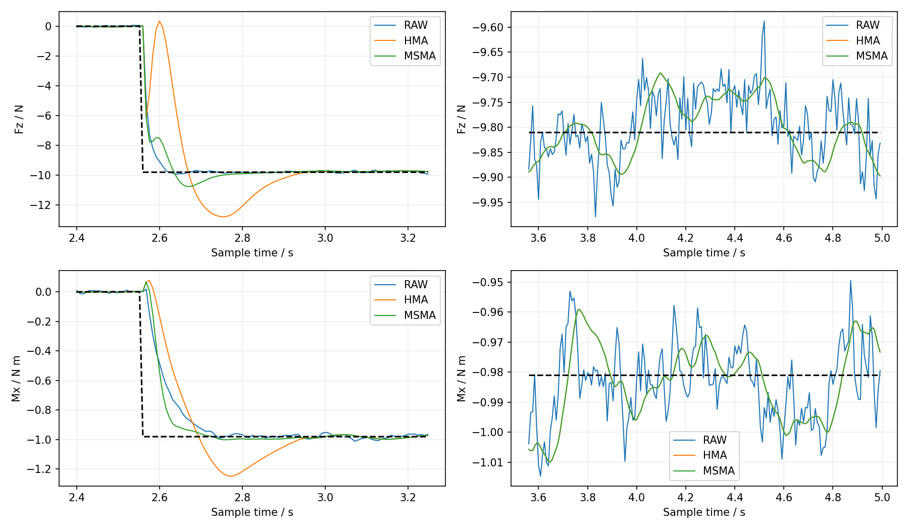

# 电流预滤波与自适应协方差：UR5仿真复现结论

**已完成本项目约定的核心思路复现：等效电流 → 因果HMA/MSMA → 匀速残差标定 → 配套输入协方差 → 125 Hz动量KF。MSMA缓解了固定HMA的加载瞬态代价，但相对同口径标定的RAW，没有取得全面优势。**

本页汇总已完成的探索，不作为正式科学证据。电流—力矩系数与黏性摩擦按已知量使用，参数辨识不属于本次完成标准；没有复现真实电机电流或作者全部实机实验。代码入口见[实验目录说明](../../../scripts/Cao_2021_VariableTimeAKF/README.md)。

## 当前主要结果：三个配对噪声种子

三组共用一次6 s物理运动：TCP保持方向、沿竖直方向移动，2–5 s目标速度0.06 m/s；2.56 s施加世界系 $F_z=-9.81$ N、$M_x=-0.981$ N·m。力矩由世界系偏置[0,0.1,0] m形成，是等效外载荷，不是新增负载惯性或抓取接触。

实际驱动力矩构造等效电流，并加入力矩等效标准差0.05 N·m的白噪声。评价种子8801、8802、8803；每个种子三组使用同一噪声序列。标定使用独立的12段正反匀速数据、种子8850–8861。窗口50、阈值、外力过程噪声、测量协方差和初始化固定，三组各自递推协方差和增益。

瞬态为[2.56,3.06) s，持续段为[3.56,5) s，加载全段为[2.56,5) s；不移位、不去偏，采用125 Hz原生样本。以下为**三种子的均值 ± 种子间样本标准差**，不是置信区间。三次噪声实现共享物理轨迹，不代表三个独立工况。

|指标|RAW|HMA|MSMA|
|---|---:|---:|---:|
|Fz瞬态RMSE／N|1.4308 ± 0.0065|3.5650 ± 0.0047|1.5025 ± 0.0070|
|Fz持续RMSE／N|0.06706 ± 0.00193|0.06076 ± 0.00447|0.06076 ± 0.00447|
|Mx瞬态RMSE／N·m|0.26419 ± 0.00720|0.36781 ± 0.00410|0.26743 ± 0.00197|
|Mx持续RMSE／N·m|0.01415 ± 0.00109|0.01436 ± 0.00105|0.01436 ± 0.00105|
|Fz首次90%响应／ms|37.3 ± 4.6|104 ± 0|64 ± 0|
|Mx首次90%响应／ms|120 ± 8|122.7 ± 4.6|69.3 ± 4.6|
|Fz超调／%|1.98 ± 0.45|31.05 ± 0.45|10.19 ± 0.61|
|Mx超调／%|3.46 ± 0.20|27.11 ± 1.33|3.08 ± 0.59|

MSMA相对RAW的Fz持续RMSE配对差为−0.00631 ± 0.00434 N；Mx瞬态配对差为+0.00324 ± 0.00523 N·m。后者不能表述成每个种子都退化，更不能据此作显著性判断。

六轴持续段结果进一步说明收益并不一致。下表仅列RMSE均值，力与力矩分别计量：

|轴／单位|RAW|HMA|MSMA|
|---|---:|---:|---:|
|Fx／N|0.09836|0.07221|0.07221|
|Fy／N|0.05761|0.03059|0.03059|
|Fz／N|0.06706|0.06076|0.06076|
|Mx／N·m|0.01415|0.01436|0.01436|
|My／N·m|0.01953|0.02279|0.02279|
|Mz／N·m|0.01480|0.01680|0.01680|

加载全段Fx串扰峰值的均值为RAW **0.768 N**、HMA **3.167 N**、MSMA **1.592 N**。MSMA相对固定HMA明显改善，仍高于RAW。

**本轮判断：**

- MSMA相对HMA减轻瞬态误差，支持变窗口机制在当前工况的作用。
- 相对RAW，持续Fz精度和Mx响应速度有收益，但Fz响应变慢、超调和Fx串扰增大，不能判为整体更好。
- 持续段六关节输入力矩RMSE均值均降低，最终估力却只有Fx/Fy/Fz的RMSE均值改善。输入准确性不能代替输出准确性。
- MSMA在持续段已进入HMA状态，两者指标在报告精度下相同；不能把这部分收益归于窗口重置。
- 三种子中J1–J5各重置一次，J6未重置。Mx持续段在历史单种子试验中的小幅收益没有在本轮均值上重现，应保留这种不稳定性。

## 先前探索保留的结论

以下属于较早的单配对噪声实现，不能与上面的三种子均值混用。旧原始日志已清理，保留的是当时的结论与图；本轮重新生成了物理日志和标定表，没有声称恢复旧数据。

### 同口径标定改变了基线判断

早期六轴0.3 Hz小幅往复，在1 s施加+3 N的Fz阶跃。A为RAW＋人工输入协方差；B为MSMA＋同一人工协方差；C为MSMA＋滤后残差表；D为RAW＋原始残差表。其余KF条件相同。

|Fz指标|A|B|C|D|
|---|---:|---:|---:|---:|
|加载1–6 s RMSE／N|0.211022|0.252123|0.250734|0.149603|
|持续2–6 s RMSE／N|0.162457|0.084408|0.083314|0.061020|
|首次90%响应／ms|16|16|16|24|
|超调／%|17.515|11.651|11.424|6.097|

D相对C的全段六轴RMSE更低，但首次90%慢8 ms，持续Fy仍有C优于D的例外。**不能用未经同口径标定的RAW，把协方差配置带来的收益全部归于预滤波。** D定义了后续RAW标定规则，不是全工况最优模型。

### 匀速标定有效，但不能直接迁移到动态加载

12段单关节正反0.05 rad/s标定中，50点MSMA降低了六轴残差RMSE，并非只有J2有效；但5–100点检查未得到六轴统一的50点最优或平台。方差最小也不一定对应RMSE最小。

将匀速标定选出的窗口用于旧阶跃日志：J2由50点改为30点，输入RMSE从0.151197降到0.096096 N·m，仍高于RAW的0.048311；J3由50点改为100点则从0.060026升至0.270809 N·m。候选未采用。

固定实际模式及窗口权重分解时，传播噪声RMS下降64%–75%，但部分关节的真实信号失真抵消收益。误差分解必须保留交叉项，不能直接相加两个RMS。匀速关节的位置、重力和电流仍在变化，残差不能称为“纯电流噪声”。

### 三倍噪声没有带来整体净收益

历史竖直加载对照将同一标准化噪声从0.05放大到0.15 N·m，并在原匀速数据上同等级重标输入协方差，没有把旧表直接乘9。窗口、阈值和其余KF配置不变。下表为该历史单实现的RMSE：

|噪声／窗口／轴|RAW|HMA|MSMA|
|---|---:|---:|---:|
|0.05 N·m／瞬态Fz／N|1.4301|3.5282|1.4892|
|0.05 N·m／持续Fz／N|0.07207|0.06305|0.06305|
|0.15 N·m／瞬态Fz／N|1.7715|3.5354|3.5691|
|0.15 N·m／持续Fz／N|0.13066|0.16574|0.14316|
|0.15 N·m／瞬态Mx／N·m|0.40285|0.40380|0.43789|
|0.15 N·m／持续Mx／N·m|0.03266|0.04545|0.03846|

高噪声下MSMA瞬态六轴RMSE均劣于RAW，持续段仅Fy较好；Fx峰值达到4.805 N，RAW为0.549 N。每轴全段重置从0–1次增至11–12次。J2在2.480 s重置后，2.560 s加载落在不判断阈值的增长期，直到2.888 s才再次重置。

高噪声瞬态J2传播噪声仅0.066 N·m，但信号失真1.475 N·m、总输入误差1.454 N·m，RAW为0.171 N·m。重置与退化同时出现，支持状态选择值得关注，但不足以证明其是唯一因果来源。该高噪声结果仍只有一个配对实现。

[历史正常噪声曲线](figures/normal_noise_response.png) · [历史三倍噪声曲线](figures/triple_noise_response.png)

## 最值得保留的问题

1. **降噪、输入准确性与最终估力准确性是三个层级。** 平滑真实信号、误差时间相关性和KF动态都可能抵消降噪收益。
2. **标定的统计对象应对应实际条件。** 固定窗口的匀速残差方差不等于带噪信号触发窗口选择后的条件误差，也不覆盖一般动态失真；全局零均值不保证局部无偏。
3. **滤波与协方差应公平拆分。** RAW也需要同口径标定；较小方差不自动推出更小估力误差。
4. **噪声会改变自适应滤波状态。** 固定阈值下，噪声改变重置时机，可能使真实加载落入窗口增长期，不能只按线性滤波器的降噪比例理解高噪声结果。

这些是已显露的技术问题，尚未确定为新的研究课题，也没有证明新窗口、补偿网络或改进KF一定有效。

## 方法边界与复现假设

- Docker、MuJoCo 3.3.7、UR5；物理16 kHz、控制1 kHz、电流反馈及KF125 Hz。独立名义模型使用准确MuJoCo参数，实际反馈q/v不加噪。
- 等效电流 $i=D^{-1}\tau_{act}$，主实验 $D=I$；A_eq不是标定后的真实安培。控制器的阻尼补偿力矩完整保留，观测器只减一次物理黏性阻尼。
- 关节顺序为shoulder_pan、shoulder_lift、elbow、wrist_1、wrist_2、wrist_3；wrench顺序Fx/Fy/Fz/Mx/My/Mz，世界系表达、tool0参考点、环境作用于机器人为正。
- HMA50使用半窗25、外窗7。MSMA逐轴从WMA1增长到50，增长期不判断突变阈值，之后进入HMA或重置；缓存连续，重置不重置KF。用64帧真实过去样本预热，从0.512 s开始估计。
- 六轴固定阈值约[0.264722,0.261700,0.258254,0.262431,0.259611,0.262913] A_eq，来自静态合成噪声规则，是本地假设。
- 标定每段8 s、核心[3,7) s共500帧；每轴只用自身正反运动。取两方向中心样本方差（ddof=1）的等权均值，不消除偏置；RAW、WMA1–50、HMA50共312项。
- 输入力矩方差 $\Sigma_\tau$ 按 $T^2\Sigma_\tau$ 映射，$T=0.008$ s。上一帧模式/窗口、输入、雅可比和方差共同用于下一帧预测；保留外力随机游走的协方差交叉块。这是逐点独立误差近似，不是滤后有色噪声的精确模型。
- $R=M\operatorname{diag}(10^{-8})M^T$ 来自假定速度标准差，实际速度未加噪。其余KF、控制增益、种子和容差见[固定比较配置](../../../scripts/Cao_2021_VariableTimeAKF/configs/core_comparison.json)及[基础配置](../../../scripts/Cao_2021_VariableTimeAKF/configs/base.json)。阈值、变窗查表和经验方差映射不能包装成作者全部参数的精确复刻。

## 完成范围

核心方法及有指标仿真实验已完成，不要求MSMA必须胜出。三种子比较通过全部检查：位置峰值1.177 mm、姿态峰值0.003866 rad、速度误差0.002975 m/s；速度门槛余量较小。此前原PD加载运动未通过检查（位置38.20 mm、姿态0.1365 rad），没有进入该失败场景的KF比较；后续采用模型前馈、增强PD及受限积分，不能把运动改善只归于积分。旧分析路径错误也不属于物理或算法失败。

本轮没有检验更广的姿态、速度、载荷、模型偏差或真实电流。先前探索主要是单配对噪声实现，本轮补充的是同一物理轨迹上的三个配对噪声种子；没有高噪声多种子或真机验证。持续段指标与响应时间需要并列解释，不能宣布一个方法全局最好。

当前三种子数据、检查与完整六轴CSV保留在[运行报告](../../../runs/H-088/R-20261025T112357Z-core/compare/decision.md)；上述主要结论和图已独立保存在本目录。最新整理仅更新结论与代码入口，没有新增科学实验，也未更换默认模型。

[论文与复现方法](../../../reproductions/Cao_2021_VariableTimeAKF/UR5_MuJoCo_Reproduction.md) · [代码与运行说明](../../../scripts/Cao_2021_VariableTimeAKF/README.md) · [通用动力学](../../../scripts/rigid_baseline/reference_kf/oracle_kf.py) · [通用KF](../../../scripts/rigid_baseline/reference_kf/momentum_observer.py)
