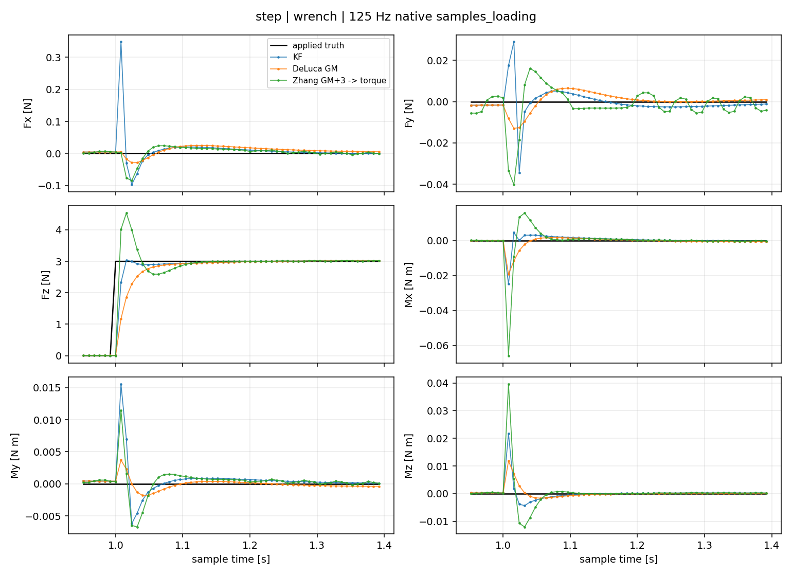
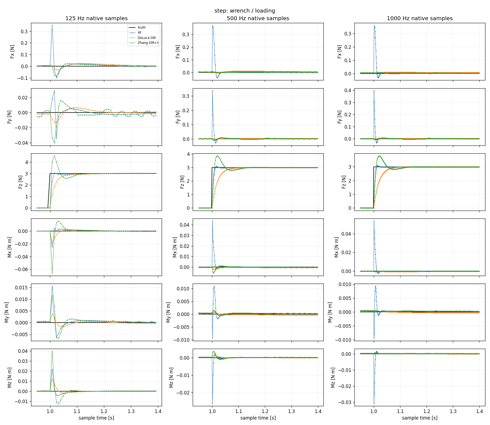
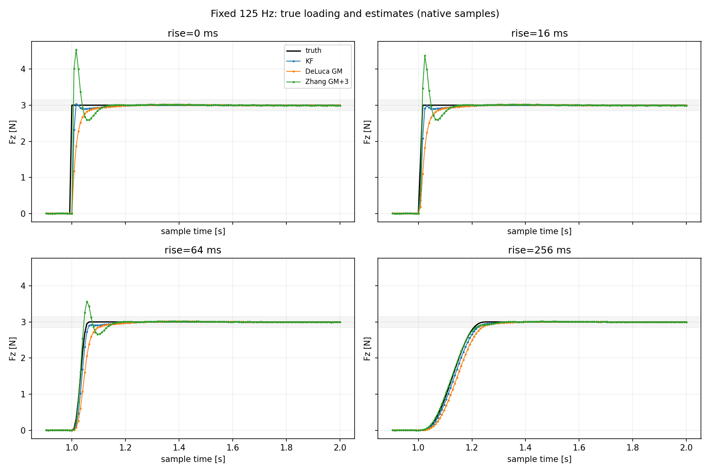
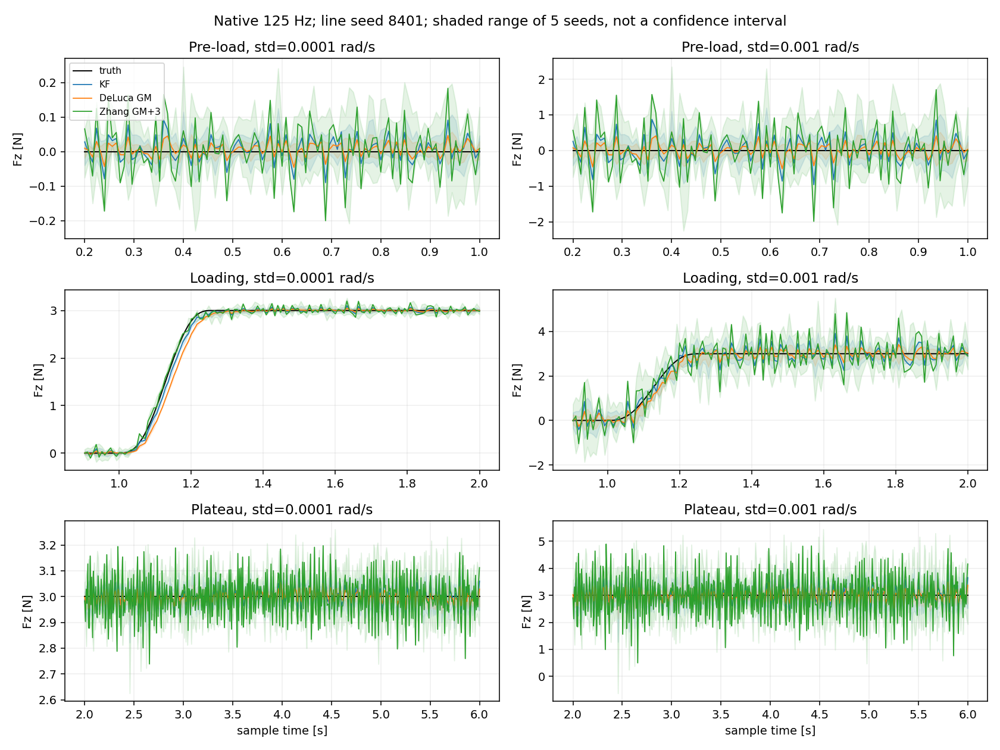

# UR5三种观测方法：实验设计与阶段结论

**三种方法没有固定赢家。当前准确模型、固定参数下，Zhang的平滑跟踪较好，KF在部分突变工况较均衡，DeLuca在已测速度噪声条件下波动较小。优势随采样率、加载速度和测量噪声改变。**

本页汇总已完成的探索性比较，不代表各方法经过公平整定后的性能上限，也不升级为正式证据。工程实现、原始输出和已有统计已在清理前核对；本页保留主要数值、适用边界和四张原图，不保留逐轮流水账。

## 比较是怎样设计的

三方法使用同一UR5模型、关节顺序、坐标系和实际反馈。物理仿真16 kHz、控制1 kHz；除采样率对照外，估计器均为125 Hz。外力施加于tool0，以世界坐标表达，环境作用于机器人为正。六轴均评价，近期动态激励主要为Fz。

名义模型参数与MuJoCo物理模型一致，但使用独立模型状态。估计器只接收时间戳、位置、速度和实际驱动力矩；外力与qacc真值只用于评价。控制器不使用估力输出。

| 方法 | 原生输出 | 统一比较时的处理 |
|---|---|---|
| DeLuca GM | 关节外力矩残差 | 解雅可比映射得到末端力／力矩 |
| 动量KF | 末端六维力／力矩 | 直接评价，并换算关节外力矩 |
| Zhang GM＋三层 | 关节加速度 | 用同帧逆动力学得到派生外力矩，再换算末端量 |

Zhang派生外力矩采用：

$$
\widehat\tau_{ext}=M(q)\widehat a+h(q,v)+Bv-\tau_a,\qquad h=C(q,v)v+g(q).
$$

Zhang的派生外力不能称为论文原生输出。加速度、关节力矩、末端力和末端力矩分别评价，不混合单位。无噪声时误差满足 $e_\tau=M e_a$，因此加速度误差排序不必等于力矩误差排序。

| 对照 | 唯一改变的主要因素 | 回答的问题 |
|---|---|---|
| 基本场景 | 静止无力、运动无力、0.5 Hz正弦、3 N阶跃 | 平滑跟踪、突变响应和假力各有什么取舍？ |
| 采样率 | 同一高频日志按125／500／1000 Hz重放 | 125 Hz是否是当前表现的主要限制？ |
| 加载速度 | 0／16／64／256 ms加载到3 N，固定125 Hz | 对输入突变程度是否敏感？ |
| 速度噪声 | 同一256 ms加载日志加入两档速度噪声 | 平滑跟踪优势在噪声下是否保留？ |

所有组保持原增益；没有根据结果调参、滤波或平移输出。加载快慢对照各自运行物理轨迹，加载后的运动可以不同；同一组内三方法始终共用反馈。噪声对照只扰动估计器反馈，不重新运行物理系统。

## 基本场景：平滑跟踪与突变响应的排名不同

| 125 Hz指标 | KF | DeLuca GM | Zhang GM＋三层 |
|---|---:|---:|---:|
| 0.5 Hz正弦Fz RMSE，2—6 s／N | 0.05963 | 0.13362 | **0.00640** |
| 阶跃Fz RMSE，1—6 s／N | **0.12332** | 0.15295 | 0.15113 |
| 阶跃首次达到90%的时间／ms | 16 | 48 | **8** |
| 阶跃最大超调／% | 1.07 | **0.55** | 51.13 |
| 阶跃进入并保持5%带的时间／ms | **16** | 64 | 104 |

时间从1 s施力起点计算，按原生采样首次越阈；保持要求只到6 s记录结束，不代表无限时域稳定性。阶跃稳定窗的Fz RMSE仅约0.00491／0.00723／0.00665 N，不能用它替代包含加载瞬态的结果。

- Zhang跟踪正弦更准确，但阶跃首次响应快伴随明显超调，稳定下来较慢。
- KF在本组阶跃主轴误差和超调之间较均衡，但有跨轴代价。
- DeLuca较慢，超调较小；它不是所有指标都最差。
- 三方法静止无力输出均为0；无力运动时，关节力矩向量RMSE约为KF 0.00353、DeLuca 0.00352、Zhang 0.00486 N·m，增加高阶校正没有降低该指标。

串扰没有统一排名。阶跃Fx峰值为KF **0.348 N**、DeLuca **0.0288 N**、Zhang **0.0851 N**；Mx峰值则为0.02496、0.01937、0.06588 N·m，Zhang最大。末端Fz会真实映射到多个关节，不能把其他关节的真实外力矩误称为串扰。

图中点为原生125 Hz样本。主轴Fz超调与非激励方向瞬态应分别评价。

## 采样率：提高频率有帮助，但没有消除性能取舍

同一1 kHz反馈日志按步幅8／2／1取样。平均误差同时按共同125 Hz网格比较，峰值按各组原生采样保留。

| 估计频率 | Zhang阶跃超调 | KF阶跃超调 | KF达到90%的时间 |
|---|---:|---:|---:|
| 125 Hz | 51.13% | 1.07% | 16 ms |
| 500 Hz | 28.70% | 2.88% | 10 ms |
| 1000 Hz | 26.77% | 3.22% | 9 ms |

Zhang在1 kHz仍有约26.8%超调；共同网格也保留这一趋势，改善不只是峰值取样差异。0.5 Hz正弦的共同网格Fz RMSE，Zhang为6.398／3.176／3.383 mN，KF为59.631／31.861／25.264 mN，DeLuca为133.624／130.464／129.953 mN。

KF的Fy原生串扰峰值随三档频率为0.0344／0.3363／0.3956 N；1 kHz序列若只看共同125 Hz网格，该峰值仅剩0.0106 N。**平均误差降低不能代替原生尖峰检查；也不能据此推断原125 Hz估计器曾产生未记录的相同尖峰。**

提高频率同时改变输入保持、离散更新和测量使用，未分离各自贡献，不能把全部问题归因于125 Hz。

各列纵轴可能不同，应结合数值表比较峰值，不凭曲线视觉高度排序。

## 加载速度：不提高采样率，也能出现Zhang的跟踪优势

固定125 Hz，最终外力3 N；平滑组使用同一五次S形，仅改变加载时长。下表全部为 **1—2 s Fz RMSE／N**，与前面1—6 s窗口不同。

| 加载时间 | KF | DeLuca GM | Zhang GM＋三层 | Zhang最大超调 |
|---|---:|---:|---:|---:|
| 理想阶跃 | **0.27470** | 0.34062 | 0.33660 | 51.13% |
| 16 ms | **0.13243** | 0.24897 | 0.19258 | 45.63% |
| 64 ms | **0.08453** | 0.20187 | 0.11225 | 18.90% |
| 256 ms | 0.05456 | 0.12832 | **0.02629** | 0.50% |

256 ms组Zhang的加速度向量和关节力矩向量RMSE也更低，收益不只来自末端换算。真值首次越过90%在加载后200 ms，Zhang／KF／DeLuca分别在200／208／224 ms越过，对应0／8／24 ms相对滞后。

但Zhang没有全面领先：该组平台Fz RMSE为KF 4.924、Zhang 5.374、DeLuca 7.241 mN；Zhang的Fy瞬态RMSE为0.003609 N，高于KF的0.001086 N。主轴或向量领先不能替代逐轴评价。

**当前估计动态对输入变化速度敏感。** 16 ms平滑仍有明显超调；256 ms只是一个已测条件，不是通用切换阈值，也不代表真实装配接触规律。

## 速度噪声：原先的跟踪优势没有完整保留

复用256 ms加载日志。六关节速度加入独立零均值高斯噪声，标准差0／0.0001／0.001 rad/s；两档非零噪声各5个配对种子，三方法使用相同序列，两个等级缩放同一标准序列。噪声从首帧开始，带噪速度一致用于初始化、动量、速度相关动力学、摩擦、HODO及输出换算。

下表为 **1—2 s Fz RMSE／N**；非零档为五种子均值±样本标准差。

| 速度噪声标准差 | KF | DeLuca GM | Zhang GM＋三层 |
|---|---:|---:|---:|
| 0 | 0.0546 | 0.1283 | **0.0263** |
| 0.0001 rad/s | **0.0652 ± 0.0015** | 0.1296 ± 0.0003 | 0.0815 ± 0.0055 |
| 0.001 rad/s | 0.3599 ± 0.0280 | **0.2195 ± 0.0101** | 0.7403 ± 0.0561 |

五个种子的主轴排名一致。小噪声档Zhang仍优于DeLuca，但不及KF；大噪声档落后于二者。

| 平台2—6 s的Fz指标／N | KF | DeLuca GM | Zhang GM＋三层 |
|---|---:|---:|---:|
| 小噪声档RMSE均值 | 0.03766 | **0.01989** | 0.08092 |
| 大噪声档RMSE均值 | 0.37331 | **0.18524** | 0.77588 |
| 小噪声档五种子最大绝对误差 | 0.17829 | **0.09445** | 0.37471 |
| 大噪声档五种子最大绝对误差 | 1.72393 | **0.85679** | 3.62316 |

两个噪声档下，加载前无外力与平台阶段的六轴wrench RMSE均值均为DeLuca最低、KF其次、Zhang最高。平台Fz偏置仍约−0.001至−0.002 N，主要增加的是持续波动，不能只用均值接近真值宣称准确。

KF的Q/R保持原值，R仍依据1e−4 rad/s的速度标准差构造；大噪声档超过这一假设。噪声尺度为仿真假设，不代表UR5实测水平。五种子描述同一物理轨迹上的测量噪声变化，不是五条独立运动轨迹。

曲线固定为种子8401；阴影为五种子的逐时刻范围，不是置信区间。带噪首次提前越阈可能来自尖峰，不能当作预测能力或稳定响应变快。

## 与此前两层／三层消融的关系

此前Zhang消融主要在1 kHz下激励J2，评价关节加速度：1、2 Hz时三层较低；3、4、6、7、8 Hz和扫频时两层较低；0.5 Hz两层略低但差异很小。该结果支持“增加高阶状态的收益有条件，幅值与相位必须共同评价”。它与本页125 Hz末端估力比较的激励、评价量不同，不能合并排名。

详细结论仅保留在[Zhang关节加速度估计结论](../record/Zhang_关节加速度估计结论.md)，这里不复制旧实验记录。

## 可以保留的结论与尚未解决的问题

1. **准确动力学是比较基础，不保证估计结果同样准确。** 输入保持、离散实现、估计动态和测量噪声仍会产生误差。
2. **三种固定配置体现不同取舍。** Zhang适合本轮无噪声平滑跟踪；KF在部分突变主轴指标上较均衡；DeLuca在本轮速度噪声下波动较小，但干净输入响应较慢。这些都有限定条件。
3. **增加状态或补偿层不保证全面改善。** 跟踪、超调、跨轴输出和噪声敏感性必须同时评价。
4. **评价窗口与物理量影响结论。** 首次越阈不等于稳定时间，稳定窗不代表加载瞬态，加速度误差不等于外力误差，向量优势不等于六轴优势。
5. **还不能宣布整体最优方法。** 尚未按相同带宽或相同无接触输出波动整定；本批三方法动态比较主要覆盖Fz，没有完成多方向、多姿态、模型失配、真实接触和真机对照。

值得保留的问题是：同等噪声代价下各方法还能达到怎样的跟踪能力；高阶校正各通道如何共同影响幅相与噪声；离散保持和估计动态分别承担多少瞬态误差。当前结果未唯一分离这些机制，也未证明某种修复有效。

## 保留的实现与解释所需参数

- [KF独立动力学与观测器](../../../scripts/rigid_baseline/reference_kf/oracle_kf.py)、[KF离散递推](../../../scripts/rigid_baseline/reference_kf/momentum_observer.py)。状态为动量与末端wrench，外力随机游走；冻结雅可比的Q离散化保留交叉块。连续Qp对角前三轴1e−7、后三轴1e−9；Qw前三轴1、后三轴0.01；初始wrench方差前三轴25、后三轴1；R由M和各轴1e−4 rad/s速度标准差构造。
- [DeLuca观测器](../../../scripts/DeLuca_2003_GeneralizedMomenta/observer.py)：六轴GM增益均50 s⁻¹，因果Euler更新。
- [Zhang加速度观测器](../../../scripts/Zhang_2022_JointAcceleration/acceleration.py)：完整GM＋三层；每轴六个校正增益依次为0.1264911064、120、0.16、4800、6.4、64000，单位依次为 $\sqrt{\mathrm{rad/s}}/\mathrm{s}$、s⁻¹、rad/s³、s⁻²、rad/s⁴、s⁻³。不把两层消融与完整输出混用。
- 名义模型为 `scripts/models/ur5/nominal_16khz.mjb`；关节黏性阻尼为 `[1,1,1,0.1,0.1,0.1]` N·m·s/rad；惯性时间导数的方向差分步长1e−6 s。Docker环境为 `piakf:h022-physical`，MuJoCo3.3.7、NumPy1.26.4、SciPy1.14.1。
- 六轴参考运动为 $q_{ref}=q_0+A[1-\cos(2\pi f t)]$，$q_0=[0,-1.2,1.6,-1.8,-1.1,0]$ rad，$A=[0.05,0.08,0.06,0.05,0.04,0.03]$ rad，$f=0.3$ Hz。控制采用名义逆动力学前馈与PD，位置增益 `[200,200,150,25,20,5]`、速度增益 `[30,30,20,1.5,1,0.05]`，实际驱动力矩包含阻尼补偿。
- 噪声配对种子8401—8405，NumPy `Generator(PCG64(seed)).standard_normal((751,6))`；输出评价均使用原生样本。纯速度噪声与位置差分测量链不能等同。

按用户要求，本批原始日志、逐样本输出、工作流快照和一次性实验脚本已清理，仅保留本总结与四张原图；公共代码、模型及既有方法配置保留。这里不是可逐样本复核的完整证据包，也不能原地重放已删除的运行；重新比较需要由保留实现和上述设计重建新的任务与运行。整理没有新增实验或改变方法参数。
