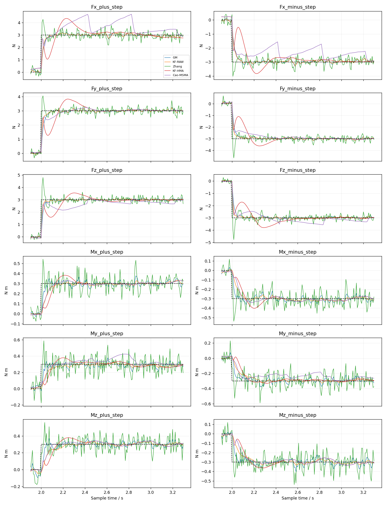
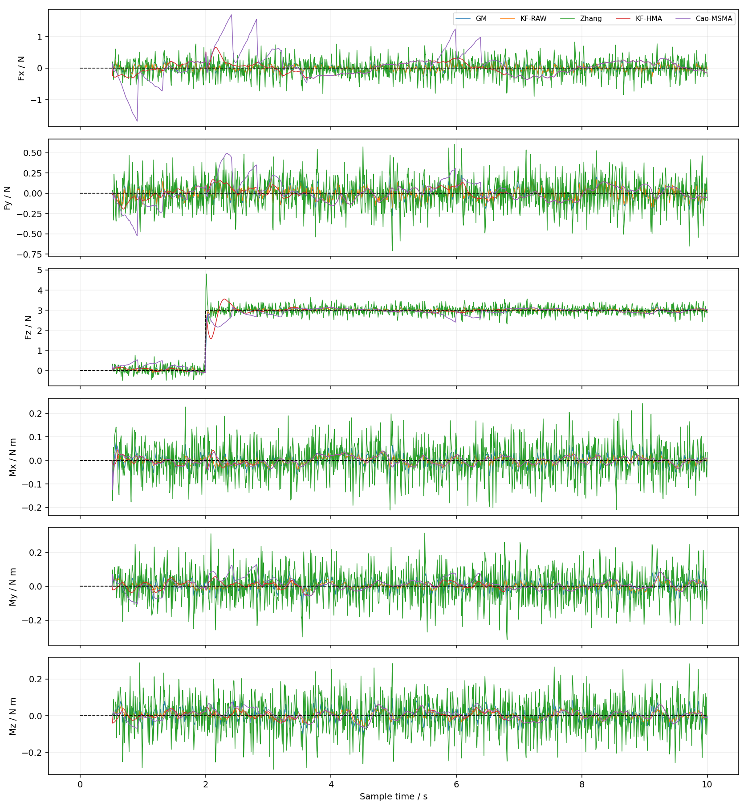
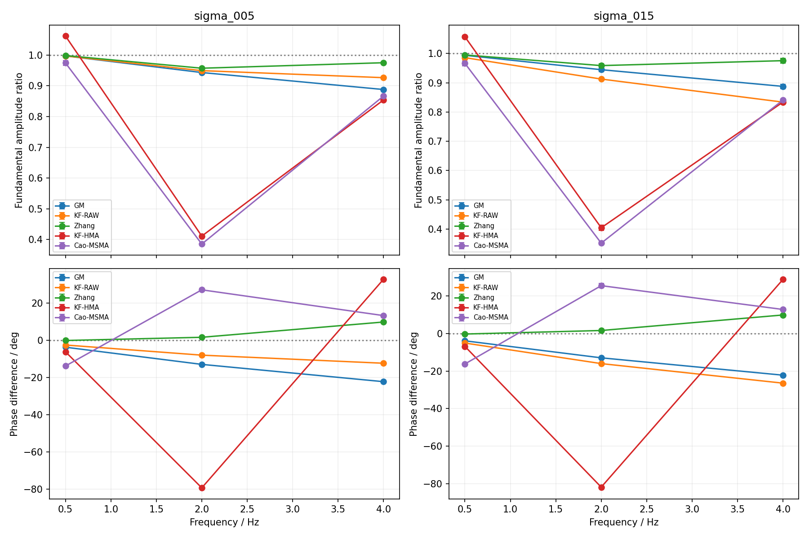

# UR5四种估力方法：固定配置对比结论

**这些固定实现呈现不同的跟踪、降噪和跨轴代价；现有检查支持计算自洽，但对论文严格等价性仍有明确边界。没有跨工况、跨指标的统一赢家，也没有证据要求复杂方法必须获胜。**

本页归档已完成的探索性比较及收尾核对，不代表各算法经过公平整定后的性能上限。本轮已结束，不追加调参或替换默认方案。

## 比较条件

- 四种方法：DeLuca GM、RAW动量KF、Zhang GM＋完整三层、Cao MSMA＋KF；另设HMA＋KF作为Cao内部消融，共五组。
- 同一UR5准确名义模型、实际位置和速度、带噪等效电流；世界系tool0处的外力／力矩。Zhang原生输出为加速度，外力由同帧逆动力学派生。
- 物理16 kHz、控制1 kHz、估计125 Hz。17个场景各采集一次10 s日志：无外力运动、六方向正负阶跃、256 ms平滑加载、0.5／2／4 Hz正弦。平滑加载和正弦均为Fz；力幅值3 N，力矩幅值0.3 N·m。
- 位置、速度无噪声；电流采用力矩等效标准差0／0.05／0.15 N·m的合成白噪声。无噪声运行一次，两档非零噪声各10个配对种子，共1785条估计序列。噪声重复共享物理轨迹，不是独立物理实验。
- 增益、窗口50、阈值、外力过程噪声、测量协方差及初始化固定。三条KF按各自滤波方式、噪声等级，在独立匀速数据上重算输入方差；高噪声不直接将旧表乘9。无噪声组沿用0.05等级的表。

RAW-KF也经过输入协方差标定。这里比较的是现有完整实现，不能把滤波和协方差配置的合并收益全归于某一个模块。不同载荷会改变实际运动；同一场景内全部方法严格共享反馈。

## 主要结果

下表为0.05 N·m噪声下的 **Fz RMSE，单位N，10种子均值 ± 样本标准差**。阶跃瞬态为[2,3) s，持续段及正弦为[4,10) s；不移位、不去偏，使用125 Hz原生样本。

|场景／窗口|GM|RAW-KF|Zhang|HMA-KF|Cao-MSMA|
|---|---:|---:|---:|---:|---:|
|正阶跃瞬态|0.346 ± 0.011|0.302 ± 0.007|0.383 ± 0.018|0.576 ± 0.012|0.507 ± 0.020|
|正阶跃持续段|0.070 ± 0.003|0.057 ± 0.002|0.205 ± 0.007|0.070 ± 0.004|0.126 ± 0.050|
|0.5 Hz正弦|0.154 ± 0.003|0.109 ± 0.003|0.207 ± 0.004|0.277 ± 0.004|0.590 ± 0.017|
|2 Hz正弦|0.484 ± 0.004|0.312 ± 0.003|0.233 ± 0.007|2.141 ± 0.004|1.640 ± 0.019|
|4 Hz正弦|0.809 ± 0.003|0.469 ± 0.002|0.417 ± 0.003|1.154 ± 0.003|0.716 ± 0.007|

**RAW-KF的优势主要体现在持续精度。** 该噪声等级下，六方向正负阶跃的主轴持续RMSE均以RAW-KF最低；瞬态则是三个力方向由RAW-KF较低、三个力矩方向由GM较低。不能概括成KF在所有指标上最好。

**Zhang的平滑跟踪收益会被噪声抵消。** 无噪声256 ms加载的瞬态Fz RMSE，Zhang为0.0265 N，RAW-KF为0.0887 N；无噪声0.5 Hz正弦分别为0.00627、0.08917 N。加入0.05 N·m噪声后，0.5 Hz的排序反转，但2／4 Hz仍保留Zhang主轴误差较低的结果。

**首次响应快不等于瞬态更好。** 无噪声Fz阶跃中，Zhang首次达到90%只需8 ms，却有50.25%超调，104 ms后才进入并保持5%带；RAW-KF分别为24 ms、0.224%、48 ms。保持要求只到记录结束，不表示无限时域稳定性。

**MSMA相对HMA有局部收益，相对RAW没有全面优势。** 常规噪声Fz阶跃中，MSMA把HMA的首次90%时间从174.4缩短到31.2 ms，但持续RMSE从0.0696增到0.1256 N，Fx瞬态绝对峰值从0.631增到1.669 N。256 ms平滑加载中，MSMA首次90%为524.8 ms，HMA为328.8 ms，优势没有迁移。

图1：六方向正负阶跃，左列正向、右列负向，2 s加载；上三行为力，下三行为力矩。采用预先固定的种子8901、0.05 N·m噪声，曲线连接125 Hz原生样本，黑色虚线为真值。此图是单个噪声实现的瞬态示例，不是10种子均值；各子图纵轴范围不同，应结合数值表比较。

## 主轴更准，不等于完整估力更准

下表为持续段三维力向量RMSE的种子均值，单位N。每条序列先计算力误差平方范数的均值再开方；不含力矩，不是三个轴RMSE的平均。

|频率／噪声标准差|GM|RAW-KF|Zhang|HMA-KF|Cao-MSMA|
|---|---:|---:|---:|---:|---:|
|2 Hz／0.05 N·m|0.499|0.331|0.412|2.293|2.091|
|4 Hz／0.05 N·m|0.819|0.484|0.540|1.447|1.215|
|4 Hz／0.15 N·m|0.906|0.988|1.236|1.345|1.309|

常规噪声下，Zhang在2／4 Hz的Fz误差更小，三维力误差却高于RAW-KF。高噪声4 Hz时，Cao的Fz RMSE均值最低，为0.690 ± 0.029 N，Zhang为0.704 ± 0.011 N；但Cao三维力误差更大。该主轴均值差距较小，不能当作显著性或普遍优势。

非激励轴误差包含运动假力和测量噪声，本轮没有扣除无外力对照，不能全部解释为加载独立造成的串扰。力、力矩、关节外力矩应分别评价，不能混成一个总分。

图2：同一种子8901、0.05 N·m噪声下的Fz正阶跃，2 s施加3 N，展示全部六轴估计。除Fz外，其余末端分量真值为零；加载前后的假力和波动均保留。不能只看Fz平台接近真值，就认定完整估力更好。

## 更大噪声不保证预滤波更有利

无外力运动持续段，噪声由0.05增至0.15 N·m时，三维假力RMSE为：

|方法|0.05 N·m噪声／N|0.15 N·m噪声／N|
|---|---:|---:|
|RAW-KF|0.122|0.219|
|HMA-KF|0.208|0.289|
|Cao-MSMA|0.280|0.750|

同一条件下，MSMA的J2输入力矩RMSE从0.0920增至0.2255 N·m，高于RAW的0.0505、0.1515 N·m；全估计段平均重置次数从4增至22。重置增加与误差增大同时出现，但本轮未分离触发、信号失真和有色误差协方差失配的独立贡献，不能指定唯一根因。

预滤波处理的是闭环驱动电流，不是外力真值。输入更平滑、某个频点幅相更好或首次越阈更早，都不能替代最终六轴误差评价。

图3：左列为0.05 N·m噪声，右列为0.15 N·m；在[4,10) s拟合Fz基波，上行为估计／真值幅值比，下行为估计减真值的相位差。点和误差棒为10种子均值及样本标准差，不是置信区间。只测了0.5、2、4 Hz三个频点，连线不表示中间频率已经验证；正相位不意味着非因果预测，幅相也不能代替包含其他轴和非基波成分的总误差。

## 三项收尾核对与复现边界

|项目|已确认的计算含义|必须保留的边界|
|---|---|---|
|Zhang|用上一帧导数推进内部状态，再计算当前时刻加速度；与同帧带噪力矩和模型反算外力，没有固定错配一帧|派生外力是本地比较接口。125 Hz欧拉、固定增益及原生输出，不等于论文1000 Hz、统一50 Hz加速度滤波及相同输出噪声整定的实验链|
|Cao/HMA|WMA最新样本权重最大；HMA为25／50／7点组合。重置当帧输出WMA1，增长至50期间不判阈值，第51帧起比较当前原始电流与上一滤后电流；对应原文公式与图2|逐轴独立重置、连续保留HMA缓存、64个过去样本预热、阈值公式及模式／窗口方差表，属于明确的本地实现选择。HMA50实际使用56个原始样本，切回时可能重新使用重置前历史|
|KF|输入、雅可比与方差表项来自同一帧，共同用于下一8 ms保持区间。样本输入方差贡献为 $T^2\Sigma_u$；$R=M\Sigma_vM^T$ 中的离散速度方差不再除以 $T$|左端输入保持不是区间真实平均量。方差表不是连续噪声谱密度，也不是动态触发条件下的真实协方差；跨时刻相关性、偏置及状态误差相关性未被完整建模|

收尾核对未发现需要修正的时间错配、权重／窗口索引错误或方差单位混用。工程自洽不等于严格论文等价，也不能保证这些固定增益是最优的。

## 最终保留的判断

1. 方法复杂度不能决定估力质量；优势取决于外力变化方式、输入噪声、参数配置和评价量。
2. 主轴跟踪、完整向量误差、其他轴误差、持续波动、超调与响应时间必须分开看。
3. 降噪收益可能被真实信号失真抵消；配套协方差自洽也不代表误差统计模型充分。
4. 当前结果支持固定实现的条件性取舍，不支持通用赢家、唯一因果根因或真机适用性结论。本轮到此结束。

本结论不覆盖真实电流统计、速度噪声、模型失配、更多姿态和真实接触。与[早期三方法比较](三种观测方法对比结论.md)的噪声类型、协方差和工况不同，不能拼表排名；Cao独立核心复现见[电流滤波与估力结论](../Cao_2021_VariableTimeAKF/Cao_电流滤波与估力结论.md)。

来源：[完整比较与三项审阅](../../../runs/H-089/R-20261025T121345Z-compare/evaluate/decision.md)。本页保留独立可读的结论、关键数值及三张原图；图片已复制到本目录的figures中。详细逐轴／逐种子指标留在原运行目录，本次整理未删除原始文件。
