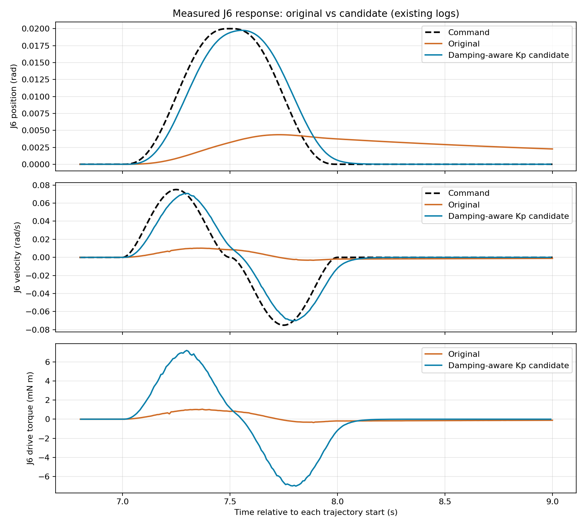

# UR5仿真接口与控制基础

当前模型全量检查、名义参数核对和反馈口径见[模型与接口测试报告](模型与接口测试报告.md)；本文保留控制改善与齿隙机制的阶段结论。

## 已得到的结论

- 六轴齿隙配置后续ROS启动检查未通过：轨迹尚未发送，J1已触及150 N·m限幅并停止。静态接线通过不能替代启动保持验证，当前六轴配置尚不能用于完整运动/采集；详见[更新后的测试报告](模型与接口测试报告.md)。
- 已建立位置轨迹→控制器→MuJoCo物理积分→状态反馈→只读等效电流链路。电流由驱动侧力矩换算，无电流控制写接口；不要求实机电气参数匹配。
- 无载保持通过。原增益下J6运动幅度不足；仅修改J6比例增益后，0.02rad指令对应实际范围从0.00436增至0.01975rad，核心位置RMSE从0.00407降至0.000828rad。支持当前增益未充分计入阻尼的解释，不证明唯一根因或全域稳定。
- J2—J5仍有约0.01rad保持偏差；通过有限小幅检查不等于满足应用精度。J6改善伴随力矩峰值由1.05增至7.20mN·m。
- 等效电流与q/v同帧配对通过。无噪声、系数一致时换算闭合为零，仅证明接口正确，不是独立动力学或估力精度证据。发布配置125Hz，实际间隔有变化；源ROS标签与物理线程采样的偏差尚未独立验证。
- 新增六轴原生双同轴关节小齿隙配置，每轴名义全宽1角分；旧单J6结论及已有Run快照保留，过渡配置已清出工作目录。驱动角和连杆角分别输出，电流继续取驱动侧力矩，避免掩盖间隙传力过程。配置已通过静态检查，六轴运动闭环尚未验收。

## 齿隙实现检查

旧单J6模型的90ms换向检查中，间隙两侧均啮合，无非有限值、物理警告或碰撞；质量矩阵正定。连杆角与驱动角＋间隙角的运动学差为2.22e-16，反馈映射差为0。未把间隙约束力矩当作电流来源，缺少间隙状态会拒绝输出。

该旧模型半间隙为0.001rad；间隙范围约−0.001282至+0.001269rad，最大软限穿透0.000282rad。这只支持单轴机制工作，不能用于证明新六轴配置的动态表现。

新六轴模型共12个坐标、6个驱动。静态检查确认：原刚体参数不变；保持姿态质量矩阵正定；六个间隙两侧的约束力矩方向正确；负载侧运动学求和误差小于8e-16，电流/位置映射误差小于8e-17；任一间隙反馈缺失都会拒绝输出。这里只赋值静态状态并计算前向量，没有推进物理时间，没有运行ROS。检查记录见`runs/H-097/R-20261027T034634Z-sixbacklash/`。

新配置每轴全宽0.000290888209rad（1角分），半宽±0.000145444104rad；六轴相等只是仿真假设。公开减速器资料区分机械齿隙、弹性回差与lost motion，不能据此声称获得UR5实测间隙。[Harmonic Drive资料](https://www.harmonicdrive.net/media/2650/hd-ebook-version2.pdf)、[Nabtesco定义](https://www.nabtesco.de/en/service/faq/glossar/backlash)。新增驱动armature及软限位参数也不是实测值；小间隙运行时的穿透和闭环稳定性仍需验证。

## 保留的图表

以下图来自无齿隙J6增益候选，不是新增齿隙模型的结果。

[六轴位置与误差](figures/position.png) · [六轴速度与误差](figures/velocity.png) · [等效电流](figures/current.png) · [电流换算驱动力矩](figures/drive_torque.png) · [六轴指标CSV](six_axis_metrics.csv)

## 适用范围

当前无齿隙配置统一为`control/`，采用此前小幅运动检查中的改善后J6增益；六轴齿隙配置为`control_backlash/`。两者PID数值相同。此次合并只改变原`control/`默认的J6比例增益和目录引用，没有新增运动验证，历史基线结果仍对应当时的旧参数。

当前没有带载、测量噪声、六轴齿隙运动闭环或KF估力验收。当前只读电流采用力矩换算；原生dcmotor测试模型与专用脚本已清出工作目录。此前原生电流时序预检失败源于actearly计算阶段错配，不通过改参数掩盖；历史结论与原失败记录保留。

模型与调用方式统一见[模型入口](../../../scripts/models/ur5/INDEX.md)。原始控制记录和齿隙机制记录保留在runs/H-097；模型目录中的重复报告已清出。以上为有限仿真设置下的工程结论，不提升为正式科学证据。
