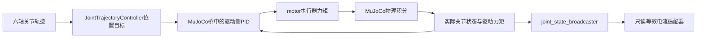
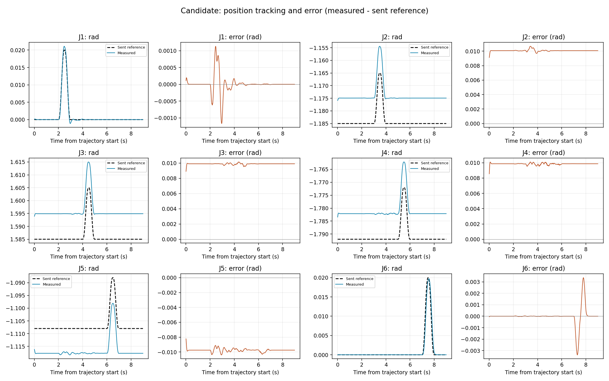

# UR5模型、反馈接口与控制链测试报告

检查日期：2026-10-27。范围为 `scripts/models/ur5/` 全部41个文件，以及实际使用它们的ROS启动程序、反馈适配器、已有运动日志。初次审计只执行静态检查和日志统计；随后获批的一次六轴齿隙ROS检查在启动阶段失败，未发送运动轨迹，详见第8节。没有训练或KF。

**当前可以使用无齿隙UR5进行位置控制仿真，读取位置、速度、驱动力矩和只读等效电流。六轴齿隙已加入且静态检查通过，但当前六轴配置在启动时出现J1力矩饱和，不能直接作为已验证的运动/采集平台。参数对应官方UR5名义描述，不能称为某台UR5真机的完整标定模型。**

## 1. 对使用问题的直接回答

| 问题 | 检查结论 | 依据与边界 |
|---|---|---|
| 是UR5，能够加载和运动吗？ | 无齿隙配置已有实际ROS运动记录 | 使用UR5而非UR5e；四个XML入口均编译成功。六轴齿隙ROS启动检查未通过 |
| 参数与官方一致吗？ | 六个运动连杆的质量、质心、惯量和名义关节变换一致 | 官方惯量自身含圆柱近似；不代表个体机器人标定精度 |
| 可以读取类似真机的数据吗？ | 有六轴位置、速度、电流及时间戳 | 字段和单位明确；自定义ROS测量包，不是UR RTDE接口的完整复刻 |
| 有电流吗？ | 有，只读等效电流 | 来自驱动力矩换算；没有电气状态，不是测得的真实电机电流 |
| 有齿隙吗？ | 有，J1—J6均已加入 | 静态通过；启动时J1出现明显软限位穿透及驱动力矩饱和，完整换向尚未执行 |
| 有控制器和controller_manager吗？ | 有，实际安装并运行过 | `ros2_control`、`controller_manager`、`joint_trajectory_controller`、`joint_state_broadcaster`及MuJoCo桥均存在 |
| 能宣称整个带齿隙平台已验证吗？ | 不能 | 无齿隙运动结果不能代替六轴齿隙闭环、带载和估力验证 |

本报告是工程有效性检查。**No new scientific evidence was generated.**

## 2. 目录内容与实际入口

| 资产 | 数量 | 实际作用 |
|---|---:|---|
| `scene_equivalent_current.xml` | 1 | 当前无齿隙物理模型，6坐标、6个motor |
| `scene_backlash.xml` | 1 | 当前六轴小齿隙模型，12坐标、6个motor |
| `scene.xml`、`ur5.xml` | 2 | 既有采集和可视化入口；前者包含后者，仍被脚本引用 |
| `control/`、`control_backlash/` | 各5 | 每组包含接口URDF、控制器、PID、电流映射、设计说明 |
| `metadata/` | 3 | 来源版本、旧模型适配、六轴齿隙定义 |
| `vendor/ur_description/` | 23 | 官方YAML、Xacro、视觉/碰撞网格、许可证和包描述 |
| `INDEX.md` | 1 | 模型选择与使用说明 |

`control_j6_candidate/`已经合并并删除；现有 `control/` 使用原改善后的J6增益。历史运行目录中的旧名称仅标识当时的来源。

当前两个ROS入口都使用62.5 μs物理步长、`implicitfast`积分器、0.5 m基座安装高度。旧 `scene.xml`/`ur5.xml` 基础步长为0.5 ms、基座高度为0；调用脚本可能再次配置它们，不能直接套用新入口的说明。

运行用的 `control*/robot.urdf` 没有惯性标签，负责关节树和ROS接口；**实际物理参数由它引用的MJCF提供**。不能仅检查这个简化URDF，就认定机器人没有质量或惯量。

完整清单及编译结果见[文件清单](../../../runs/H-097/R-20261027T065551Z-modelaudit/check/model_inventory.csv)、[模型编译表](../../../runs/H-097/R-20261027T065551Z-modelaudit/check/compiled_models.csv)。

## 3. 官方名义参数核对

来源是[Universal Robots官方描述仓库](https://github.com/UniversalRobots/Universal_Robots_ROS2_Description/tree/c2ae8652b6e9c1f9f3fedac48d63bef93d3cb9ba)，固定提交 `c2ae8652b6e9c1f9f3fedac48d63bef93d3cb9ba`，选择器为 `ur5`。本轮23个来源文件全部匹配已保存的上游Git blob标识；没有修改vendor。

四个XML入口的六个运动连杆均与保存的官方YAML核对，惯量经过对应坐标旋转后比较：

| 检查量 | 全部入口最大差值 |
|---|---:|
| 连杆质量 | 0 kg |
| 质心坐标 | 0 m |
| 惯性张量元素 | $7.28\times10^{-18}$ kg·m²以内 |
| 关节局部平移 | 0 m |
| 关节局部旋转矩阵元素 | $1.17\times10^{-16}$以内，无量纲 |
| 驱动关节位置边界、执行器力矩限值 | 与来源配置一致 |

这些差值证明转换保持了**来源中的数值**，不是仿真与真机之间的误差。J1—J6对应运动连杆质量为3.7、8.393、2.33、1.219、1.219、0.1879 kg。详见[逐连杆核对表](../../../runs/H-097/R-20261027T065551Z-modelaudit/check/physical_parameters.csv)和[限值核对表](../../../runs/H-097/R-20261027T065551Z-modelaudit/check/joint_limits.csv)。

参数来源边界如下：

- [官方物理参数文件](../../../scripts/models/ur5/vendor/ur_description/config/ur5/physical_parameters.yaml)注明惯量含圆柱近似，基座质量也带有不确定性注释；默认运动学不是特定设备的校准结果。
- 重力为world坐标系下的 $(0,0,-9.81)$ m/s²。关节黏性阻尼为 $(1,1,1,0.1,0.1,0.1)$ N·m·s/rad，`frictionloss=0`；阻尼不是UR5实测摩擦辨识结果。
- 六轴齿隙、驱动侧armature、电流换算系数和伺服增益是本项目仿真配置。新增armature使总动力学发生变化；“保留刚体参数”不等于两模型总惯性完全相同。
- 当前没有附加夹爪、力传感器或工具负载惯性；`tool0`不代表用户真机已经标定的工具TCP。
- J3的±π位置范围沿用官方规划限制，不能等同于真机机械极限。官方速度上限为π rad/s，运行URDF写为3.14 rad/s；当前不能宣称完整复现UR速度保护、速度缩放和安全控制。

## 4. 实际控制链

`controller_manager`管理硬件读、控制器更新和硬件写。启动文件虽然运行的是 `mujoco_ros2_control/ros2_control_node`，该节点内部确实创建ControllerManager，并由spawner激活两个控制器。已有运行记录确认轨迹控制器处于 `active`，占用六个 `/position` 命令接口；状态发布器也处于 `active`。依据：[启动代码](../../../scripts/simulation/position_control.launch.py)、[原运行日志](../../../runs/H-097/R-20261027T030209Z-j6candidate/motion/launch.log)、[控制器状态记录](../../../runs/H-097/R-20261027T030209Z-j6candidate/motion/metrics.json)及[桥接节点源码](https://github.com/ros-controls/mujoco_ros2_control/blob/0.1.2/mujoco_ros2_control/src/mujoco_ros2_control_node.cpp)。

底层读取当前驱动侧位置，计算位置误差，通过PID向 `data.ctrl` 写入力矩。本配置积分增益为零，因此实际为带输出限幅的PD：

$$
e_{j,k}=q^{\mathrm{cmd}}_{j,k}-q^{\mathrm{drive}}_{j,k},\qquad
\tau^{\mathrm{cmd}}_{j,k}=\operatorname{clip}\!\left(K_{p,j}e_{j,k}+K_{d,j}\dot e_{j,k},-\tau_{\max,j},\tau_{\max,j}\right).
$$

这里的误差变化率由 `control_toolbox` 的 `compute_command(error, period)`计算；桥接调用没有直接传入速度误差。该路径没有显式重力、逆动力学、外力真值或学习模型前馈，也没有KF反馈。目标位置不在每周期直接覆盖实际 `qpos`。实现依据：[MuJoCo系统接口源码](https://github.com/ros-controls/mujoco_ros2_control/blob/0.1.2/mujoco_ros2_control/src/mujoco_system_interface.cpp)。

| 关节 | $K_p$，N·m/rad | $K_d$，N·m·s/rad | 输出限幅，N·m |
|---|---:|---:|---:|
| J1 shoulder_pan | 594.579241 | 59.457924 | ±150 |
| J2 shoulder_lift | 3016.753790 | 159.177833 | ±150 |
| J3 elbow | 1580.855277 | 67.040650 | ±150 |
| J4 wrist_1 | 140.171100 | 3.166694 | ±28 |
| J5 wrist_2 | 15.155614 | 0.482320 | ±28 |
| J6 wrist_3 | 2.052847 | 0.005285 | ±28 |

完整精度见[pids.yaml](../../../scripts/models/ur5/control/pids.yaml)。两组当前PID数值一致，设计JSON与实际YAML逐项匹配。每轴为 `motor`、`gear=1`，因此其控制量、执行器标量力及驱动坐标广义力矩在本配置下按1:1转换；这不是任意执行器都具备的性质。

已安装版本：Python 3.12.3、MuJoCo 3.12.0、`mujoco_ros2_control` 0.1.2、`mujoco_vendor` 0.1.0、`controller_manager` 4.48.1、轨迹控制器/状态发布器4.42.1、`control_toolbox` 4.11.1、`robot_state_publisher` 3.3.4。未安装 `ur_robot_driver`；当前容器是仿真环境，未连接机器人。

## 5. 反馈、电流与时间含义

关节顺序固定为shoulder_pan、shoulder_lift、elbow、wrist_1、wrist_2、wrist_3，对应J1—J6。名称以配置中的 `_joint` 完整名称为准，禁止按数组前六项猜测。

| 数据 | 来源与单位 | 六轴齿隙配置中的含义 |
|---|---|---|
| `/joint_states.position` | 仿真关节位置，rad | 包含6个驱动坐标和6个被动gap坐标 |
| `/joint_states.velocity` | 仿真关节速度，rad/s | 与上述坐标对应；不是位置离线微分 |
| `/joint_states.effort` | `qfrc_actuator`，N·m | 驱动力矩；被动gap的这一字段不是约束传递力矩 |
| `/ur5/measurement.position_rad` | 驱动角＋gap角，rad | 六轴连杆侧角度 |
| `velocity_rad_s` | 驱动速度＋gap速度，rad/s | 六轴连杆侧角速度 |
| `current_A` | 驱动侧力矩除以等效系数，A | 只读；不采用gap约束力矩 |
| `drive_torque_estimate_Nm` | 等效电流乘回系数，N·m | 驱动侧力矩，不是外力矩估计 |
| `motor_position_rad`、`motor_velocity_rad_s` | 原驱动侧反馈 | 供区分伺服侧和连杆侧使用 |
| `backlash_angle_rad`、`backlash_velocity_rad_s` | 被动gap状态 | 缺少任意必要gap时拒绝输出，不补零掩盖 |
| `stamp_sec`、`stamp_nanosec` | 原JointState消息时间戳 | 适配器保持原标签；不是机器人RTDE设备时间戳 |

`/ur5/measurement`使用 `std_msgs/String` 承载JSON。无齿隙版本不含单独的motor/gap字段。计算为：

$$
I_{\mathrm{eq},j}=\frac{\tau_{\mathrm{drive},j}}{K_{\mathrm{eq},j}},\qquad
\widehat\tau_{\mathrm{drive},j}=K_{\mathrm{eq},j}I_{\mathrm{eq},j},\qquad
K_{\mathrm{eq},j}=1\ \mathrm{N\!\cdot\!m/A}.
$$

四个编译模型均无activation状态（`na=0`），没有dcmotor、电阻、电感或电气电流动态。当前噪声关闭。换算闭合说明接线和单位自洽，不能独立验证电流测量精度。

UR官方接口区分 `actual_q`、`actual_qd`、`actual_current` 与目标值；本项目只提供相近用途的数据字段，没有实现RTDE协议，也未确认真机编码器字段与当前“连杆侧求和”定义完全等价。[UR RTDE字段说明](https://docs.universal-robots.com/tutorials/communication-protocol-tutorials/rtde-guide.html)

时间配置是16 kHz物理积分、2 kHz控制、125 Hz状态发布。旧运动核心段实际平均间隔为**8.0751 ms**，范围**7.75—10.75 ms**，平均频率**123.84 Hz**。运行日志提示未获得FIFO实时调度权限。因此它已提供近125 Hz反馈，尚不能声称严格8 ms等间隔或硬实时。

本轮用当前适配器重新处理1145组已有配对消息，位置/速度同帧数值差、电流—驱动力矩闭合误差，以及与原保存测量包的差异均为0。**该检查没有独立证明ROS标签与物理线程中状态/力矩计算阶段之间不存在偏差。**

## 6. 六轴齿隙的实现与验证范围

每个连杆使用两个同轴、同位置hinge：驱动关节负责motor输入，第二个被动关节提供有限间隙。这使用MuJoCo的原生关节与限位机制。连杆角为：

$$
q_{\mathrm{link},j}=q_{\mathrm{drive},j}+q_{\mathrm{gap},j}.
$$

六轴各自全间隙为1角分，即0.000290888209 rad，半宽±0.000145444104 rad；驱动armature各为0.0001 kg·m²。约束 `solref=(0.000125,1)`、`solimp=(0.99,0.99,0.001)`，gap无黏性阻尼。参数详见[六轴齿隙定义](../../../scripts/models/ur5/metadata/backlash_six_axis.json)。

这组等宽参数是仿真假设，不能称为UR5真实齿隙。软限位允许穿透；模型表达间隙和接触传力，不包含完整的减速器弹性、迟滞和摩擦机制。控制器闭环读取驱动侧位置，不会自动补偿连杆侧间隙。

| 本轮静态检查 | 结果 |
|---|---|
| 12个坐标、6个motor，驱动/gap按名称配对 | 通过 |
| 六轴间隙宽度、同轴结构和驱动目标 | 通过 |
| 原刚体参数保留 | 通过；新增armature单独披露 |
| 保持姿态质量矩阵正定 | 通过；最小特征值 $4.0834\times10^{-5}$ kg·m² |
| 六轴正负两侧限位恢复力矩方向 | 全部通过 |
| 连杆位姿对应驱动角与gap角之和 | 通过 |
| 电流只取驱动侧，缺失gap拒绝 | 通过 |
| ROS六个命令、十二组状态接口 | 配置检查通过；后续启动检查失败，见第8节 |

静态检查调用模型前向计算，没有调用物理积分。旧单J6的大间隙换向记录仍保留，但不能代替当前六轴小间隙的动态验收。当前既有运动检查器会拒绝齿隙配置，防止按刚体坐标错误打分。[静态检查明细](../../../runs/H-097/R-20261027T065551Z-modelaudit/check/six_axis_static/metrics.json)

## 7. 已有无齿隙运动结果复核

采用已保存的六轴依次小幅运动：每轴增加0.02 rad再返回，使用零端点速度/加速度的五次插值。统计轨迹开始后2—9 s的866个反馈样本；误差定义为实际位置减参考位置。没有新增运动。

| 轴 | 位置RMSE，rad | 绝对峰值，rad | 平均偏差，rad | 驱动力矩绝对峰值，N·m |
|---|---:|---:|---:|---:|
| J1 | 0.00028616 | 0.00116938 | +0.00000253 | 3.78987 |
| J2 | 0.01008401 | 0.01067261 | +0.01008324 | 36.15367 |
| J3 | 0.00989510 | 0.01014892 | +0.00989476 | 17.75756 |
| J4 | 0.00985465 | 0.01010598 | +0.00985420 | 1.51213 |
| J5 | 0.00976772 | 0.01039110 | −0.00976540 | 0.17145 |
| J6 | 0.00082756 | 0.00337964 | −0.00000019 | 0.00720 |

六轴核心段位置峰值均小于原0.02 rad门槛，采样力矩未达到配置限幅；J6本轴运动范围为0.01974953 rad。J2—J5仍有约0.01 rad偏差，不能将这一有限检查写成高精度跟踪或应用验收。

历史运行的模型、启动文件、PID、控制器配置、接口URDF和电流映射与当前合并后的 `control/` 内容一致。当前检查器只增加了齿隙配置拒绝条件；当前适配器增加了齿隙字段，而无齿隙路径对上述1145条消息完全重现。因此可以复用该日志说明当前无齿隙配置的有限运动表现，**本轮没有重新执行无齿隙ROS运动链路**。

图来自上述历史无齿隙运动，不是六轴齿隙测试。另见[速度图](figures/velocity.png)、[等效电流图](figures/current.png)、[电流换算驱动力矩图](figures/drive_torque.png)及[本轮重算CSV](../../../runs/H-097/R-20261027T065551Z-modelaudit/check/existing_motion_recomputed.csv)。

## 8. 六轴齿隙ROS启动检查：未通过

追加预算获批后，仅运行一次原模型、原PID的启动与小幅换向检查。在采样时间标签8.5 ms，J1驱动力矩达到+150 N·m，触发原定限幅停止。此前力矩为−20.630、+53.313、−127.300 N·m，交替变号并迅速增大。预定9秒轨迹尚未发送，不能报告计划核心段的RMSE或换向验收。

| 启动片段指标 | 结果 |
|---|---:|
| 驱动侧反馈 | 15帧，标签1.0625—8.5 ms |
| 关节状态／电流话题 | 各0帧，未完成发布链验证 |
| J1驱动位置偏移绝对峰值 | 0.00166580 rad |
| J1连杆位置偏移绝对峰值 | 0.00005829 rad |
| J1间隙角绝对峰值 | 0.00171496 rad |
| J1名义半间隙 | 0.00014544 rad |
| J1采样最大穿透 | 0.00156951 rad，约为全间隙的5.40倍 |

源码确认底层位置PID在接口初始化时即启用，上层轨迹控制器尚未激活时也可能输出保持力矩。本次失败发生在启动保持链路，不能归因于尚未发送的运动轨迹。驱动侧与gap的反向变化使连杆角暂时变化较小，单看连杆位置不足以判断内部动态是否正常。

当前只能提出“原刚体PD与新增驱动侧/间隙动态可能不相容”的待检验解释，不能确定是某个增益、软限位还是启动时序的唯一作用。不放宽限幅，不改变模型或自动重跑。[失败片段报告与图](../../../runs/H-097/R-20261027T072006Z-gapmotion/summary/decision.md)

## 9. 使用结论与剩余工作

**现在可用的是：官方名义UR5刚体模型、ROS位置轨迹闭环、明确单位的状态反馈、只读等效电流，以及已接线并静态验证的六轴齿隙模型。** 不需要为了仿真算法验证先完成真实电机电气参数辨识，但应持续保留这些仿真假设。

尚未验证三项：

1. 当前六轴配置先解决启动时J1触限问题，再评价完整换向、软限位穿透和带载表现；无齿隙记录不能替代。
2. ROS采样标签与物理状态及驱动力矩计算阶段的严格对齐；125 Hz目前是配置频率，已有日志并非严格等间隔。
3. 当前控制/齿隙配置下的接触估力、噪声及应用精度。真实UR5个体参数与实际电流一致性不在当前仿真验收范围。

最小后续动作是只读核对现有启动片段与离散PD、驱动侧惯量及间隙状态的相容性；先解释J1快速交替放大的力矩，不直接增加运动实验或算法比较。本轮未执行该进一步诊断。

模型入口与启动方式见[模型索引](../../../scripts/models/ur5/INDEX.md)。当前启动方式为headless，Docker未配置GUI挂载；能发布状态不等于已经显示MuJoCo窗口。

初次静态审计及日志复核耗时0.584 s，无物理推进。后续动态准备预检0.410 s，单次ROS启动检查1.446 s，失败片段统计与图1.195 s。用户批准累计上限追加至1860 s后，当前已用1796.057 s、剩余63.943 s；不使用余额自动重跑。真实机器人连接为0，原模型、运行日志和失败记录未覆盖。

复核入口：[审计脚本](../../../scratch/H-097/model_validity/audit.py)、[执行请求](../../../scratch/H-097/model_validity/request.json)、[检查汇总](../../../runs/H-097/R-20261027T065551Z-modelaudit/check/metrics.json)。报告保存在结论目录，模型目录继续只保存模型、配置和来源。
