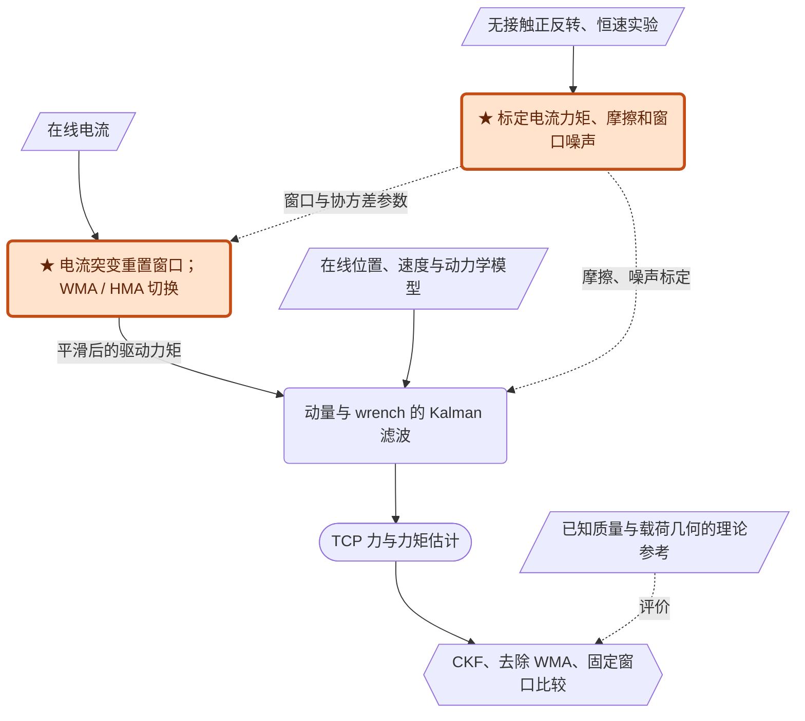

# Contact force and torque sensing for serial manipulator based on an adaptive Kalman filter with variable time period

[PDF](Cao_2021_VariableTimeAKF.pdf) · [原文转换](Cao_2021_VariableTimeAKF_source.md) · [精读与讨论总结](VariableTimeAKF_论文精读与讨论总结.md) · [UR5 / MuJoCo 复现说明](UR5_MuJoCo_Reproduction.md) · [批次入口](../README.md)

> **2026-10-24 整合复核**：参考精读总结，回看 PDF 第 3—5 页的状态模型、窗口切换及标定公式，第 9 页表 1—6 与图 10，以及第 11—12 页附录。原文报告、阅读推导与仿真实施判断分别标注；原始材料保留，论文包仍在 Scratch，尚未复现。

## 一句话结论

在动量 Kalman 测力前增加会重置窗口的电流平滑器，并用离线实验标定噪声，可在 UR5 提起已知载荷时降低误差方差；这里的 variable time period 指**平均窗口长度**，不是改变机器人采样频率。

| 阅读抓手 | 本文实际含义 |
|:---|:---|
| 输入 → 输出 | 位置、速度、电流与模型 → TCP 六维力／力矩估计 |
| 推断机制 | 观测由模型计算的动量，联合更新动量与外力状态 |
| 新增环节 | 可变窗口、WMA / HMA 切换、电流与噪声标定 |
| 自适应来源 | 窗口与模式变化，以及离线统计量结合实时动力学的协方差配置 |
| 已验证范围 | 单台 UR5 竖直加载；主要评价基坐标系 Z 方向力、X 方向力矩 |

**阅读导航**：[模型与算法](#方法) · [噪声分工](#三种噪声协方差不能一概说越小越快) · [标定条件](#正反转标定为什么依赖摩擦对称性) · [实验](#实验与证据) · [公式核查](#原文问题与局限) · [MuJoCo 对应](#与-mujoco-的对应关系阅读延伸) · [关联阅读](#关联阅读与研究用途)

## 问题与核心贡献

电流换算力矩有噪声，长窗口平滑却会把接触前的旧数据带入接触后的估计。本文把加权移动平均 WMA、Hull 移动平均 HMA 和窗口重置组合起来：变化阶段兼顾响应，平稳阶段重视平滑，再交给既有 Kalman 状态估计（§2.3—2.4）。

另一个贡献是无需额外关节力矩传感器的电流—力矩及简化摩擦标定，以及按电流滤波窗口、关节速度噪声校准协方差（§3）。这与通过 VB 在线辨识未知协方差的 AKF 不是同一类自适应。

全文逻辑是：直接逆动力学依赖加速度 → 改用动量建模 → 电流噪声与平滑滞后仍存在 → 用可变窗口和模式切换调节输入 → 标定动力学换算与噪声 → 用已知载荷检验精度和响应。**动量模型和 KF 是方法基础，输入处理与标定组合是本篇主要改进。**

### “自适应”和“经典 KF”怎样理解

§5.3 将本方法与根据估计结果在线更新协方差的 AKF 区分：它先通过离线实验获得不确定性，再结合实时动力学配置滤波器。窗口和模式会在线变化，测量协方差随惯性矩阵改变；正文没有给出完整的、由新息反推未知噪声的递推学习律。窗口对应的噪声统计量怎样查表或插值、两种模式是否分别标定，也未完整报告。

本篇属于**基于物理模型的随机状态估计与信号处理**。在每步把实测姿态对应的雅可比视为已知系数后，动量／外力模型对扩张状态是线性的，按时变 KF 形式更新。这里的 classical Kalman filter 指标准 KF 基线，不表示其属于“经典控制理论”；也不能仅因机器人动力学非线性，就直接称整个实现为 EKF。

## 方法

### 从关节动力学到动量方程

原文式（1）将驱动和外力矩都放在等式左边：

$$
M(q)\ddot q+C_C(q,\dot q)\dot q+G(q)+\tau_{\mathrm{fri}}+\tau_{\mathrm{ext}}+\tau_{\mathrm{dri}}=0,
\qquad \tau_{\mathrm{ext}}=J(q)^Tf.
$$

这里 $C_C$ 是科氏矩阵，而 $G$ 是关节重力力矩向量；与 HOFTO 中直接表示科氏／离心向量的 $C$ 不同。定义 $p=M(q)\dot q$，利用附录所用构造的恒等式 $\dot M=C_C+C_C^T$，可逐步得到

$$
\begin{aligned}
\dot p&=\dot M\dot q+M\ddot q\\
&=(\dot M-C_C)\dot q-G-\tau_{\mathrm{fri}}-\tau_{\mathrm{dri}}-J^Tf\\
&=C_C^T\dot q-G-\tau_{\mathrm{fri}}-\tau_{\mathrm{dri}}-J^Tf.
\end{aligned}
$$

**避免加速度的原因**是用该微分方程预测动量，再与测得位置、速度经模型算出的动量比较；算法不需要直接对带噪动量求时间差分。速度噪声和模型偏差仍然存在（式（2）—（4））。

### 状态模型：观测动量，同时估计末端 wrench

原文以 $x=[p^T,f^T]^T$ 为状态，$p=M(q)\dot q$，$f$ 是基坐标系下 TCP 六维力/力矩。沿用原文的力矩符号约定，其模型为

$$
\dot p=\tau_{\mathrm{inp}}-J(q)^Tf+e_p,\qquad
\dot f=Sf+e_f,\qquad
y=p+z.
$$

$\tau_{\mathrm{inp}}=C_C^T\dot q-G-\tau_{\mathrm{fri}}-\tau_{\mathrm{dri}}$。文中动力学将驱动力矩放在等式左边，因此负号与其他论文的约定不同，实现前必须统一电流、力矩及外力方向。实验设 $S=0$，即用随机游走描述未知外力，而非假设已知载荷时间曲线。在线不需要加速度或惯性逆（式（1）—（7））。

六轴 UR5 的动量与 wrench 各六维，合起来是 **12 维状态**；测量 $y=M(q_m)\dot q_m$ 为六维，由模型与编码器数据计算，没有独立的动量传感器。外力的前三项单位为 N、后三项为 N·m，不能将六维输出的误差直接不加区分地合并。

### 电流窗口究竟如何变化

为避免与物理时间混淆，本笔记用 $N$ 表示原文的窗口参数 $t$。WMA 给新样本更大权重：

$$
W(d,N)=\frac{2}{N(N+1)}\sum_{j=0}^{N-1}(N-j)i_{d-j}.
$$

HMA 将半窗口与全窗口的 WMA 组合，再对组合产生的**历史序列**做一次平均。令

$$
a_d=2W(d,\lfloor N/2\rfloor)-W(d,N),\qquad
H(d,N)=\operatorname{WMA}_{\lfloor\sqrt N\rfloor}(a)_d.
$$

外层 WMA 的输入是 $a$ 序列，不能只对当前单个 $a_d$ 重复求平均（式（12））。

**图 2 已回看 PDF 第 4 页。**记标定长度为 $N_{\max}$、本轮窗口起点为 $r$，其流程可以还原为：

| 阶段 | 条件与操作 | 下一步 |
|:---|:---|:---|
| 启动／重置 | 令 $r=d$ | 进入 WMA 增长循环 |
| WMA 增长 | 当 $d\leq r+N_{\max}-1$，输出 $W(d,d-r+1)$ | $d$ 加一，继续检查窗口长度 |
| 长度已满 | 离开增长循环 | 开始逐点电流变化判断 |
| 变化不超阈值 | 输出 $H(d,N_{\max})$ | $d$ 加一，继续电流变化判断 |
| 变化超过阈值 | 回到 $r=d$ | 当前新样本作为下一轮增长窗口的起点 |

变化判断为

$$
|i_d-i^{\mathrm{opt}}_{d-1}|\leq\delta,
$$

成立则使用 HMA，否则重置。该判断使用电流变化，既不是 F/T 触发，也不能保证只对真实接触触发。**按原图，WMA 增长循环中没有逐点执行此阈值判断**；若实现为所有阶段都检查突变，应标为设计改动。

正文未报告六轴完整阈值、窗口参数以及 HMA 历史缓存初始化规则。图 2 明确了主要控制流，但不能据此声称所有复现细节已经齐全。

### 信息与证据图

本图为阅读重构。平行四边形为数据，圆角框为处理，体育场形为输出，六边形为验证；橙色★为作者提出的组合/标定。实线为在线或标定数据流，虚线为离线参数与评价参考。

### 只测动量，Kalman 滤波为什么能更新外力

这里 $y=p$ 不直接含力，外力通过下一步的动量变化被观察。对于一个采样间隔内冻结的 $J$ 和实验所用 $S=0$，连续模型矩阵为

$$
A=\begin{bmatrix}0&-J^T\\0&0\end{bmatrix},\quad
B=\begin{bmatrix}I_n\\0\end{bmatrix},\quad
C=\begin{bmatrix}I_n&0\end{bmatrix}.
$$

因 $A^2=0$、$AB=0$，在该冻结近似下可直接推得

$$
A_d=\begin{bmatrix}I_n&-T_sJ^T\\0&I_6\end{bmatrix},
\qquad B_d=\begin{bmatrix}T_sI_n\\0\end{bmatrix}.
$$

为明确在线顺序，将式（13）—（15）改写为统一的预测／校正记号。当前周期的矩阵已由姿态更新，输入 $u_k=\tau_{\mathrm{inp},k}$ 中使用经过 MSMA 处理的电流换算力矩：

$$
\begin{aligned}
\hat x_{k+1}^-&=A_{d,k}\hat x_k^++B_{d,k}u_k,\\
P_{k+1}^-&=A_{d,k}P_k^+A_{d,k}^T+Q_{d,k},\\
\nu_{k+1}&=y_{k+1}-C\hat x_{k+1}^-,\\
K_{k+1}&=P_{k+1}^-C^T(CP_{k+1}^-C^T+R_{k+1})^{-1},\\
\hat x_{k+1}^+&=\hat x_{k+1}^-+K_{k+1}\nu_{k+1},\\
P_{k+1}^+&=(I-K_{k+1}C)P_{k+1}^-.
\end{aligned}
$$

$P$ 是状态估计误差协方差，$Q_d$ 是离散过程噪声协方差，$R$ 是离散动量测量噪声协方差；三者不能混用。原文建议一般初值为 $x_0=0$、$P_0=I$，也允许已知粗估计作初值（§2.4）。上述统一下标属于阅读重写；实际实现仍需检查输入所在区间与测量时间戳，不能把平滑造成的滞后误当成当前无延迟输入。

按动量/力分块的预测协方差为 $P^-=[P_{pp}^-,P_{pf}^-;P_{fp}^-,P_{ff}^-]$。测量更新的外力部分是

$$
\hat f^+=\hat f^-+P_{fp}^-(P_{pp}^-+R)^{-1}(y-\hat p^-).
$$

因此真正把“动量预测不对”转化为“应该调整外力”的是交叉协方差 $P_{fp}^-$；它由状态耦合及协方差传播形成。$S=0$ 表示确定性预测阶段保持上一外力估计，**不是把外力设置为零**。

这一冻结模型的可观测矩阵前两块为 $C$ 与 $CA=[0,-J^T]$，其秩为 $n+\operatorname{rank}(J)$。完整六维 wrench 的瞬时可辨识性要求足够的 Jacobian 秩；奇异姿态或未建模的多点接触仍有边界。时变运动可能改善一个时间区间内的可观测性，但本文未系统评估这种情形。

输出应由 $\hat f=[0_{6\times n}\ I_6]\hat x$ 选出后六维。该尺寸是按状态定义恢复的，原文式（16）的零块下标存在打印问题，详见后文核查。

### 三种噪声协方差不能一概说“越小越快”

| 量 | 所代表的不确定性 | 相对调整时的解释 |
|---|---|---|
| 动量过程噪声 $Q_p$ | 电流换算、摩擦及名义动力学误差 | 减少该项的实际噪声后，动量残差更容易归因于接触，而非自身输入误差 |
| 外力过程噪声 $Q_f$ | 未知 wrench 的变化 | 增大通常允许更快跟随变化，但会带来更大的估计波动 |
| 动量测量噪声 $R$ | 位置/速度测量传播到 $p$ 的误差 | 决定对当前测量相对于预测的信任 |

这些作用依赖矩阵之间的相对大小、姿态和采样。§3.4 明确讨论增大外力噪声参数以改善响应，所以不能把 §5.2 中“较小协方差有利”的说法推广到所有块。

原文分别记为 $\sigma_{\mathrm{Dyn}}^2$、$\sigma_f^2$、$\sigma_{\mathrm{mea}}^2$；上表用 $Q_p,Q_f,R$ 区分作用位置。本文假设前两者为对角阵，表示忽略相应通道间相关性；这是建模假设，不能由单关节正态性检验推出。

无外力、近似匀速的标定阶段使用

$$
\bar\tau_{\mathrm{dri}}=-C_C\dot q-G-\tau_{\mathrm{fri}},\qquad
\varepsilon_\tau=\bar\tau_{\mathrm{dri}}-D\circ i^{\mathrm{opt}}.
$$

改变电流窗口，分析残差 $\varepsilon_\tau$ 的分布与方差，得到窗口长度和输入不确定性的经验关系（式（24）、图 5—6）。它混合了电流噪声、模型误差、运动跟踪偏差和滤波滞后，不是纯电流传感器噪声；方差较小也不意味着残差均值为零。

忽略惯性误差、认为速度误差主导时，动量测量协方差可写成

$$
R_p(q)=M(q)\Sigma_{\dot q}M(q)^T.
$$

原文式（25）末尾未显式写转置，因 $M$ 对称，在该理想模型中等价。即使 $\Sigma_{\dot q}$ 为对角阵，$R_p$ 一般也不是；位置、惯性参数误差和速度处理相关性则不由这个简式完整覆盖。

为替代有打印问题的式（10），可从连续白噪声协方差强度 $Q_c=\operatorname{diag}(Q_p,Q_f)$ 出发，使用

$$
Q_d=\int_0^{T_s}e^{A\tau}Q_ce^{A^T\tau}\,d\tau
=\begin{bmatrix}
T_sQ_p+\frac{T_s^3}{3}J^TQ_fJ&-\frac{T_s^2}{2}J^TQ_f\\
-\frac{T_s^2}{2}Q_fJ&T_sQ_f
\end{bmatrix}.
$$

这是基于本篇符号与冻结 $J$、$S=0$ 的**阅读推导**，不是作者代码。还必须区分连续噪声强度与离散采样方差：原文式（9）使用除以 $T_s$ 的测量噪声换算，但若输入本来就是采样数据的经验方差，不能不经定义核对再除一次。源文的正态性检验也没有自动证明噪声在时间上独立；移动窗口会引入相关性。

矩阵指数式与上述闭式都以给定噪声模型为前提。不能只把残差样本方差直接填入连续强度，再宣称得到严格的离散噪声统计；需要先统一随机量、采样／平均方式和单位。

### 窗口缩短改善的是哪一段延迟

对固定窗口、低频输入，WMA 的权重平均样本年龄为

$$
\bar j=\frac{\sum_{j=0}^{N-1}j(N-j)}{\sum_{j=0}^{N-1}(N-j)}=\frac{N-1}{3}.
$$

所以 $N=50$、125 Hz 时，这个低频延迟量级约为 131 ms，而窗口跨度为 400 ms；两者都不是完整 AKF 的实测响应时间。接触后重置窗口的作用，是不再把大量接触前样本混入新估计；但小接触若不足以触发阈值，仍可能保留长窗口。摩擦换向或运动导致的电流突变也可能触发重置。

HMA 中短、长窗口的线性组合可产生负的等效权重，用以减轻平滑滞后，但不等同于无延迟或无超调。它仍是因果处理，无法提前知道一个历史中没有信息的接触事件。实际重置、窗口增长和模式切换后，不能再用一个固定线性传递函数描述全程。

**历史缓存的阅读推导：**固定 $N$ 时，标准 HMA 的完整有限冲激响应最长涉及 $N+\lfloor\sqrt N\rfloor-1$ 个原始样本；因此从增长 WMA 转入 HMA 时，仅有新窗口的 $N$ 个样本未必足够。旧历史是否保留、截断或另行预热会影响初期输出，原文未给出完整规则。这不改变图 2 已确认的分支，但属于复现时必须明确的细节。

### 正反转标定为什么依赖摩擦对称性

按原文力矩正负号，在相同姿态、相同速度幅值的正反转数据中有

$$
i_g=-\frac{i^++i^-}{2},\qquad
D=\frac{G(q)}{i_g},\qquad
\tau_f=D\frac{-i^++i^-}{2}.
$$

加和消去奇对称摩擦、差分消去重力，才得到两个量的分离。该实验识别的是电机常数与减速比的乘积 $D$，不是分别辨识二者。若重力力矩接近零，比例估计会变得病态；温度、方向不对称、速度不匹配也会破坏上述消去。以上是对式（19）—（23）的条件展开，本文没有证明所有关节/姿态下均可直接套用。

同构型与同速率大小需要通过轨迹配对实现；“单关节匀速”也不自动保证整个多关节系统的所有速度相关力矩都消失。用于式（19）简化的项应核查为可忽略或已扣除，不能把残余动态项无条件归入重力电流。

PDF 第 5 页的式（22）确实写成 $\tau_{\mathrm{fri}}=f_C+f_{\dot q}\dot q$，没有显式符号函数。若要覆盖正反两个方向，常用展开为 $\tau_{\mathrm{fri}}=f_C\operatorname{sgn}(\dot q)+f_v\dot q$；这里是双向建模的实施解释，不能冒充原文给出了完整的分方向拟合与切换规则。

§3 主要辨识电流—力矩乘积和简化摩擦，**没有重新辨识全部质量、质心与惯性参数**。正文假设刚体动力学足够准确，附录则说明已知参数如何计算动力学量；这两项前提不能合并成“所有动力学已被数据准确识别”。

### 标定、在线输入与参考

| 阶段 | 数据/处理 | 用途与条件 |
|---|---|---|
| 电流力矩标定 | 单关节正反向恒速，其他关节固定；以重力模型和正反转电流分解重力/摩擦 | 求电机常数与减速比的乘积 $D$；依赖重力模型准确及正反转摩擦近似对称 |
| 摩擦标定 | 多个速度下的正反转数据 | 库仑与黏性摩擦；不覆盖温漂、载荷依赖和复杂静摩擦 |
| 过程噪声 | 无外部载荷恒速运动，电流力矩与模型力矩残差，改变窗口长度 | Anderson–Darling 正态性检验与经验方差；肘关节选择 50 样本窗口 |
| 测量噪声 | 恒速目标与测得速度的偏差 | 传播到动量协方差 $R_p=M\Sigma_{\dot q}M^T$；目标速度并非独立速度真值 |
| 在线估计 | 电流、位置、速度和已知模型；125 Hz | 每步随姿态更新模型；KF 无需知道接触时刻和新增载荷质量 |
| 评价参考 | 夹具/杯中铅块的已知质量及几何关系 | 已知载荷参考；本文未报告独立六维 F/T 测得的瞬态真值 |

50 样本在 125 Hz 下对应 0.4 s，这是窗口跨度，不是声称每次估计都有固定 0.4 s 延迟。标定样本总数、重复次数及泛化到新温度条件的验证未报告。

## 实验与证据

UR5 以 0.06 m/s 竖直抬升，抓手随后与装有铅块的杯子接合；夹具质量 1.742 kg，对应原文 17.09 N 重力参考。新增负载 100–1000 g、每档增加 100 g；另测 0.04/0.08 m/s。主要展示 $Z_0$ 方向力和 $X_0$ 方向力矩，不是六维任意接触的充分验证（§4、图 8—11）。

加载过程分为“仅夹具运动 → 接合并提起杯中载荷 → 共同抬升”。平稳阶段的参考来自已知质量与重力，力矩参考还依赖载荷相对 TCP 的力臂；这些量用于评价，新增载荷质量不作为 KF 的在线输入。夹具重力是否归入模型必须与评价定义一致，不能同时计入模型补偿和外力参考。突然接合阶段的惯性、冲击及软管作用不能仅用质量乘重力刻画。

### 模式切换改善了哪个阶段

在 0.06 m/s 恒载估计试验中，表 1 按初始过渡阶段和后续阶段列出力误差方差：

| 方法 | 0–0.45 s，N² | 0.45–1.5 s，N² | 0–1.5 s，N² |
|:---|---:|---:|---:|
| CKF | 0.885 | 1.423 | 1.256 |
| 仅 HMA 的 AKF | 0.841 | 0.780 | 0.933 |
| 完整 AKF | **0.358** | 0.780 | **0.711** |

完整方法在初始阶段使用 WMA，优势主要出现在这一段；后续两个 AKF 版本都进入 HMA，表中方差相同。这支持按阶段切换模式的作用。这里对应图 9(c)(d) 的恒载估计过程，不能把 0.45 s 当成图 9(a)(b) 杯子接合的时刻。

### 不同速度下的整体表现

PDF 第 9 页表 1—6，0–1.5 s 全区间误差方差如下：

| 速度 | 指标 | CKF | 仅 HMA 的 AKF | 完整 AKF |
|---|---|---:|---:|---:|
| 0.06 m/s | 力方差，N² | 1.256 | 0.933 | **0.711** |
| 0.06 m/s | 力矩方差，(N·m)² | 0.0802 | 0.0386 | **0.0208** |
| 0.08 m/s | 力方差，N² | 0.9579 | 1.1519 | **0.8066** |
| 0.08 m/s | 力矩方差，(N·m)² | 0.07839 | 0.037 | **0.02466** |
| 0.04 m/s | 力方差，N² | 2.2218 | 2.3318 | **1.9897** |
| 0.04 m/s | 力矩方差，(N·m)² | 0.10586 | 0.07987 | **0.06191** |

这些是**方差，不是 RMSE 或绝对测力精度**。按表中数值计算，0.06 m/s 的力/力矩方差相对 CKF 分别降低约 43.4%/74.1%；只用于该表条件，不能推广为所有载荷的固定收益。

若对同一组误差采用除以 $N$ 的方差定义，则 $\mathrm{RMSE}^2=\operatorname{Var}(e)+\bar e^2$；若采用无偏样本方差 $s^2$，则为 $\mathrm{RMSE}^2=\frac{N-1}{N}s^2+\bar e^2$。所以方差更小并不排除恒定偏置更大。§5.1 将“SD 大于 RMSE”与模型不确定性联系起来，但 PDF 第 9 页图 10 的图例与曲线反而呈现 SD 低于对应 RMSE。这更像文字表述问题，不能当作作者已经证明的误差来源诊断；没有据此推定官方勘误或补写其计算代码。

### 响应、精度与消融证据

| 验证问题 | 对照和观察 | 边界 |
|---|---|---|
| 模式切换是否必要？ | 全 AKF 对比无 WMA 的 AKF；后者在 0.04/0.08 m/s 的全区间力方差甚至大于 CKF | 支持组合的必要性，不是“任意平滑都会改善” |
| 力与力矩是否都响应更快？ | 图 11(a)：超过 400 g 时，AKF 力响应优势较明显；较小载荷接近 | 力矩响应在已测范围内基本接近；更大力矩可能获益是作者推测，待验证 |
| 变窗口是否更快？ | 图 11(b) 固定/变窗口 WMA 对照；多数载荷改善 | 100/200 g 有例外；力矩响应优势不明显 |
| 精度是否普遍改善？ | 图 10 多载荷 SD/RMSE 曲线大多改善 | 作者指出 100 g 力 RMSE 是例外；无重复统计和置信区间 |

### 装配证据

有 UR5 真机载荷接合试验，在线使用位置、速度、电流和模型。轴孔插装任务、装配公差、初始位姿误差、装配成功判据、成功率及周期统计均**未报告**。估计采样频率 125 Hz，机器人底层控制频率未报告；每个工况重复次数及独立接触峰值测量也未报告。图中的响应时间没有完整数值表和统一可复算判据，不据曲线估读成精确毫秒指标。

## 原文问题与局限

**转换问题：**MinerU 将表 1 附近错标为 Table 3，表 2—6 标题不完整；上表已按 PDF 第 9 页重建。

**原文公式核查：**以下问题已回看 PDF，不能全部归因于文本转换。修正依据是状态定义、矩阵尺寸和物理量纲，不代表作者发布了勘误。

| 位置 | 核查结果 | 笔记采用的处理 |
|:---|:---|:---|
| §2.1—2.2，PDF 第 3 页 | $G$ 被写成矩阵维度；噪声向量 $w$ 又被称为协方差矩阵 | 按动力学式将 $G$ 视为关节力矩向量，区分噪声随机量与其协方差 |
| 式（6），第 3 页 | 状态方程左侧漏写时间导数点 | 按上下文恢复为 $\dot x=Ax+Bu+w$ |
| 式（10），第 3 页 | 噪声离散化重复含 $A,B$ 的块指数，尺寸不一致，也未引入过程噪声协方差 | 从连续噪声积分推导 $Q_d$，不直接照抄打印式 |
| 式（16），第 4 页 | 选取外力状态时零块下标不符合拼接尺寸 | 恢复为 $[0_{m\times n}\ I_m]$，本文 $m=6$ |
| 式（22），第 5 页 | 库仑项没有显式方向符号 | 保留原式，同时注明双向摩擦的实现规则未完整交代 |
| 附录，第 11—12 页 | 文字误将 $C_C$ 称为惯性矩阵；$G=\mathrm{gra}\cdot g(q)$ 中重力方向三维向量与六维 $g$ 的乘法含义不清，势能中又出现重力项 | 按一致的重力加速度、势能和关节重力力矩定义重建，不直接执行该写法 |

附录怎样支撑动量模型：已知物理参数到动力学量

连杆质量为 $m_i$，质心线速度／角速度雅可比为 $J_{v_i},J_{\omega_i}$，关于质心的惯性张量为 $I_i$。把惯性张量通过 $R_i$ 变换到与雅可比一致的坐标系后，有

$$
M(q)=\sum_i\left[m_iJ_{v_i}^TJ_{v_i}+J_{\omega_i}^TR_iI_iR_i^TJ_{\omega_i}\right].
$$

第一项对应质心平动动能，第二项对应绕质心转动动能。附录的 Christoffel 构造为

$$
[C_C]_{kj}=\frac12\sum_i\left(
\frac{\partial M_{kj}}{\partial q_i}
+\frac{\partial M_{ki}}{\partial q_j}
-\frac{\partial M_{ij}}{\partial q_k}\right)\dot q_i.
$$

它支撑正文使用的 $\dot M=C_C+C_C^T$。对重力项，采用通常的势能约定，令 $g_0$ 为实际重力加速度向量、$r_{c_i}$ 为基坐标系下的质心位置，可一致地写成

$$
U(q)=-\sum_i m_i g_0^Tr_{c_i}(q),\qquad G(q)=\frac{\partial U}{\partial q}.
$$

最后这一写法是为澄清原文记号而给出的物理重构。附录提供计算关系，不提供全部惯性参数的辨识结果。

**作者明确边界：**相邻外力事件间隔假设大于窗口跨度，典型 200–400 ms；这不是估计器截止频率。更快的重复接触／加工振动可能失去优势。更复杂摩擦、其他机器人及装配闭环属于后续工作（§5.5）。

**我的判断：**该方法主要改善输入噪声与平滑响应，并未把模型误差从接触力中独立分离。已知静载参考对平稳阶段有用，但突然接合时的冲击、杯体运动及软管力，不能由质量乘重力完整描述。引用时应保留这一参考边界。

## 与 MuJoCo 的对应关系：阅读延伸

本节吸收精读总结中的仿真讨论，**不属于论文已经完成的实验**。接口依据 MuJoCo 3.3.7 官方文档，面向固定基座、六个普通转动关节的 UR5；未检查用户实际安装版本，也未运行本篇仿真。

具体实施步骤见[复现说明](UR5_MuJoCo_Reproduction.md)。该文档统一采用正向受力约定，并补充缓存、协方差和实验规则；使用其中状态矩阵时，不要与本笔记沿用的原文负号混用。

| 论文需要的量 | 仿真中的对应与注意点 |
|:---|:---|
| 惯性矩阵 $M(q)$ | `data.qM` 是压缩表示，经 `mj_fullM` 展开；包含模型配置的关节附加惯性 |
| 速度相关力矩加重力 | `data.qfrc_bias` 对应 $C_C\dot q+G$，不含所有驱动、被动及约束力 |
| 重力力矩 $G(q)$ | 在独立计算状态中，用相同构型、零速度刷新 bias；避免改动正在积分的状态 |
| 质心／TCP 雅可比 | 分别使用 `mj_jacBodyCom`／`mj_jacSite`，核对参考点、坐标系和力／力矩排列 |
| 笛卡尔力与关节力矩映射 | `mj_applyFT` 可把指定点的力与力矩映射到广义力；注入扰动与评价真值需单独记录 |
| 摩擦与阻尼 | `damping` 进入被动力；`frictionloss` 通过约束求解处理，不能简单当成同一个力数组 |

这些对应关系见 [MuJoCo 动力学框架](https://mujoco.readthedocs.io/en/3.3.7/computation/index.html#general-framework)、[API 函数说明](https://mujoco.readthedocs.io/en/3.3.7/APIreference/APIfunctions.html)和[关节属性说明](https://mujoco.readthedocs.io/en/3.3.7/XMLreference.html#body-joint)。仿真器的递推计算与附录公式可以描述同一物理模型，但计算路径不同。

最关键的接口区别是：论文需要 $C_C^T\dot q$，MuJoCo 的 bias 给出的是 $C_C\dot q+G$。由动量恒等式推导，

$$
C_C^T\dot q=\dot M\dot q-(\mathrm{bias}-G).
$$

因此不能直接用 `qfrc_bias` 替代动量方程里的速度项。若采用 MuJoCo 常见的正向受力约定 $M\ddot q+\mathrm{bias}=\tau_{\mathrm{total}}$，则相应为

$$
\dot p=\dot M\dot q+\tau_{\mathrm{total}}-\mathrm{bias}.
$$

这是阅读推导，迁移时须把论文的驱动／外力负号统一转换。$\tau_{\mathrm{total}}$ 中驱动、被动、外加及约束力各归哪一项必须明确；已知项参与预测，待估接触项保留为未知状态，不能把真值又作为输入。

普通关节的 `armature` 会增加惯性矩阵对角项；若没有其他附加惯性机制，可理解为 $M_{\mathrm{MuJoCo}}=M_{\mathrm{links}}+\operatorname{diag}(\mathrm{armature})$。已经读取完整 $M$ 后无需再加一次。名义估计模型与仿真被控对象也应区分：同参数模型只能验证算法自洽，参数偏差试验才能检验模型误差影响。

**对本篇复现尤其重要：**MuJoCo 的理想关节驱动力矩不自动包含真实电流测量噪声。若只输入无噪声力矩，会绕开本文电流平滑的主要贡献；应显式规定电流换算、噪声与滤波标定流程。主线验证可以依次比较原始电流 CKF、仅 HMA、完整切换方案及固定／可变窗口，并覆盖小载荷、换向和密集接触；这些是建议实验，尚未完成。

## 关联阅读与研究用途

- [HOFTO 2022](../HOFTO_2022/HOFTO_2022_notes.md)：主要用高阶扰动状态与非线性反馈改善时变扰动跟踪，本文主要处理电流噪声与平滑滞后。HOFTO 的中间估计量是惯性归一化扰动，本文直接把 TCP wrench 纳入状态；比较前要统一最终物理量、噪声和动力学条件，不能直接排列两篇的实验误差。
- [Wahrburg 2015](../../paper01/Wahrburg_2015_MomentumKalman/Wahrburg_2015_MomentumKalman_notes.md)：先理解动量与外力联合状态为何能通过交叉协方差被更新。
- [Dong 2022](../Dong_2022_ErrorProbabilitySWVAKF/Dong_2022_ErrorProbabilitySWVAKF_notes.md)：进一步根据运行状态与滑窗残差调整协方差，需区分两篇 AKF 的机制。
- 用于装配前，先在相同动力学补偿下对比固定窗口、重置窗口与原始电流，记录轻接触、换向和密集接触的偏差与延迟；本篇不能直接证明精密装配可用性。
