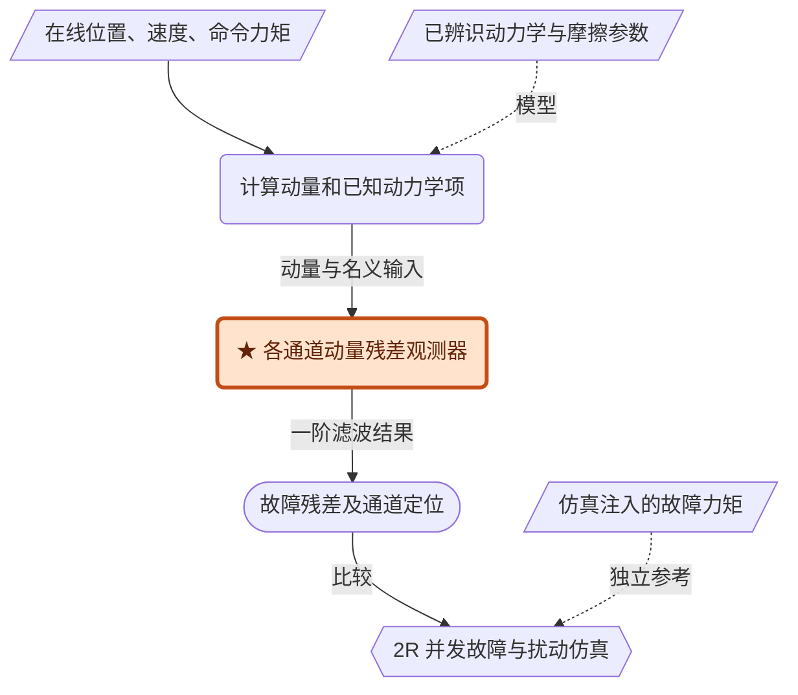

# Actuator Failure Detection and Isolation Using Generalized Momenta

> [PDF](DeLuca_2003_GeneralizedMomenta.pdf) · [原文转换](DeLuca_2003_GeneralizedMomenta_source.md) · [书目核对](https://iris.uniroma1.it/handle/11573/366849)。2026-10-23 参考精简稿重新组织；结论以论文为准。关键式（5）—（7）已核对 PDF 第 3 页；未完成 UR5 仿真，暂留 Scratch。

UR5 仿真实施入口：[UR5 / MuJoCo 实现说明](UR5_MuJoCo_Implementation.md)，含模型接口、离散观测器、实施流程与验证工况；核心递推已通过合成数据检查，尚未运行 UR5 整机仿真。

## 一句话核心

**用广义动量构造逐通道解耦的故障残差：不测加速度、不求惯性矩阵逆，便能得到缺失力矩的一阶低通估计；同通道的未知扰动仍无法与故障分开。**

## FDI 解决什么问题

FDI（Fault Detection and Isolation）包含两步：**检测**是否出现异常，**隔离**异常所在的执行器通道；它不自动识别故障类型。FTC（Fault Tolerant Control）则负责故障后的控制重构，本文没有设计完整 FTC 控制器。

本文的贡献是动量残差构造及其扩展（§1、3、5）：无需参考轨迹、特定稳定控制律或在线积分完整正动力学；相较已有滤波逆动力学方案，减少所需动力学项的计算。仍需位置、速度、命令力矩和正确的模型。

## 故障建模：统一成“缺失输入”

原文式（1）为

$$
M(q)\ddot q+c(q,\dot q)+g(q)+\tau_{\mathrm{fri}}(\dot q)=u-u_f,
\qquad
\tau_{\mathrm{fri}}=F_v\dot q+F_s\operatorname{sgn}(\dot q).
$$

$u$ 是命令力矩，$u_f$ 是等效缺失力矩，实际输入为 $u-u_f$。这一符号约定与把外力矩以正号放在动力学右侧的论文不同（§2）。

| 输入异常 | 等效 $u_{f,i}$ | 含义 |
|---|---|---|
| 完全失效 | $u_i$ | 执行器不再输出力矩，关节可自由运动 |
| 部分失效 | $\eta u_i,\ 0<\eta<1$ | 实际力矩为 $(1-\eta)u_i$ |
| 卡死 | $u_i-\tau_i$ | $\tau_i$ 为卡死运动约束下动力学左端对应分量 |
| 恒定偏置 | $b_i$ | 相对命令值存在固定缺失 |
| 饱和 | $u_i-\operatorname{sgn}(u_i)u_{i,\max}$ | 该式用于超过力矩限幅时；未饱和时此项为零 |
| 碰撞 | $j_i^T(q)F$ | 按本文符号，接触 wrench 经接触点 Jacobian 映射为输入异常 |

这些类型统一了模型，并不意味着残差能区分它们；本文完整展示的仿真主要是间歇完全失效。

## 方法：动量平衡 → 残差 → 通道定位

### 为什么动量变换能避免加速度

取 $p=M(q)\dot q$。利用拉格朗日动力学结构，原文式（2）—（5）给出

$$
\begin{aligned}
\dot p&=M\ddot q+\dot M\dot q=u-u_f-\alpha(q,\dot q),\\
\alpha_i&=-\frac12\dot q^T\frac{\partial M}{\partial q_i}\dot q+g_i+\tau_{\mathrm{fri},i}.
\end{aligned}
$$

其中 $(\dot M\dot q-c)_i=\frac12\dot q^T(\partial M/\partial q_i)\dot q$。在线只计算 $p$、$\alpha$，再通过积分生成残差，**不实际微分 $p$**。速度仍需测量或由编码器估计；避免加速度不等于不受测量噪声影响。

### 残差为什么解耦

将式（6）的积分常数显式写出，并令初始残差为零：

$$
r(t)=K\left[p(0)+\int_0^t\bigl(u-\alpha-r\bigr)\,ds-p(t)\right],
\qquad K=\operatorname{diag}(K_i)>0.
$$

代入动量平衡，得到全文最关键的结果：

$$
\dot r=K(u-\alpha-r-\dot p)=-Kr+Ku_f,
\qquad
\frac{r_i(s)}{u_{f,i}(s)}=\frac{K_i}{s+K_i}.
$$

理想模型下，每个残差只受对应输入异常驱动，因此可隔离并发故障。这里解耦的是**补偿后的残差动态**，不是说一个关节故障不会改变其他关节的实际运动。

每个通道都是直流增益为 1 的一阶低通：无故障时残差趋零，常值故障可渐近跟踪，时变故障则存在幅值衰减和相位滞后。$K_i$ 的单位为 $\mathrm{s}^{-1}$，时间常数为 $1/K_i$；增益越大通常响应越快，但噪声与阈值的代价也需一起评估。

### 信息与证据图

阅读重构：平行四边形为信息，圆角框为处理，体育场形为输出，六边形为验证；橙色★标贡献，虚线表示模型或评价参考。在线使用 $q,\dot q,u$；仿真注入的 $u_f$ 仅用于评价。

## 检测、隔离与阈值的边界

实际报警可用 $|r_i|>h_i$。阈值应依据正常运行时的模型残差、测量噪声及允许误报水平设定；本文只讨论固定或自适应阈值的可能性，没有给出通用整定算法（§3—4）。

- **残差非零不等于故障。**理想零初值、准确模型且无扰动时，非零残差可归因于输入异常；实际还可能来自摩擦、负载、参数误差和初始化瞬态。
- **不同通道可分，同通道不可任意分。**理想模型下，通道 1 的未知扰动不污染通道 2 的残差；同一通道的故障和非结构化扰动则以相同方式进入，阈值只能在有额外幅值或统计先验时帮助判断。
- **不存在对所有故障、所有时刻都有效的阈值间隙。**故障刚出现时残差尚未上升，小故障也可能淹没在正常波动中。完全失效满足 $u_f=u$，若命令力矩为零，当下甚至没有缺失输入可供检测（由模型推得）。

因此，检测到异常通道不等于识别故障原因，也不等于确定碰撞位置或恢复完整接触力。

## 扩展：选择更靠近故障的状态

§5 将同一残差结构用于电机侧力矩故障和电压故障：

| 场景 | 状态及平衡式 | 必要信息与收益 |
|---|---|---|
| 弹性关节 | $p_\theta=J\dot\theta$；$\dot p_\theta=u-u_f-K_e(\theta-q)$ | 需 $u,\theta,\dot\theta,q$ 及 $J,K_e$，不需连杆速度或完整连杆动力学；对角结构支持分散式诊断 |
| 直流电机 | 令 $s_j=L_ji_j+K_{B,j}q_j$，则 $\dot s_j=v_j-R_ji_j-v_{f,j}$ | 需本地电压命令、电流、位置及 $L_j,R_j,K_{B,j}$，无需显式电流微分；输出是电压故障残差，单位 V |

$\theta$ 为电机位置，$J$ 为电机惯量，$K_e$ 为关节刚度；$L,R,K_B$ 分别是电感、电阻和反电动势常数。两种场景都可按上述平衡式构造一阶残差；这是模型推导，本文未提供对应的定量实机验证。

## 仿真与证据

§4 使用竖直平面 2R 机器人，忽略摩擦；两杆长均 0.5 m，质量分别为 20、10 kg。从向下平衡位置静止启动，开环运行 25 s，关节 1/2 的命令分别为正弦/方波，$K=\operatorname{diag}(50,50)$。

| 验证问题 | 设置与结果 | 证据边界 |
|---|---|---|
| 能否定位并发故障？ | 关节 1 在 15–20 s、关节 2 在 12–18 s 完全失效；15–18 s 并发。图 4 残差分别跟踪注入的缺失力矩 | 支持理想模型下的通道隔离与恢复跟踪；未报告 RMSE、检测延迟或重复统计 |
| 能否排除其他扰动？ | 通道 1 加入带限白噪声力矩。图 5—6 的通道 2 故障可隔离；图 7—8 的同通道故障与扰动混合 | 验证同位扰动不可分，不能解读为任意抗扰能力 |
| 是否完成真机验证？ | §6 提到 Quanser Pendubot 初步实验及传感器 FDI 扩展，指向报告 [12] | 本文未展示相应真机曲线、指标或次数；完整可核查证据是仿真 |

**装配记录：**未开展装配任务；几何公差、初始位姿误差、成功判据、试验次数、周期时间与接触峰值均未报告。仿真用位置、速度和命令力矩；真机传感配置、采样及控制频率未报告。

## 局限与研究关联

**作者明确的限制（§6）：**模型必须足够准确。同通道未知扰动不可分；若采用自适应参数，应在故障前完成调整，且参数未收敛到真实值时，新轨迹上仍可能出现非零残差。

**阅读判断：**这篇最值得掌握的是“动量平衡—残差动态—异常通道”的推理。后续滑模、有限时间和 Kalman 方法可改善动态或噪声处理，却不能仅凭观测器形式区分接触、摩擦与模型误差。

关联阅读：[Garofalo 2019](../Garofalo_2019_SlidingMomentum/Garofalo_2019_SlidingMomentum_notes.md)改进时变外力矩跟踪；[ADRC 2009](../ADRC_2009/ADRC_2009_notes.md)解释总扰动估计与控制补偿。

补充：观测器实现与理想报警时间

**等价观测器（原文 §3）：**

$$
\dot{\hat p}=u-\alpha+K(p-\hat p),\qquad
r=K(\hat p-p),\qquad \hat p(0)=p(0).
$$

定义 $e_p=p-\hat p$，则 $\dot e_p=-u_f-Ke_p$、$r=-Ke_p$，与主文残差符号一致。若采用前向 Euler，可写成

$$
p_k=M(q_k)\dot q_k,\qquad
r_k=K(\hat p_k-p_k),\qquad
\hat p_{k+1}=\hat p_k+T_s(u_k-\alpha_k-r_k).
$$

此离散式是阅读推导，非论文已验证实现。输入需同步；标量理想残差模型的 Euler 稳定条件为 $0<T_sK_i<2$，不能代替对实际采样系统的检查。

**理想报警时间（由式（7）推导）：**零初值、$t_0$ 时出现常值故障 $A$ 时，

$$
r_i(t)=A[1-e^{-K_i(t-t_0)}],\qquad
\Delta t_{\mathrm{cross}}=-\frac1{K_i}\ln\left(1-\frac{h_i}{|A|}\right),\quad 0<h_i<|A|.
$$

$\Delta t_{\mathrm{cross}}$ 是连续信号达到阈值的时刻差；实际离散报警还受采样与判据影响。$K_i=50\,\mathrm{s}^{-1}$ 对应 20 ms 时间常数、约 60 ms 达到终值的 95%，均为理想推算，**不是本文实测检测延迟**。

