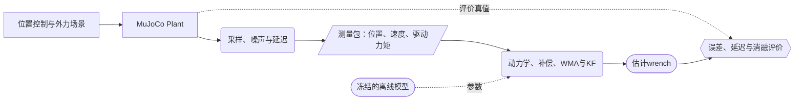

# PIAKF MuJoCo Reproduction Guide

更新日期：2026-10-17。关键词：`sensorless force estimation`, `MuJoCo`, `PIAKF`, `structured dynamics`, `backlash compensation`, `causal filtering`。

目标论文：*Physics-informed adaptive Kalman filter for contact force estimation in industrial robots considering model uncertainty*，RCIM，2026，DOI：[10.1016/j.rcim.2026.103292](https://doi.org/10.1016/j.rcim.2026.103292)。

**建议路线：先打通真实受力的仿真对象、测量接口和动量KF，再训练结构化动力学，最后接入TCN／Gaussian补偿和变窗口WMA，完成四组消融。**第一轮使用六轴UR5e替代模型，保留论文的末端六维wrench状态；获得SN7B模型和作者配置后，再考虑数值结果复现。

本文是实施文档。文中的配置、代码骨架与验收规则不代表已经训练或获得机器人仿真结果。编写时当前Python环境有NumPy、SciPy，没有MuJoCo和PyTorch；没有安装软件、下载模型或运行机器人仿真。论文依据见[详细笔记](../../Force_Estimation/Learning_Aided_Estimation/PIAKF_2026/PIAKF_2026_notes.md)和[原文source](../../Force_Estimation/Learning_Aided_Estimation/PIAKF_2026/PIAKF_2026_source.md)。

## 阅读入口

| 当前需要 | 位置 |
|---|---|
| 今天先做什么 | [1. 阶段与交付物](#stages)、[2. 环境和机器人](#environment) |
| MuJoCo究竟模拟什么 | [3. Plant与测量边界](#plant)、[4. 信号和时间](#signals) |
| 第一版估计器怎样写 | [5. 名义动力学](#nominal)、[6. KF](#kf) |
| 如何覆盖论文学习模块 | [7. 结构化动力学训练](#pinn)、[8. 换向误差补偿](#compensation) |
| 如何复现核心消融 | [9. WMA](#wma)、[10. Benchmark](#benchmark) |
| 怎么判定实现正确 | [11. 验收](#acceptance)、[12. 排错](#troubleshooting) |
| 如何衔接后续研究 | [13. 工程组织与真机](#engineering)、[14. 首轮清单](#first-run) |

## 0. 先规定“复现”的范围

原文使用MATLAB/Simscape与SIASUN SN7B，仿真采样／控制频率1 kHz，仿真摩擦只包含黏性项。真机实验才进一步检验换向误差补偿。当前材料未给出足以唯一重建全部实现的配置，例如误差标签、TCN结构与事件时基。

| 层次 | 要完成什么 | 可以报告什么 |
|---|---|---|
| 方程实现 | 动量状态、KF离散化、符号、外力映射 | 公式自洽实现 |
| 模块复现 | PINN、换向补偿、WMA位置及消融 | 声明实现假设的MuJoCo方法重实现 |
| 原结果复现 | 相同机器人、数据、训练与观测配置 | 只有条件齐备后，才能声称复现原论文数值 |

使用UR5e得到的RMSE不能直接与SN7B的0.43 N作等价比较。本文优先实现前两层。原文事实、本文默认配置和诊断实验在下文分别标注。

<a id="stages"></a>

## 1. 按六个阶段推进

| 阶段 | 实际工作 | 必须留下的产物 | 进入下一步的条件 |
|---|---|---|---|
| A：接口 | 加载模型、施加末端外力、记录同步数据 | 一段无接触与一段已知受力日志、版本清单 | 外力确实改变运动；力方向和关节映射正确 |
| B：基础估计 | 名义模型＋GMO／12维动量KF | 无噪声与含噪声的估计曲线 | 不依赖外力真值也能恢复规定方向的力 |
| C：学习动力学 | 采集无外力激励、训练结构网络与摩擦 | 数据划分、模型权重、留出轨迹误差 | 学得的动量和动力学能支持KF运行 |
| D：换向补偿 | 建立内部误差工况、TCN检测、Gaussian参数预测 | 标签说明、事件指标、补偿前后曲线 | 降低换向假力，并检验真实接触保留 |
| E：完整方法 | 加入CW1／CW2，固定配置做消融 | PIKF、PIKF-C、CW1、CW2结果表 | 能解释误差、平滑与延迟的变化 |
| F：任务与泛化 | 未见轨迹、负载、误差形态及表面接触 | 分工况统计、失败案例、步长敏感性 | 结论不只依赖同一种注入波形 |

**第一份有价值的结果是阶段B的可核查日志与曲线。**它能先暴露接口、符号和时间问题；完整的PIAKF重实现仍须完成C—E。

<a id="environment"></a>

## 2. 环境、机器人和初始配置

### 2.1 建立独立代码项目

建议代码项目命名为 `piakf_mujoco`，与文献库分开维护。本文件留在文献库；训练数据、模型资产、运行结果放在代码项目中。以下命令在已创建的代码项目根目录运行，不是本库已经存在的程序：

```bash
python3 -m venv .venv
source .venv/bin/activate
python -m pip install mujoco numpy scipy matplotlib pyyaml
python -m pip freeze > requirements-lock.txt
python -c "import mujoco; print(mujoco.__version__)"
```

进入学习阶段再安装适合设备的PyTorch，并更新锁定文件。先用CPU、关闭渲染完成基础估计。官方Python包已经包含MuJoCo库。[Python安装说明](https://mujoco.readthedocs.io/en/stable/python.html#installation)

保存Python版本、操作系统、依赖锁定文件、CPU／GPU型号。API以实际安装版本为准；例如不同版本的 `mj_fullM` 参数可能不同，不应混用旧教程和当前接口。

### 2.2 六轴模型

默认选择[Menagerie UR5e](https://github.com/google-deepmind/mujoco_menagerie/tree/main/universal_robots_ur5e)。下载时保留模型目录、资产与许可证，并记录仓库commit及本地改动；模型快照冻结后再开展对照。

当前模型的 `attachment_site` 可以作为初始工具参考点。其 `general` actuator含位置和速度反馈，**`ctrl`应按位置伺服目标使用，不能当作关节力矩**；模型还含关节 `armature`，名义惯性必须采用一致约定。[UR5e模型定义](https://github.com/google-deepmind/mujoco_menagerie/blob/main/universal_robots_ur5e/ur5e.xml)

建立两份独立的 `MjModel` 与各自 `MjData`：

- `plant_model / plant_data`：产生机器人运动、内部误差和接触。
- `nominal_model / nominal_data`：仅由允许获取的测量更新，向估计器提供名义模型量。

第一版限定固定基座、六个hinge关节，`nq = nv = 6`，不装活动夹爪。后续增加自由工件或传动自由度时，使用关节名对应的地址映射，不能继续把全部 `qpos`、`qvel`切成前六个就默认正确。

### 2.3 推荐起始配置〔本文建议，非原文参数〕

```yaml
robot: ur5e
tool_site: attachment_site
physics_dt_s: 0.0005
observer_dt_s: 0.001
control_dt_s: 0.001
integrator: implicitfast
state: momentum_and_tool_wrench
wrench_frame: world
wrench_point: tool_site
wrench_order: [Fx, Fy, Fz, Mx, My, Mz]
force_process: random_walk
measurement_mode: torque_proxy
seed: 0
render: false
```

关节限位、控制饱和仍保留并记录，但基础实验应选取不会触及这些边界的轨迹。初始场景不发生接触、自碰撞或工具碰撞。选择非奇异初始姿态，先检查雅可比，不能仅凭模型自带的 `home`名称认定适合六维估力。

本方案的物理步长是估计周期的一半。正式结果至少再用0.25 ms物理步长检查一次；观测器采样周期保持1 ms。

<a id="plant"></a>

## 3. Plant模拟什么，估计器允许知道什么

### 3.1 物理引擎承担运动与接触

将Plant的概念方程写为

$$
M_p(q)a+h_p(q,v)+\tau_{f,p}(q,v,z)+d_{int}(t)
=\tau_{act}+\tau_{ext}.
$$

这里$h_p=C_pv+G_p$；$z$为可选内部摩擦／传动状态；$d_{int}$为在本式左侧定义的额外内部扰动。MuJoCo根据实际驱动力、外力及接触约束推进运动。只有注入记录数组而不改变物理推进，不能检验外力改变机器人运动后的估计表现。

MuJoCo的驱动、被动力、偏置力和约束力分别存储；关节阻尼的实际作用方向与速度相反。基础场景可只设黏性阻尼，避免弹簧、流体、重力补偿及其他被动项混入同一个摩擦解释。[动力学与被动力说明](https://mujoco.readthedocs.io/en/stable/computation/index.html)

### 3.2 软件信息边界

下图是本文建议的软件信息流，实线表示在线数据流，虚线表示离线模型或评价参考。



矩形表示物理对象／场景，平行四边形表示测量，圆角框表示处理，六边形表示验证。估计结果暂不反馈改变控制，便于所有方法重放同一份测量记录。

| 数据 | 在线估计器 | 离线训练／评价 |
|---|---|---|
| 含噪声与时延的$q,v,\tau_{dri}$ | 可用 | 可用 |
| 从上述信号因果获得的$a$ | 补偿网络可用 | 可用 |
| 独立名义模型、冻结的网络参数 | 可用 | 可用 |
| Plant的真实$M,h,a$ | 不可用 | 仅评价或明确标注的诊断实验 |
| 注入外力、接触求解力、真实接触标志 | 不可用 | 评价真值 |
| 注入的$d_{int}$或真实传动隐状态 | 不可用 | 诊断；不充当正式补偿器的在线输入 |

**同模型、无噪声是允许的代码自检工况。**完成自检后要加入模型差异和测量限制；否则只能证明一致方程的实现，不能证明对未知误差有效。

### 3.3 内部误差按三层建设

| 层次 | Plant中如何产生误差 | 能回答的问题 |
|---|---|---|
| 参数失配 | 连杆质量／惯量、黏性摩擦与名义模型不同 | KF对模型失配的表现 |
| 合成换向扰动 | 在实际速度换向附近施加有限时长的$d_{int}$ | 补偿符号、触发时序与滤波位置机制 |
| 显式传动模型 | 电机侧、相对间隙、惯量与接触／限位 | 对所建传动机理的有效性 |

质量与惯量变化要保持物理可行。例如保持几何与质心不变、同时按正比例缩放质量和惯量；不要独立随机扰动惯性矩阵各元素。模型属性修改后正确重编译或重算常量，并保存参数快照。

合成扰动按本节符号通过额外广义力$-d_{int}$作用到Plant。外力广义项和内部扰动分别记录；禁止把包含两者的总 `qfrc_applied`当作外力参考。Gaussian注入与Gaussian补偿只能先检查结构；增加非对称或双峰波形作为未见形态测试。合成脉冲不自动满足真实传动的能量规律，不能将它直接称为物理齿隙。

MuJoCo官方给出的间隙建模办法使用同轴的两个hinge：一个受驱动，另一个具有小范围相对运动，并配置必要的转动惯量。应从单关节验证后再移入六轴机器人。[Backlash建模说明](https://mujoco.readthedocs.io/en/stable/modeling.html#backlash)

增加间隙自由度后，明确$q_{link}=q_{motor}+q_{gap}$及相应速度关系。若假设机器人只有电机编码器，估计器不能读取真实$q_{gap}$去恢复连杆位置；连杆侧编码器只能作为额外传感假设的单独实验。新增自由度也改变驱动力、惯量及雅可比映射，不能直接套用原来的六维数组切片。

<a id="signals"></a>

## 4. 测量、外力真值与时间安排

### 4.1 驱动力矩与电流代理

阶段A—B先用 `qfrc_actuator`产生含噪驱动力矩测量代理：

$$
\tau_m(t_k)=\tau_{act}(t_k-d_\tau)+b_\tau+\eta_{\tau,k}.
$$

该通道明确命名为 `torque_proxy`。它假设能够获取驱动力矩，尚未复现工业机器人电流环。若要模拟电流，另定义

$$
I_m=D_{m,true}^{-1}\tau_{act}+b_I+\eta_I,
\qquad \tau_{dri}=D_{m,cal}I_m.
$$

分别设置真实增益与标定增益，并加入反馈滤波、量化和延迟。真实$D_m$、电机／连杆侧别没有数据时写“假设”，不能将任意增益映射称为已标定电流模型。基础场景中，actuator速度反馈已属于驱动力矩，不应再作为关节摩擦重复扣除。

### 4.2 位置、速度与加速度

按三个难度逐步开启：

1. `ideal`：无噪声$q,v$，只验证接口与公式。
2. `independent_noise`：分别加入位置、速度、力矩噪声，便于定位敏感性。
3. `encoder_like`：对位置量化并加入噪声，再用同一条因果处理链构造$v,a$，保留误差相关性。

可将$10^{-5}$ rad位置噪声、$10^{-3}$ rad/s速度噪声、0.05 N·m力矩噪声作为第二档的程序起点；这些是本文建议的合成标准差，不是SN7B或UR5e的传感规格。随后根据目标信号幅度和真实日志调整。

第三档可用尾随窗口局部多项式拟合，在窗口末端求位置导数；记录窗口长度、阶数及输出时间。不能使用居中窗口或在线 `filtfilt`。加速度是否适合TCN和MLP，须在同样的在线处理下检验。

记录每个通道的物理采样时间、算法可用时间和延迟设置。时间戳同步不等于消除反馈滤波动态；也不要再将实际电流已经体现的指令响应延迟重复补偿。

### 4.3 已知末端wrench注入

第一版统一用世界坐标轴，在工具参考点$O$定义

$$
\omega^W_O=[F_x,F_y,F_z,M_x,M_y,M_z]^T,
\qquad J_O=\begin{bmatrix}J_{pos,O}\\J_{rot,O}\end{bmatrix},
\qquad \tau_{ext}=J_O^T\omega^W_O.
$$

用 `mj_jacSite`构造两块雅可比；`mj_applyFT`可把作用于指定世界点的力／力矩累加到独立广义力数组，再加入Plant。不要同时在 `xfrc_applied`中再施加同一个wrench。[MuJoCo API](https://mujoco.readthedocs.io/en/stable/APIreference/APIfunctions.html#mj-applyft)

接口示意如下，`plant_data`的运动学量应已在当前$q,v$下刷新：

```python
tau_ext_ref = np.zeros(plant_model.nv)
point_world = plant_data.site_xpos[site_id].copy()
body_id = int(plant_model.site_bodyid[site_id])
mujoco.mj_applyFT(
    plant_model, plant_data,
    force_world, moment_about_point_world, point_world,
    body_id, tau_ext_ref,
)
plant_data.qfrc_applied[:] += tau_ext_ref
# tau_ext_ref只送日志与评价；估计器仅接收measurement packet。
```

每个物理步重新组装外力数组，防止上一帧数值重复累积。先验证$J^T\omega$与该数组一致，再验证虚功关系$\tau_{ext}^Tv=\omega^TJv$。

### 4.4 接触求解真值

阶段F再用工具压平面、沿平面滑动和接触撤离。通过 `mj_contactForce`取目标接触对的局部wrench，转换为世界系，并统一到工具点$O$：

$$
F_O=\sum_iF_i,
\qquad M_O=\sum_i\left(M_i+(x_i-x_O)\times F_i\right).
$$

先做单一法向压平面测试，核查返回力属于接触哪一侧、接触坐标变换方向和作用反作用符号。只有工具／工件相关接触进入参考；不能把全局 `qfrc_constraint`直接当作末端接触力，它还可能含限位、摩擦损失或其他约束作用。[接触力API](https://mujoco.readthedocs.io/en/stable/APIreference/APIfunctions.html#mj-contactforce)

动态工具重力／惯性是否已计入机器人模型，应与评价边界一致。插入物体接触力和未建模载荷力矩不能混成同一标签。

### 4.5 采样顺序：先一致，再优化速度

建议第一版在当前状态下完成 `mj_forward`、复制日志，再推进物理时间。`mj_step`包含积分，而派生力与几何量未必对应推进后的同一状态，不能盲目在调用后拼接全部字段。[仿真流程说明](https://mujoco.readthedocs.io/en/stable/programming/simulation.html)

```text
每个物理时刻t：
  按控制周期更新位置目标，其余物理子步保持目标。
  清空本步外加力；刷新当前运动学，计算作用点与注入外力。
  加入tau_ext_ref与-d_int；执行mj_forward得到同一时刻的派生量。
  复制当前q、v、tau_act及独立参考；若到采样点，生成测量包。
  观测器用上一采样区间输入预测，以当前动量测量校正。
  由当前测量更新补偿、WMA与下一采样区间输入。
  执行mj_step推进一个物理步。
```

这一初版可能重复计算动力学，但便于核对时序。自定义摩擦或事件状态每个物理步只更新一次，不能因多次 `mj_forward`／`mj_step`调用而重复推进内部状态。后续优化成分步接口时重新验证日志时间含义。

<a id="nominal"></a>

## 5. 第一版名义动力学：先支持KF，再替换网络

### 5.1 名义模型接口

估计器只调用以下函数，不能取得Plant对象：

```text
nominal.evaluate(q_meas, v_meas)
  -> M_hat, h_hat, tau_fri_hat, Mdot_hat, J_hat

compensator.update(measurement_history)
  -> tau_err_hat, event_score

observer.update(timestamp, q_meas, v_meas, tau_meas)
  -> wrench_hat, tau_ext_hat, covariance, diagnostics
```

第一版从独立名义MuJoCo模型获取$\widehat M$与$\widehat h$，冻结其他被动项，仅另建黏性摩擦$\widehat\tau_{fri}=B_nv$。`qfrc_bias`对应名义刚体速度／重力偏置；不要把它当成已经包含所有被动摩擦的总逆动力学。

可以用 `mj_mulM`对单位基向量逐列乘法得到稠密$M$；也可按安装版本的 `mj_fullM`签名展开。不要在观测器里调用Plant的质量矩阵。模型接口只需$M,h,J$等，不读取名义前向计算产生的加速度充当测量。[矩阵API](https://mujoco.readthedocs.io/en/stable/APIreference/APIfunctions.html#mj-mulm)

### 5.2 计算动量输入

采用已审阅的符号：

$$
p=\widehat M(q)v,
\qquad H=\dot{\widehat M}v+\tau_m-\widehat\tau_{fri}-\widehat h,
$$

$$
\dot p=H+J^T\omega-\tau_{err},
\qquad H_e=H-\widehat\tau_{err}.
$$

未启用补偿时设$\widehat\tau_{err}=0$。$H$与$p$必须使用同一个名义模型；从$H$扣过补偿后，不要在最终外力输出再扣一次。

基础版本可用名义模型的方向有限差分：

$$
\dot{\widehat M}(q,v)\approx
\frac{\widehat M(q+\epsilon v)-\widehat M(q-\epsilon v)}{2\epsilon}.
$$

这里$\epsilon$单位为秒，两次查询都在独立名义数据对象上完成，不能改变Plant或污染主名义状态。测试若干$\epsilon$，确认结果不由差分步长决定；$v=0$时应得到零。这是调试实现，不能用它声称复现了论文的网络导数加速。

完整结构网络上线后可直接由链式法则得到$\dot{\widehat M}$，并检查等价式：

$$
H=\tau_m-\widehat\tau_{fri}+\nabla_q\widehat T-\widehat G.
$$

原文式(19)等处的速度二次记号不能实现为逐元素$v^2$；矩阵导数与速度相乘包含跨关节交叉项。推导见[笔记附录A—B](../../Force_Estimation/Learning_Aided_Estimation/PIAKF_2026/PIAKF_2026_notes.md#appendix-a)。

<a id="kf"></a>

## 6. KF核心：保持论文的动量＋wrench状态

### 6.1 状态与离散化

六关节、六维wrench时$x\in\mathbb R^{12}$。本文默认$S=0$随机游走；这是实施选择，需要与作者实际$S$区分。

$$
x=\begin{bmatrix}p\\\omega\end{bmatrix},\quad
\dot x=\begin{bmatrix}0&D\\0&0\end{bmatrix}x+
\begin{bmatrix}I_6\\0\end{bmatrix}u+w_c,
\quad y=\widehat M(q_m)v_m=[I_6\ \ 0]x+\nu,
\quad D=J^T.
$$

冻结一个采样区间的$J$，令$T=T_s$：

$$
A=\begin{bmatrix}I_6&TD\\0&I_6\end{bmatrix},
\qquad B=\begin{bmatrix}TI_6\\0\end{bmatrix},
\qquad C=[I_6\ \ 0].
$$

连续噪声强度$Q_c=\operatorname{diag}(Q_p,Q_\omega)$对应

$$
Q_d=\begin{bmatrix}
TQ_p+\frac{T^3}{3}DQ_\omega D^T&\frac{T^2}{2}DQ_\omega\\
\frac{T^2}{2}Q_\omega D^T&TQ_\omega
\end{bmatrix}.
$$

此处$u$随版本分别为$H$、$H_e$或$W(H_e)$。以$u_{k-1}$传播$[t_{k-1},t_k)$，当前$y_k$进行校正，再存储当前输入用于下一段。

### 6.2 NumPy核心骨架

下面函数只实现一个KF步骤；它不包含MuJoCo、训练网络或数据预处理。

```python
import numpy as np


def momentum_kf_step(x, P, y, u_prev, J_prev, dt, Qp, Qw, R):
    n = len(y)
    m = J_prev.shape[0]
    D = J_prev.T
    A = np.eye(n + m)
    A[:n, n:] = dt * D
    C = np.zeros((n, n + m))
    C[:, :n] = np.eye(n)

    Q = np.zeros((n + m, n + m))
    Q[:n, :n] = dt * Qp + dt**3 / 3 * (D @ Qw @ D.T)
    Q[:n, n:] = dt**2 / 2 * (D @ Qw)
    Q[n:, :n] = Q[:n, n:].T
    Q[n:, n:] = dt * Qw

    x_minus = A @ x
    x_minus[:n] += dt * u_prev
    P_minus = A @ P @ A.T + Q
    innovation = y - C @ x_minus
    innovation_cov = C @ P_minus @ C.T + R
    cross = P_minus @ C.T
    gain = np.linalg.solve(innovation_cov, cross.T).T

    x_plus = x_minus + gain @ innovation
    left = np.eye(n + m) - gain @ C
    P_plus = left @ P_minus @ left.T + gain @ R @ gain.T
    P_plus = (P_plus + P_plus.T) / 2
    return x_plus, P_plus, innovation, gain
```

输入维度、对称性、单位和有限值应在调用层检查。初始化$x_0=[y_0;0]$，力初值为明确的零力猜测；使用非零的力状态初始协方差。输出$\widehat\omega=x^+_{6:12}$、$\widehat\tau_{ext}=J(q_k)^T\widehat\omega$。

**代码自检（2026-10-17）：**本文两个Python片段已通过语法检查。上述KF函数在二维满秩映射、恒定未知外力和时变已知输入的1000步合成动量序列上通过检查，末100步外力绝对误差低于$10^{-4}$，后验协方差保持正定。这只检验该代数骨架，不是MuJoCo、PINN训练或真实噪声工况的验证。

### 6.3 协方差与调参

- $R$先按$\widehat M\Sigma_v\widehat M^T$构造；位置噪声不可忽略时，用[笔记G.1](../../Force_Estimation/Learning_Aided_Estimation/PIAKF_2026/PIAKF_2026_notes.md#appendix-g)的联合传播。不能混入相对真实动量的$\Delta Mv$后又在过程误差中重复计算。
- $Q_p$是连续时间强度，不是单帧力矩噪声方差。若力矩误差每帧独立且在区间内保持，积分误差协方差为$T^2\Sigma_\tau$；仅按该项匹配时可取$Q_p=T\Sigma_\tau$。有色噪声和模型残差不能无条件沿用此换算。
- $Q_\omega$使用非零候选值检验变化力跟踪。可以从指定的每采样间隔力增量标准差$s_{\Delta\omega}$构造$Q_\omega=\operatorname{diag}(s_{\Delta\omega}^2)/T$，对力和力矩分别设尺度，再用验证集扫描。
- 原文报告$Q_p=300I_6$、$Q_\omega=0$、$R=10^{-9}MM^T$，应保留为“原文参数审计”分支。$Q_\omega=0$、$S=0$与持续变化力的先验可能失配，不能为匹配论文曲线而隐瞒改参。
- 所有消融先使用相同的$Q/R/P_0$；另设独立验证集调优的性能比较。报告二者，不用测试集决定参数。

阶段B可加一个稳定符号的GMO作排错基线：$r=K(p-\widehat p)$、$\dot{\widehat p}=H+r$，$K\succ0$。若先直接估关节外力矩，则是调试变体；完整比较恢复原文的wrench状态和雅可比结构。

### 6.4 可观测性检查

固定$J$且$S=0$时需要$\operatorname{rank}(J^T)=6$。报告测试轨迹中的奇异性及接近奇异的时段；比较条件数时先用声明的特征长度归一化平移／转动行，避免混合单位的数值误导。KF在奇异位形输出了六个数字，不等于六个方向都有足够观测信息。

<a id="pinn"></a>

## 7. 结构化动力学训练：覆盖论文§2.2

### 7.1 采集无外力运动

原文使用12条10 s的五阶Fourier激励轨迹、1 kHz，共120,000样本。迁移到UR5e时重新生成满足其位置、速度、加速度与力矩限制的系数；不能宣称采用了作者未公开的同一轨迹。

按原文的0.1 Hz基频描述，将角频率明确写为$\omega_f=2\pi\times0.1$ rad/s。可以采用与原式等价的偏置调整形式：

$$
q_i^{ref}(t)=q_{i,0}+\sum_{r=1}^{5}
\left[\frac{a_{ir}}{r\omega_f}\sin(r\omega_ft)
+\frac{b_{ir}}{r\omega_f}(1-\cos(r\omega_ft))\right].
$$

这样$q^{ref}(0)=q_0$，但初始速度未必为零。用独立的平滑起步段进入周期运动，排除启动过渡；记录实际测量$q,v,a$，不要把指令轨迹的解析导数当作实际运动导数。

**本文默认数据划分：**12条轨迹按8／2／2整条划分训练／验证／测试，保持载荷与轨迹ID可追踪。此举与原文随机60%／20%／20%的样本划分不同，必须列入偏离表。网络归一化、事件阈值、滤波参数只用训练／验证集；TCN窗口不能跨轨迹或集合边界。

动力学训练和误差训练均采用无外部接触数据。若有附加工具，明确它已包含在所定义机器人系统中；否则其重力与惯性会被误当作内部误差。接触测试数据不进入训练标签。

### 7.2 网络计算结构

建议按论文已披露部分实现：三层隐藏层 `[128, 128, 128]`、ReLU、Adam、学习率$5\times10^{-4}$、batch 50。训练轮数和停止规则未报告；本文可采用验证集早停，记录实际轮数及规则。原文“sparsity probability = 0.2”含义未明确，不擅自补成dropout。

六关节时从$q$预测21个下三角元素及6个重力分量：

$$
\widehat M=L_\theta(q)L_\theta(q)^T,
\qquad \widehat T=\tfrac12v^T\widehat Mv,
$$

$$
\widehat\tau_{dyn}=\widehat Ma+
\dot{\widehat M}v-\nabla_q\widehat T+\widehat G_\theta(q).
$$

本文默认对$L$的对角使用$\operatorname{softplus}(s_i)+\epsilon_L$保证非零，并将该约束列为实施假设。若改成$\widehat G=\nabla_qV_\theta$，应标为额外结构变体；原文未充分交代势能网络，不能直接替作者补全。

推导接口建议先用自动微分实现，再优化为方向导数。所有导数针对**物理单位的$q$**；若网络内部使用归一化输入，必须保留归一化的链式因子。在线 `eval()`可以冻结训练行为，但不能无条件关闭计算输入导数所需的自动微分。ReLU折点的导数约定与输出连续性检查均应记录。

训练目标的可执行重建为：

$$
\mathcal L_{dyn}=\frac1N\sum_k
\left\|W_\tau\left(
\widehat\tau_{dyn}(q_k,v_k,a_k)+\widehat\tau_{fri}(v_k)-\tau_{m,k}
\right)\right\|^2.
$$

其中$W_\tau$为仅用训练集确定的关节尺度矩阵；取单位矩阵也是可报告的选择。该损失是依据动力学重建的实现，不是作者提供的训练代码。

### 7.3 摩擦与重复计数

阶段B可先使用$B_nv$。进入完整学习阶段，按原文式(17)—(18)实现：

$$
\widehat\tau_{fri,j}=\operatorname{sign}(v_j)
\left[f_{c,j}\lambda_j+f_{v,j}(1-\lambda_j)+f_{b,j}|v_j|^{\alpha_j}\right],
\quad
\lambda_j=\exp\left[-|v_j/v_{s,j}|^{\delta_j}\right].
$$

保留印刷式的系数位置，原文系数名称与各基函数含义并不完全匹配。$v_s,\delta,\alpha$需明确正值及数值边界；若要求非负耗散系数，记录约束。定义零速时的sign行为。采用平滑sign替代时单独列为变体。

Plant的黏性阻尼和名义摩擦描述同一种作用时，名义侧只计一次。不能把MuJoCo被动力已经包含的阻尼又加进同一模型的摩擦项。静摩擦、预滑动和迟滞需要额外状态，不能靠这条速度函数自动出现。

### 7.4 模型验收与冻结

1. 在留出轨迹报告每关节驱动力矩预测误差，分别统计换向和非换向区间。
2. 检查$\widehat M$对称、正定；比较链式导数与有限差分。
3. 比较两种$H$表达是否数值一致。
4. 将模型接入KF，报告留出轨迹下的无接触假力和已知外力估计。

只看逆动力学总力矩RMSE，不能证明学得的惯性分解足以支持动量观测。Plant的真实$M$可用于独立诊断，不能悄悄加入正式训练监督；如果做真实$M$监督的教师实验，要单列为诊断上限。

冻结模型版本后再生成误差标签。之后修改动力学或摩擦模型，就需要重新生成残差与补偿模型。

<a id="compensation"></a>

## 8. 换向误差补偿：覆盖论文§3.2

### 8.1 先写清训练标签

无外力训练段，按论文式(35)定义：

$$
\tau_{err}^{label}=
\tau_m-\widehat\tau_{dyn}(q,v,a)-\widehat\tau_{fri}(v).
$$

标签包含名义模型不能解释的部分，也可能含测量和处理误差。它不是独立测出的“纯齿隙真值”。本文默认使用这个**逆动力学残差标签**；作者另称学习的是观测传播后的残差，但未充分交代生成过程，因此这里是明确的实施假设。

若改用无接触时KF输出作标签，须处理观测器的符号、增益和相位。不能把输出残差直接当瞬时$\tau_{err}$送入$H_e=H-\widehat\tau_{err}$。

加速度标签允许离线处理，但在线TCN／MLP输入应由冻结的因果信号链生成。若两者不同，要分别保存，评价训练与在线预处理差异。实际外力测试段不能用真实$\tau_{ext}$反算补偿量。

### 8.2 先用规则检测事件，作为排错对照

在训练集上结合速度换向和残差峰建立事件区间。速度过零使用与噪声尺度匹配的死区和迟滞；残差阈值从训练中的非事件区间确定，避免阈值由测试集决定。

先实现“因果速度换向规则＋固定波形预测”对照，检查符号和时间基准。用Plant注入标签触发的 `oracle`版本只做诊断，不计入正常方法排名。该规则对照不替代最终TCN模块。

### 8.3 TCN的最低可实现配置〔本文假设〕

| 配置 | 建议起点 |
|---|---|
| 输入 | 单关节历史$[q,v,a]$，只含当前及过去 |
| 历史窗 | 128样本，1 kHz下为128 ms |
| 卷积 | 6层因果Conv1d，各层32通道、kernel 3、dilation为1／2／4／8／16／32、步长1 |
| 感受野 | 每层只有一次上述卷积时为127样本；改网络后重新计算 |
| 输出 | 当前事件概率，使用BCE训练 |
| 触发 | 在验证集确定概率阈值与迟滞，记录每次触发时刻 |

上述结构、窗口、分类损失均非原文完整披露配置。当前事件分类不自动获得“发生前预测”能力。分别报告事件起点检测延迟、相对峰值的提前量、漏检与误报。

### 8.4 Gaussian波形与MLP

采用事件相对时间$s=t-\widehat t_{on}$：

$$
\widehat\tau_{err,j}(t)=
\sum_e\mathbf1_{0\le s_e\le T_e}
\widehat a_{g,e}\exp\left[-\frac{(s_e-\widehat b_{g,e})^2}
{\widehat c_{g,e}^2}\right].
$$

本文选定的训练／在线一致流程：

1. 在无接触训练日志上冻结TCN，按实际在线触发规则运行，得到$\widehat t_{on}$。
2. 以这些触发时刻为基准，离线拟合之后的残差波形，形成$a_g,b_g,c_g$标签。标签拟合可以看后续训练数据；在线输入不能看未来。
3. MLP输入只取触发时刻的$q,a$，输出三个参数；本文建议两层 `[32, 32]`为起点，宽度用正值参数化，幅值允许正负。
4. 在线按当前事件时钟生成波形；已错过的误差不回填到过去输出。漏检事件保留为失败，不用真实事件表替换。

事件支持长度$T_e$由训练事件持续时间统计确定并冻结。多事件按独立时钟求和；合成首轮先使用充分分离的事件，再测试密集触发。对宽度下限、结束截断、重触发和重叠事件的规则写入配置。

若使用原文式(44)的加权形式，标量残差$e$对应$e^4+\sigma e^2$。明确权重是否参与梯度；本文默认参与。网络输入和损失尺度仅用训练集归一化。该损失会强调大预测误差，也会放大离群噪声，不能默认等同于真实峰值加权。

### 8.5 先排除补偿方向错误

手算单关节例子：$H=5$、$\tau_{err}=3$、无外力时$\dot p=2$。正确补偿后$H_e=2$，残差为零；加外力矩4后$\dot p=6$，残差应为4。完成这个检查，再分析TCN的预测性能。

<a id="wma"></a>

## 9. 变窗口WMA与论文四组消融

### 9.1 因果WMA

$$
W_z[s]_k=\sum_{\ell=0}^{z-1}
\frac{2(z-\ell)}{z(z+1)}s_{k-\ell}.
$$

本文起始候选$z_{max}\in\{5,10,20\}$，单位为1 ms样本，均非作者报告值。检测到$|s_k-s'_{k-1}|>\varepsilon$时将最近重置时刻设为$r=k$，随后

$$
z_k=\min(z_{max},k-r+1).
$$

初始化时仅使用已有样本。本文默认逐关节独立触发，同时记录各关节窗口长度；由于各轴时序可能不同，输出六维wrench也要检验跨轴耦合。验证集比较联合触发可作为变体。

原文假设相邻突变间隔大于最大窗口时长；频繁重置应作为该假设外的压力测试单列，不能与原条件混报。

阈值从无事件训练数据中的差值$s_k-s'_{k-1}$统计确定，例如扫描其绝对值的若干高分位数；记录具体分位数与物理单位。事件或测量尖峰都可能触发缩窗，算法并不自动识别来源。

### 9.2 四种版本的唯一变化点

令$a_0=\dot{\widehat M}v-\widehat\tau_{fri}-\widehat h$。

| 版本 | KF输入 | 主要比较 |
|---|---|---|
| `PIKF` | $a_0+\tau_m$ | 学习动力学后的基础KF |
| `PIKF-C` | $a_0+\tau_m-\widehat\tau_{err}$ | 补偿本身的增益 |
| `PIAKF-CW1` | $a_0+W[\tau_m]-\widehat\tau_{err}$ | 只滤电流等效驱动力矩 |
| `PIAKF-CW2` | $W[a_0+\tau_m-\widehat\tau_{err}]$ | 补偿后滤辅助输入 |

CW1可在已转换到力矩单位的通道执行，固定$D_m$时等价于电流滤波后换算，但触发阈值需同步换算。两条路径的阈值都用N·m，或明确使用噪声标准化后的无量纲阈值。相同数值仍不保证相同触发历史。

做两轮比较：

- **机制消融**：相同动力学、补偿器、KF参数、窗口上限和声明的阈值尺度。
- **性能比较**：用同一验证集分别调参，比较匹配无接触输出波动下的误差与延迟。

不强求CW2在所有指标胜出。原文表5中，CW2比仅补偿版本更平滑，但平均RMSE略高；这应当作为需要解释的现象，而不是将结果调到某个预定排名。

WMA产生相关噪声、变窗口产生时变处理。标准白噪声KF在这里是近似；实现成功不自动构成全链路最优性证明。

<a id="benchmark"></a>

## 10. Benchmark：先复现论文工况，再加辨别性测试

### 10.1 推荐实验矩阵

| ID | 场景 | 设置来源 | 主要指标 |
|---|---|---|---|
| B0 | 无外力、静止与平滑运动 | 基础自检 | 偏置、假力RMS、数值稳定性 |
| B1 | 静止，X向正弦力 | 原文：20 N、周期0.5 s | RMSE、幅值比、2 Hz相位差 |
| B2 | 运动中六维wrench | 原文量级：20 N、2 N·m；具体波形自行声明 | 每轴误差、关节力矩误差、姿态条件 |
| B3 | 换向，无真实外力 | 本文机制实验 | 假力峰、补偿误差、事件漏报／误报 |
| B4 | 换向附近建立／撤去真实力 | 本文辨别性实验 | 峰值、持续幅值、冲量、延迟 |
| B5 | 测量尖峰与真实力脉冲成对 | 本文辨别性实验 | 尖峰抑制与真实冲击保留 |
| B6 | 持续小力与慢变偏置 | 本文低速装配相关实验 | 长时间偏差、撤力后恢复 |
| B7 | 压平面、沿面滑动、接触撤离 | 后续接触验证 | 接触力误差、峰值、参数敏感性 |
| B8 | 载荷与未见轨迹 | 对应原文载荷／运动泛化问题 | 分工况误差与失败样本 |

B2先单独激励六个方向，再同时施加声明的多轴波形。B4可在换向前、同时及换向后安排接触，时间偏移例如$-50,0,+50$ ms；同时记录预定时刻和实际换向时刻，外力可能改变实际运动。B6可从1／3／5 N持续力开始，均为本文拟议数值。

B8中的3 kg、6 kg是SN7B原文工况，不直接移植成UR5e的硬件允许负载声明。所用模型的负载、控制饱和和几何稳定性须单独检查，再选择自己的载荷组。模型已包含的工具／载荷与作为待估外部作用的载荷必须区分。

### 10.2 噪声、失配与数据使用

先逐项开启参数失配、白噪声、偏置、固定延迟、有色噪声，再做组合；避免一开始将全部误差混入后无法定位原因。

所有开环估计方法重放同一测量包与参考，不让某个方法读取更干净的输入。训练与调参使用独立轨迹；正式测试使用冻结配置。先用少量种子排错，再对选定关键工况使用20个种子或独立试验批次，报告分布和失败情况；20是试验预算建议，不是统计充分性的保证。

第一阶段学习、补偿与滤波消融共用名义模型。若给某一种方法额外提供真实摩擦或更准确动力学，应另表说明，不能把先验差异归因于滤波器结构。

### 10.3 指标不要只剩RMSE

| 指标 | 计算口径 |
|---|---|
| 每轴RMSE／MAE | 原时间戳输出与独立参考比较，力和力矩分开报告 |
| 无接触偏置／RMS | 在独立的无接触时段计算，区分启动与稳定段 |
| SD2 | 对合法二阶差分取样本标准差，记录采样率；它衡量平滑性，不直接衡量保真 |
| 阶跃延迟 | 预先固定接触起点及达到目标变化10%／90%的规则，同时报告稳态幅值 |
| 正弦响应 | 对固定稳定区间拟合幅值和相位，单频相位差不能外推为全频恒定时延 |
| 脉冲保真 | 方向投影峰值比、固定事件窗内的有符号冲量误差；参考冲量近零时不报不稳定比值 |
| 事件识别 | 事件级误报、漏报、起点延迟、相对峰值提前量 |
| 运算 | 数据可用到输出发布耗时、估计器计算耗时的中位数／95分位／最大值 |

不使用事后最佳时间平移改善主结果RMSE。若为诊断计算平移后的误差，要单独命名并同时展示原始输出。1 kHz仿真时间不表示Python实现已能在1 ms墙钟时间内完成；使用GPU计时还需同步设备。

### 10.4 建议输出图表

1. 无外力运动的$q,v,\tau_m$与假力，先看整体是否自洽。
2. B1正弦参考、各方法估计及残差。
3. 换向段的TCN概率、触发时刻、残差标签与补偿波形。
4. CW1／CW2输入与各关节窗口长度。
5. 换向接触的参考力、估计峰值、事件起点和持续段。
6. 四组消融的RMSE、SD2、延迟与运算统计。

原文报告的2.50 μs属于惯性导数计算，不能作为完整算法的目标延迟。重现加速结论时需要相同设备、网络和计时边界；本项目先分别计时各模块。

<a id="acceptance"></a>

## 11. 验收规则与完成定义

以下是本文建议的实施检查，不是论文的性能承诺。

| 检查 | 通过条件 |
|---|---|
| 信息隔离 | 估计器函数只接收测量与冻结模型；没有Plant真值句柄或隐藏接触标签 |
| 力映射 | 单方向注入力经$J^T$与独立广义力构造一致，符号和功率配对正确 |
| 动力学 | 理想无接触条件下，$Ma+h+\tau_f-\tau_{act}$在相同状态处接近数值误差；限位等约束另计 |
| 模型导数 | 链式结果与有限差分随步长变化一致，$H$两种表达一致 |
| KF代数 | 闭式$A,B,Q_d$与矩阵指数／积分一致，协方差保持对称半正定 |
| 补偿 | 单关节符号例子通过；真实外力重叠时不会只报假力下降 |
| WMA | $z=3$、0到6阶跃固定窗输出3／5／6；触发缩窗时输出与声明逻辑一致 |
| 数据划分 | 测试轨迹及历史窗未泄漏到训练／调参；模型版本和预处理可追踪 |
| 数值鲁棒性 | 减小物理步长后主要结论保持，接触结论也检查合理参数范围 |
| 结果完整 | 每轴指标、配置、种子、失败样本与未复现项均有记录 |

代数映射的双精度相对误差可先以$10^{-8}$量级排错，有限差分导数以$10^{-4}$量级起步；两者仅用于良好尺度的数值自检。接触求解、含噪微分和学习误差需要自己的容差，不能套同一阈值。外力精度目标应在验证前按任务力尺度确定，不能从SN7B结果机械照抄。

**完成方法重实现的最低产物：**有A—E全部模块、冻结模型和配置、可重放测量日志、四组消融、已知力与换向接触测试、假设／缺口表。只有解析模型＋KF时，成果名称仍是基础观测器实现。

### 11.1 必须保留的实现假设表

| 项目 | 原文／当前材料 | 本文默认 |
|---|---|---|
| 机器人与平台 | SN7B、Simscape | UR5e、MuJoCo，模型版本冻结 |
| 外力过程矩阵$S$ | 具体配置需确认 | $S=0$；另做原文协方差参数审计 |
| 正定实现 | 未明确对角非零处理 | softplus对角＋小正值 |
| 重力输出 | 标量势能实现未明确 | 向量$G(q)$；势能网络另标变体 |
| TCN结构与标签 | 未完整披露 | 第8节明确的因果分类与参数 |
| 误差标签所在环节 | §3.2末尾描述仍有歧义 | 无接触逆动力学残差 |
| Gaussian时间原点与支持 | 未完整披露 | 实际在线触发时刻、训练确定支持 |
| WMA窗口、阈值与轴触发 | 未完整披露 | 验证集选择，逐关节，统一单位 |
| 数据划分 | 随机60%／20%／20% | 整轨迹8／2／2，明确偏离 |
| 在线加速度 | 详细处理未报告 | 冻结的因果估计链，记录可用时间 |
| 四次损失权重梯度 | 未说明是否detach | 默认参与反向传播 |

得到作者源码或补充信息后再修订该表，不把猜测追记为“论文原设定”。

<a id="troubleshooting"></a>

## 12. 常见失败与排查顺序

| 现象 | 先检查什么 |
|---|---|
| 无接触也出现很大恒定力 | 重力、工具载荷、力矩侧别、单位、`ctrl`是否被误当力矩 |
| 所有外力方向都反号 | 环境对机器人／机器人对环境约定、接触哪一侧、$J$与wrench顺序 |
| 只有换向附近出现峰 | 摩擦、补偿符号、通道时延、加速度与标签处理，不能立即断定全是齿隙 |
| 滤电流后更差 | 补偿波形是否同样延迟、阈值单位、触发历史及模型项相对时序 |
| KF刚开始能跟踪，后面越来越迟钝 | $Q_\omega=0$、$P_0$、协方差缩小及外力先验失配 |
| 固定姿态正常，运动时异常 | 名义$M$质量、$\dot M$交叉项、力坐标、$J$时刻和奇异性 |
| 训练力矩RMSE低，估力却差 | 惯性分解未被充分辨识、训练／在线预处理不同、模型误差被外力状态吸收 |
| 加入间隙模型后矩阵或映射出错 | 额外自由度、armature、驱动地址、编码器侧别及映射变化 |
| 接触力参考突变或方向混乱 | 目标接触对筛选、坐标变换、作用反作用符号、参考点力矩平移 |
| 仿真很好，真实日志很差 | 电流代理过理想、内环与传动动态、真实低速摩擦及数据延迟 |

每次只改变一个可疑环节，并保留同一日志重放结果。不要同时加大过程噪声、缩短滤波窗和重训模型后再猜改进原因。

<a id="engineering"></a>

## 13. 工程组织、记录与真机衔接

### 13.1 建议项目结构〔待实现〕

```text
piakf_mujoco/
  assets/                 # 冻结的机器人与场景模型、许可证
  configs/                # 版本、单位、噪声、轨迹、观测器参数
  simulation/             # Plant、外力场景、测量通道
  models/                 # 名义模型接口、结构网络、摩擦
  observers/              # GMO、KF、WMA、事件与波形补偿
  training/               # 数据划分、标签生成、动力学与误差训练
  evaluation/             # 重放、指标、图表与计时
  checks/                 # 映射、导数、离散化等必要自检
  data/                   # measurements与references分开存储
  checkpoints/            # 模型权重与归一化参数
  runs/                   # 每次运行的配置快照、结果与失败记录
  requirements-lock.txt
  README.md
```

这是职责划分，不表示文件已经生成。函数接口优先保持简单；第一轮不需要ROS、强化学习或额外任务框架。

每次运行保存：模型commit／文件hash、Plant与名义参数差异、采样率、通道噪声和延迟、轨迹ID、随机种子、训练划分、网络版本、$S/Q/R/P_0$、WMA和事件参数、软件与设备版本。

日志至少包含：

```text
measurements:
  t_sample_by_channel, t_available, q_meas, v_meas, tau_meas,
  acceleration_estimate, preprocessing_version
references:
  t, wrench_world_at_tool, tau_ext_ref, contact_ids,
  plant_state, internal_disturbance, scenario_id
estimates:
  t_state, t_publish, wrench_hat, tau_ext_hat,
  innovation, covariance, event_score, tau_err_hat, wma_window
```

部署接口只打开 `measurements`和冻结模型；评价程序再读取 `references`。若只提供理想仿真力矩代理，结果中保留这一名称。

### 13.2 真机阶段先重放日志

用同一个估计器接口读真实$q,v,I$与时间戳，重新标定$D_m$、工具模型、信号动态与因果预处理。先验证无接触换向，再用同步F/T测试缓慢压紧、换向接触和短时冲击。外部F/T用于评价，不输入在线估计器。

仿真生成的TCN和误差形状不能默认直接迁移到真实减速器；至少需要真实无接触数据确认残差形态并重新验证标签。内部误差与真实接触仍可能不可辨识，不能用仿真中已知的事件标志替代真机信息。

若进入轴孔装配，另记录任务几何、公差、初始位姿误差、传感器、控制频率、成功判据、试验次数、周期时间和失败类型。PIAKF原文没有完整精密插装证据，这些项目当前为“未报告／待设计”。

能量容器可以在估计力进入闭环导纳／阻抗控制时另设实验；它不属于本文PIAKF复现的必要模块，也不替代低速持续力的估计验证。

<a id="first-run"></a>

## 14. 首轮执行清单

- [ ] 建立独立环境，冻结MuJoCo版本与UR5e模型快照。
- [ ] 明确六关节地址、`attachment_site`、世界系wrench及驱动力矩代理。
- [ ] 先运行静止／平滑运动日志，确认没有意外接触或饱和。
- [ ] 真正施加一个末端正弦力，核对$J^T\omega$、力方向和时间戳。
- [ ] 实现独立名义模型与第6节KF，先用无噪声数据排错。
- [ ] 加入一组声明的噪声／参数失配，保存参考、估计和创新曲线。
- [ ] 完成后进入结构化动力学训练；再做TCN补偿与四组滤波消融。

**下一步的明确任务：完成阶段A—B，在同一份日志上画出参考力、KF估计力、关节外力矩与创新。**这份结果通过后，后面的网络训练和补偿才有可靠的运行基础。

## 参考与相邻文档

- [PIAKF详细阅读笔记](../../Force_Estimation/Learning_Aided_Estimation/PIAKF_2026/PIAKF_2026_notes.md)：推导、公式修读和实验边界。
- [MuJoCo研究计划](MuJoCo_Research_Plan.md)：研究模块选择与后备文献。
- [阅读选择](Reading_Selection.md)：PIAKF、HARKF与VAGAKF的当前分工。
- [MuJoCo官方文档](https://mujoco.readthedocs.io/en/stable/overview.html)：安装版本对应的接口与建模入口。

