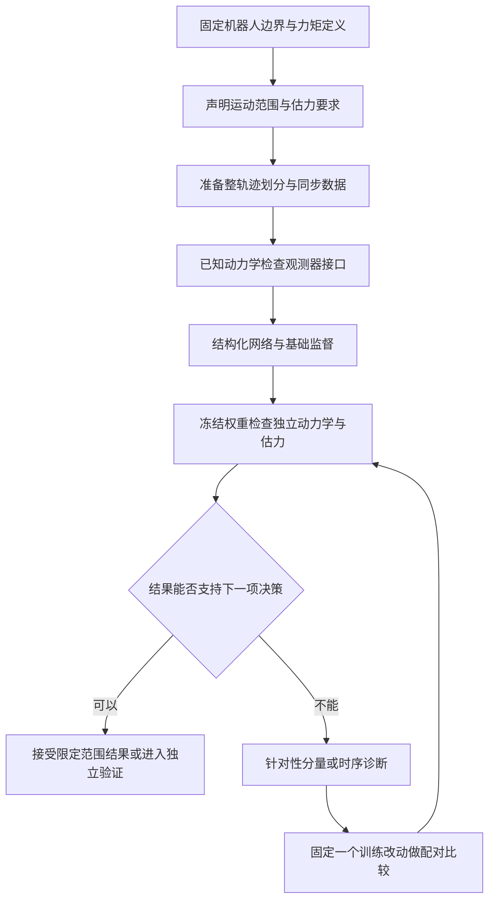

# 面向外力估计的结构化 PINN 动力学学习方法论

采用 PINN 学习机器人动力学，关键是让网络输出观测器需要的物理量，让数据提供区分这些量的信息，再用独立运动与已知加载评价模型。**总力矩拟合、动力学分量准确和最终估力可靠，是三件不同的事。**

本文面向当前 Python／MuJoCo／UR5 重实现，归纳模型、数据、训练和验收的方法。完整公式推导见[结构化动力学与动量滤波详解](<面向机器人外力估计的结构化动力学学习与动量 Kalman 滤波.md>)；PIAKF 原文内容与实施差异见[论文笔记](PIAKF_2026_notes.md)和[复现方案](PIAKF_2026_reproduction.md)。这里的设计建议不替代后续实验任务中固定的处理、预算和判据。

## 1 明确 PINN 在这里学习什么

经典 PINN 文献将微分方程作为训练先验，用于学习方程的解或未知关系；机器人结构化动力学学习则把力学结构直接嵌入网络，再通过运动与力矩数据学习其中的函数。二者都利用物理信息，但输入、输出和监督条件不同。[Raissi 等原始工作](https://arxiv.org/abs/1711.10561)、[DeLaN 原始工作](https://arxiv.org/abs/1907.04490)。

当前方法可具体称为**具有力学结构的动力学网络**：

| 对象 | 当前学习方式 | 最终用途 |
|---|---|---|
| 惯性矩阵 $\widehat M(q)$ | 从位置输出矩阵因子并构造正定矩阵 | 广义动量及惯性力矩 |
| 速度相关项 $\widehat c(q,v)$ | 从同一个 $\widehat M$ 的位置导数推导 | 逆动力学与动量输入 |
| 重力 $\widehat G(q)$ | 位置到重力矩的网络输出 | 解释重力产生的内部力矩 |
| 摩擦 $\widehat\tau_f(v)$ | 与对象匹配的参数化模型 | 解释速度相关阻力 |
| 末端外力 $\widehat w$ | 由冻结模型和动量 KF 估计 | 下游任务输出 |

网络不直接把每一帧拟合成一个外力标签，也不需要另外训练互不关联的 $M$、$\dot M$ 和 $c$ 网络。当前 KF 不参与网络反向传播；若改成端到端估力训练，应明确新增的标签、目标与比较设计。

PIAKF 的完整链还包含换向误差补偿与变窗口 WMA。动力学网络和动量 KF 跑通，只代表这部分方法完成，不等于完整 PIAKF 复现。

## 2 先固定物理边界和标签含义

统一采用外界作用于机器人的符号：

$$
M(q)a+c(q,v)+G(q)+\tau_f(v)
=\tau_{\rm act}+J(q)^T w,
\qquad v=\dot q,\quad a=\ddot q.
$$

必须说明工具、负载、转子惯量、传动和摩擦哪些属于被学习的对象。否则工具重力、驱动力矩偏置或未知接触都可能被网络吸收到内部动力学中。

| 数据或参考 | 在当前仿真中的地位 | 使用边界 |
|---|---|---|
| $q,v,\tau_{\rm act}$ | MuJoCo 运动与实际关节侧驱动力矩 | 原动态训练及 KF 的输入 |
| 差分加速度 | 由速度和时间戳计算的派生量 | 点式训练输入，包含离散近似 |
| MuJoCo 的 $M,c,G$ | 当前虚拟机器人的模型参考 | 冻结后诊断；用于训练时须另列监督配置 |
| 静止平衡力矩 | 当前新增的合成监督 | 明确由代数平衡产生，不称为实测保持数据 |
| 已施加的外力 | 仿真评价参考 | 与估计结果比较，不输入在线 KF |

MuJoCo 参考描述的是当前虚拟机器人，并不自动代表真实 UR5。真机电流换算力矩还需要确认增益、偏置、传动比、关节侧／电机侧定义和通道同步；不能直接当作无误差标签。

令 $\tau_{\rm ref}=\tau_{\rm act}+e_{\rm ref}$，$d_{\rm model}=\widehat\tau_{\rm dyn}-\tau_{\rm dyn}$，则：

$$
\widehat\tau_{\rm dyn}-\tau_{\rm ref}
=J^T w+d_{\rm model}-e_{\rm ref}.
$$

因此，内部模型误差和力矩参考误差都可能被解释为外力。只让最终输出接近零，也可能同时损害真实外力响应，必须保留加载评价。

## 3 构造结构一致且可求导的模型

### 惯性与速度项

六轴网络输出下三角矩阵的21个独立元素，采用固定尺度矩阵 $D$：

$$
\widehat M(q)=D\bigl[L(q)L(q)^T+\epsilon I\bigr]D,
\qquad D_{jj}>0,\quad\epsilon>0.
$$

对角元素可用 Softplus 参数化。该结构保证对称正定，不保证矩阵数值与机器人一致，也不保证所有刚体参数都具有物理可实现性。

从同一个函数计算：

$$
\widehat T=\tfrac12v^T\widehat Mv,\qquad
\dot{\widehat M}=\sum_j\frac{\partial\widehat M}{\partial q_j}v_j,
\qquad
\widehat c=\dot{\widehat M}v-\nabla_q\widehat T.
$$

若输入采用 $\bar q_j=(q_j-\mu_j)/s_j$，物理坐标导数必须包含 $1/s_j$。训练时还要保留从这些导数到网络权重的梯度，不能误用 `detach` 截断。

ReLU 在不可微点需要统一导数约定，分段导数的正确性也不代表函数导数接近真实动力学。更换平滑激活可以作为对照，不能未经比较就称为精度改进。

### 重力与摩擦

重力可直接输出向量 $\widehat G(q)$，也可由标量势能输出梯度 $\nabla_q\widehat V$。后者增加保守力场约束，两者应作为不同模型变体比较。当前使用直接向量头。

当前仿真只有黏性阻尼，匹配的起点是：

$$
\widehat\tau_f=\operatorname{diag}(\widehat b)v,
\qquad \widehat b_j\geq0.
$$

真实对象包含库仑、Stribeck、滞回或温度效应时，再根据数据定义相应扩展。不能仅凭论文出现某种摩擦形式，就认为它与当前对象相符。

若惯性与重力共用隐藏层，静止监督虽然直接作用于重力，也会间接改变惯性输出。因此每次改变重力训练后，仍要检查完整动力学及估力结果。

## 4 按可辨识性组织数据

只监督总力矩，相当于要求几个动力学项的和正确。有限轨迹可能允许各项误差互相补偿。正定结构缩小了候选函数范围，但不能替代充分激励。

数据应按要区分的物理作用组织：

| 数据条件 | 提供的信息 | 设计重点 |
|---|---|---|
| 多姿态静止 | 重力随位置的变化 | 包含多关节同时变化的组合姿态 |
| 相近姿态下的正反向、多速度运动 | 摩擦的速度和方向关系 | 同时记录重力与加速度影响，不能直接把全部残差归摩擦 |
| 具有不同加速度的运动 | 惯性产生的力矩变化 | 避免速度、加速度与位置始终高度相关 |
| 多关节动态激励 | 耦合项与位置导数 | 覆盖部署中的关节组合、频率和换向 |
| 独立加载数据 | 真实外力的保留能力 | 力的幅值、方向、作用点和时序明确 |

**覆盖要同时考虑 $q$、$v$、$a$ 及其组合。**各关节都在某个范围内运动，不代表这些关节的联合构型已被覆盖；沿单个关节扫描的静止姿态，也不能代表所有组合姿态。

不以总帧数代替信息量。高频采样的相邻帧高度相关，同一姿态重复很多次也仍然只有一个姿态。对参数化模型可检查回归矩阵的秩与奇异值；对神经网络可辅以参数敏感度诊断，但最终仍需独立轨迹评价。

划分与处理遵循以下顺序：

1. 按完整轨迹、姿态组或采集批次划分训练、开发和测试，再产生窗口与差分量。
2. 仅用训练集确定归一化统计；滤波、权重和检查点选择只使用声明的开发过程。
3. 静止训练姿态与主要静态评价姿态排重；组合姿态泛化与范围外外推分别报告。
4. 保留与部署一致的时间戳、反馈频率、噪声及工具／载荷条件。双向滤波可服务离线监督，不能冒充在线因果处理。
5. 已用于方案分析的轨迹继续用于回归，但不再称为未使用的封存测试。

未知外力接触数据不能直接混入无接触动力学训练，否则真实外力可能被模型学成内部动力学。

## 5 让每个损失对应一种信息

### 点式逆动力学监督

$$
\widehat\tau_{{\rm dyn},k}
=\widehat M_k a_k+\widehat c_k+\widehat G_k+\widehat\tau_{f,k},
$$

$$
\mathcal L_\tau
=\frac1{6N}\sum_k
\left\|S_\tau^{-1}
\bigl(\widehat\tau_{{\rm dyn},k}-\tau_{{\rm ref},k}\bigr)\right\|_2^2.
$$

这是当前动态训练的起点，前提是无接触、定义一致且加速度与力矩同步。差分加速度噪声会直接影响惯性学习。$S_\tau$ 的共同尺度或逐关节尺度会改变优化权重，比较时必须固定。

### 静止平衡监督

可靠静止、无外力且摩擦在零速度时为零，才有 $\tau_{\rm eq}=G(q)$。按独立姿态等权，而非按重复帧数加权：

$$
\mathcal L_s
=\frac1{|\mathcal P|}\sum_{p\in\mathcal P}
\frac1{6N_p}\sum_{k\in p}
\left\|S_\tau^{-1}
\bigl(\widehat G(q_k)-\tau_{{\rm eq},k}\bigr)\right\|_2^2.
$$

真机有静摩擦、机械制动、外部支撑或电流偏置时，静止驱动力矩不能直接等同于重力。仿真中直接由模型生成平衡力矩，属于额外的合成重力监督，必须明确这个信息来源。

### 动量区间监督

加速度参考不可靠时，可考虑无接触区间的动量残差。令 $h=t_b-t_a$：

$$
r_{ab}^p=\frac1h\left\{
\widehat M(q_b)v_b-\widehat M(q_a)v_a
-\int_{t_a}^{t_b}
\left[\tau_{\rm ref}+\dot{\widehat M}v-\widehat c-\widehat G-\widehat\tau_f\right]dt
\right\}.
$$

除以 $h$ 后残差具有力矩单位，可据此定义归一化平方损失。它避免显式速度差分，但仍受端点噪声、积分近似、区间长度和通道同步影响；在离散仿真中还要检查与积分器的匹配。

可比较 $\mathcal L_\tau$ 与 $\mathcal L_\tau+\lambda_s\mathcal L_s$，或另行比较点式与区间监督。**不必一次叠加所有损失。**权重、区间和姿态集合在观察结果前固定，每次改变一个主要因素。

同一个力矩残差换名为“数据损失”和“物理损失”并重复相加，不会增加独立信息。从同一 $M$ 构造的结构恒等式，也不能充当另一份动力学真值监督。

## 6 训练顺序与下游接口

配对比较固定初始化、动态数据顺序、归一化、更新数、优化器和检查点规则。先确认基线能够复现，再评价处理组。开发集用于规定范围内的选择，测试集不参与反复调参。一次固定预算训练完成，不等于已经收敛。

模型接入动量观测器的基本接口是：

$$
\widehat p=\widehat Mv,\qquad
y=\widehat p,\qquad
u=\tau_{\rm ref}+\dot{\widehat M}v-\widehat c-\widehat G-\widehat\tau_f.
$$

在线 KF 需要位置、速度、驱动力矩参考及冻结模型，不需要训练用的差分加速度标签。雅可比、wrench 作用点、坐标系、符号和采样区间约定必须一致。

比较模型时先冻结 KF 规则。若使用 $R=\widehat M\Sigma_v\widehat M^T$，实际 $R$ 会随模型改变，这属于原生管线效果。固定共同 $R$ 可辅助隔离分量作用，但使用真实惯性的共同 $R$ 只是教师诊断，不能当作部署配置。

## 7 分层验收和停止训练

| 验收层次 | 必须回答的问题 | 不能据此直接宣布的结论 |
|---|---|---|
| 实现与结构 | 正定性、归一化链式求导、梯度、存取与 KF 递推是否正确 | 已学准机器人动力学 |
| 独立动力学 | 新轨迹上的总力矩、重力、惯性和速度项是否准确 | 最终外力估计必然合格 |
| 下游估力 | 无接触假力与已知外力响应是否同时满足要求 | 全工作空间或真实机器人都有效 |

仿真中，动力学检查应覆盖逐关节力矩 RMSE／偏置／峰值，$M$ 的整体及关键元素误差，$\dot M$ 与 $c$ 的误差，以及多姿态重力和多速度摩擦。整体矩阵范数可能掩盖小惯量关节的误差，不能只报告一个平均百分数。

估力评价至少包括：

- 持续无接触运动的逐方向 RMSE、偏置与峰值，覆盖加速、换向和停止。
- 启动瞬态的峰值与恢复时间；启动单独统计，同时保留全时域结果。
- 已知加载的幅值、方向、延迟、超调、卸载恢复和串扰。
- 固定频率或频段的响应；不以事后平移时间轴降低 RMSE。

性能门槛由最小目标外力 $F_{\min}$、允许误报和任务响应时间确定。例如，可预先规定假力 RMSE 小于 $\alpha F_{\min}$、峰值小于 $\beta F_{\min}$，再独立规定加载相对误差和延迟；$\alpha,\beta$ 由应用决定，不是论文通用常数。力矩方向另用 N·m 定义要求。

**在声明的使用范围内，独立运动和加载结果都达到事先约定的要求，就可以结束该轮网络训练。**不必要求每一个动力学量达到机器精度。若目标是证明分量辨识准确，则还需要相应的独立动力学依据，不能用估力结果替代。

## 8 什么时候需要逐关节追踪到 Fx

逐关节分解属于可选诊断，不是建立 PINN 动力学模型的必经步骤。

| 当前要做的决策 | 是否值得进一步分解 |
|---|---|
| 确认网络和 KF 已接通 | 通常不需要，先完成结构与接口检查 |
| 判断网络是否可用 | 先做独立轨迹和已知加载验收 |
| 已知某一模型分量与退化有关，需要决定补哪些数据 | 可以帮助区分关节、构型和运动阶段 |
| 某一方向对应用至关重要，改善其他方向不能抵消它的退化 | 值得做，并保持其他设置固定 |
| 希望靠更多诊断替代数据设计和独立评价 | 不能替代，应回到使用范围与验收目标 |

仅在满秩、准静态且其他误差可忽略的近似下，重力误差可写成：

$$
\delta w\approx(J^T)^{-1}\delta G.
$$

实际动量 KF 有状态和历史，$J$ 与增益还随时间变化，不能用这个瞬时公式代替完整传播。固定测量轨迹、惯性、协方差与增益递推后，可以将六个关节的重力误差信号分别通过同一观测器，检查其估力输出如何叠加。这只是固定条件下的通道诊断，不是唯一物理因果归属。

若误差信号为 $e=\sum_j e_j$：

$$
\operatorname{MSE}(e)
=\sum_j\operatorname{MSE}(e_j)
+2\sum_{i<j}\operatorname{mean}(e_i e_j).
$$

交叉项可以放大或抵消，因此不能把各关节或各分量的 RMSE 相加，也不能把单次替换的 RMSE 降幅当作贡献百分比。

对当前工作，已有诊断足以确认“静止监督没有保证运动估力全面改善”。如果下一项决策是重新规划数据覆盖和验收，逐关节追踪可以暂缓；如果必须解释轨迹05的 Fx 退化并据此精准选取补充姿态，再继续这一步。

## 9 当前探索提供的具体教训

以下是当前 UR5、无测量噪声、单种子及有限轨迹上的探索观察，阶段保留指标与Run索引为记录依据；不是已接受的普遍科学结论。

| 观察 | 数值或事实 | 方法上的含义 |
|---|---|---|
| 原网络能拟合训练力矩，但泛化差距明显 | 归一化 MSE：训练0.00171，开发0.551 | 训练 loss 小不足以结束辨识 |
| 追加25个静止姿态改善静态重力 | 48个非训练姿态的 J2 重力 RMSE：1.157→0.142 N·m | 新监督确实约束了部分重力预测 |
| 持续运动效果有取舍 | Fx 核心 RMSE：轨迹04为1.068→0.409 N，轨迹05为0.555→0.623 N | 静态结果不能代替运动评价 |
| 轨迹05的重力变化与退化关系更直接 | 共同协方差下，仅换增强重力：Fx RMSE 0.555→0.648 N | 改进总体重力指标，仍可能改变某方向的误差传递 |
| 真实加载也存在取舍 | 阶跃评价段 Fx RMSE 0.133→0.032 N；正弦0.531→0.587 N | 加载幅值、延迟与总误差需要一起检查 |

这些观察支持把**数据覆盖、分量可辨识性和下游验收**作为下一轮设计重点；它们没有证明增加数据、更换激活、分离网络或继续训练中的哪一种一定有效。

当前静止监督使用训练中心及单关节轴向偏移。多关节组合姿态是值得评估的覆盖维度，但补充数据不能直接从已反复分析的评价轨迹挑选标签后，再把同一轨迹称为独立泛化测试。

## 10 后续设计应先固定的内容

开始下一轮训练前，用一份短配置回答以下问题即可：

1. **对象与范围**：机器人、工具／载荷、反馈条件，以及要服务的姿态、速度与外力范围。
2. **唯一主要改动**：例如静止姿态覆盖，或摩擦激励；其余结构和训练设置保持配对。
3. **监督来源**：运动力矩、实测静止保持或合成平衡标签分别是什么；哪些真值只用于诊断。
4. **数据划分**：训练、开发、独立评价的轨迹和姿态组，排重方式及统计量来源。
5. **预算与停止**：参数更新、检查点规则和数值失败条件；失败不靠追加训练或改阈值挽救。
6. **验收输出**：逐关节动力学、六方向假力和已知加载响应，以及目标使用范围内的门槛。

先完成成本最低、仍能否定当前方案的检查，再投入训练。结果有改善和退化时保留全部方向，依据任务需要决定是否接受限定范围结果，或进入下一项对照。

## 参考与实现入口

- Hu、Ma、Lu、Zhuang，*Physics-informed adaptive Kalman filter for contact force estimation in industrial robots considering model uncertainty*，RCIM 101，103292，2026。[DOI](https://doi.org/10.1016/j.rcim.2026.103292) · [本地正文](PIAKF_2026_source.md)。
- Raissi、Perdikaris、Karniadakis，*Physics Informed Deep Learning Part I*。[作者预印本](https://arxiv.org/abs/1711.10561)。用于理解 PINN 的方程先验，不作为当前机器人实现已被验证的依据。
- Lutter、Ritter、Peters，*Deep Lagrangian Networks Using Physics as Model Prior for Deep Learning*，ICLR 2019。[作者预印本](https://arxiv.org/abs/1907.04490)。用于理解将力学结构嵌入网络的路线。
- 当前模型、坐标与复现差异：[实现来源说明](../../scripts/PIAKF/provenance.json)；当前网络：[structured.py](../../scripts/PIAKF/structured.py)；动态训练：[learning.py](../../scripts/PIAKF/learning.py)。
- 原训练指标：[metrics.json](../../scripts/PIAKF/conclusion/metrics/dynamic_training.json)；静止监督配对：[阶段摘要](../../scripts/PIAKF/conclusion/summary.md)、[完整指标](../../scripts/PIAKF/conclusion/metrics/paired_evaluation.json)与[配置](../../scripts/PIAKF/configs/static_constraint.json)。
- 轨迹05分量诊断：[完整指标](../../scripts/PIAKF/conclusion/metrics/paired_components.json)与[CSV](../../scripts/PIAKF/conclusion/tables/paired_components.csv)；来源见[原Run索引](../../scripts/PIAKF/conclusion/run_index.json)。归档用于追溯探索观察，不作为正式科学主张的依赖。
- 续接本阶段工作见[HANDOFF](HANDOFF.md)，保留资产、可复查内容与限制见[代码说明](../../scripts/PIAKF/README.md)。
