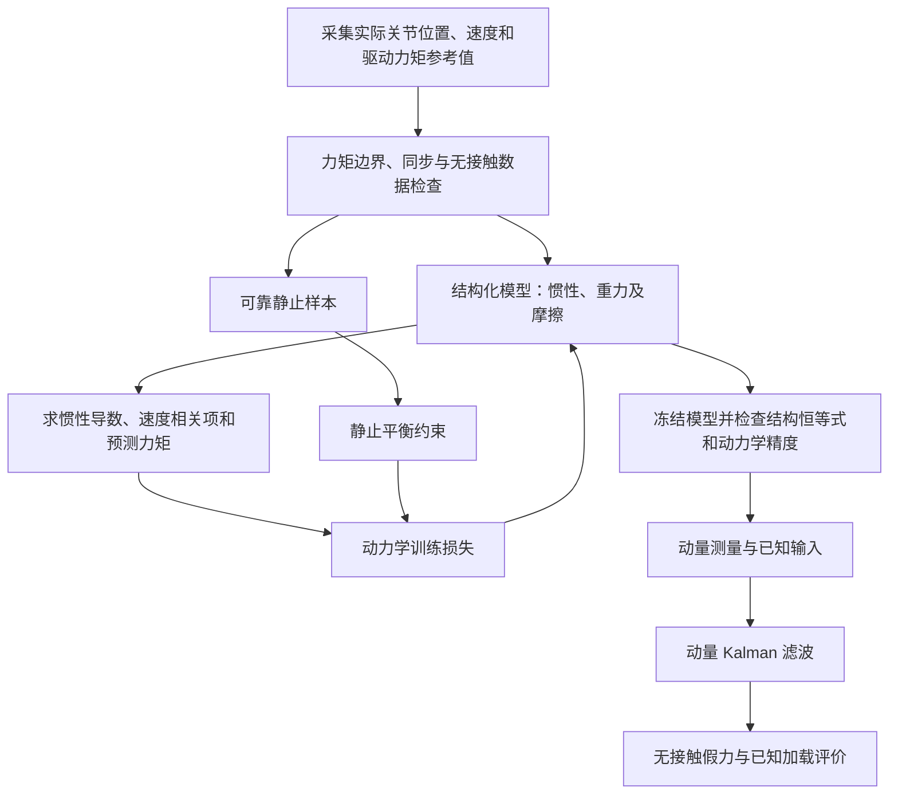

# 面向机器人外力估计的结构化动力学学习与动量 Kalman 滤波

**——惯性矩阵、Christoffel 符号、斜对称性质、动力学训练及六维外力估计**


## 摘要

对于无法直接测量末端接触力的工业机器人，可以利用关节运动信息与驱动力矩建立动力学模型，再通过动量观测器估计外界施加的力和力矩。然而，动力学模型误差、驱动力矩换算误差及运动反馈噪声均可能被观测器解释为外力，造成无接触假力、瞬态超调或不同方向之间的串扰。因此，动力学学习的评价目标不能停留在总力矩拟合误差，而应同时考察惯性矩阵及其位置导数、重力和摩擦等内部动力学量，以及它们对最终外力估计的影响。

本文以六自由度工业机械臂为对象，构建“**参考力矩定义—结构化动力学学习—区间与静止约束训练—独立动力学验证—动量 Kalman 滤波—外力估计评价**”的完整方法框架。重点推导惯性矩阵与科氏矩阵之间的 Christoffel 关系、$\dot M=C+C^\mathsf T$、$\dot M-2C$ 的斜对称性质及其能量意义；在此基础上讨论结构化网络的正定参数化和求导、无需直接加速度的区间损失、动量状态空间建模，以及动力学模型误差和电流力矩误差在估力环节中的传播机制。文末给出一种已完成的局部仿真验证配置与阶段性结果，并明确尚未验证的条件。

**核心原则：力矩拟合精度、内部动力学一致性和最终外力估计性能是三个不同的评价层次，不能彼此代替。**

---

## 1. 研究目标与总体技术路线

### 1.1 研究对象及最终目标

研究对象为具有 $n$ 个关节的机器人，以下在具体网络结构和实验配置中取 $n=6$。已知机器人关节位置 $q$、关节速度 $v=\dot q$ 以及关节驱动力矩参考值，训练一个结构化动力学模型，产生：

$$
\widehat M(q),\qquad
\widehat c(q,v),\qquad
\widehat G(q),\qquad
\widehat\tau_f(v).
$$

这些输出具有两个相互关联的用途：

1. 构造预测驱动力矩 $\widehat\tau_{\rm dyn}$，判断模型能否解释机器人运动；
2. 构造广义动量 $\widehat p=\widehat M(q)v$ 和动量动力学输入，供 Kalman 滤波器（KF）估计外力。

训练与估力原则上分离：先使用无接触运动数据训练模型、选择并冻结参数，再对冻结模型开展相同条件下的估力评价。除非另行设计联合优化目标，否则不应称 KF 已经参与网络训练。

### 1.2 总体流程



整个流程应依次回答：

| 评价层次 | 核心问题 | 不允许直接推出的结论 |
|---|---|---|
| 力矩层 | 模型能否解释参考驱动力矩？ | $\widehat M$、$\widehat G$ 等各分量一定正确 |
| 动力学层 | 惯性、导数、重力、动量是否与参考物理规律一致？ | KF 输出一定准确且不串扰 |
| 估力层 | 是否能在无接触时抑制假力，在加载时正确跟踪真实外力？ | 对全部未见工况具有普遍泛化能力 |

---

## 2. 动力学方程、符号与力矩参考

### 2.1 统一的动力学模型

设 $q\in\mathbb R^n$ 为实际关节位置，$v=\dot q$、$a=\dot v$，机器人关节空间动力学为：

$$
\boxed{
M(q)a+c(q,v)+G(q)+\tau_f(v)
=\tau_{\rm act}+J(q)^\mathsf T w.
}\tag{1}
$$

其中，$M$ 为关节空间惯性矩阵；$c$ 是科氏及离心力矩**向量**，在选定科氏矩阵表示后有 $c(q,v)=C(q,v)v$；$C$ 是 $n\times n$ 矩阵，**不能与 $c$ 混为一个物理量**；$G$ 是重力矩；$\tau_f$ 是约定模型边界内的摩擦或其他耗散力矩；$\tau_{\rm act}$ 是真实关节驱动力矩；$J^\mathsf T w$ 是外部末端力映射得到的关节力矩。

对于六关节机械臂，末端六维外力写成：

$$
w=[F_x,F_y,F_z,M_x,M_y,M_z]^\mathsf T.
$$

本文约定 $w$ 表示**外界作用于机器人**的力／力矩，以工具坐标原点 `tool0` 为参考点，分量表达在世界坐标系中；对应几何雅可比的行次序为线速度在前、角速度在后。改变坐标系、参考点或受力符号，必须同步变换 $w$ 和 $J$。

常用符号汇总如下。

| 符号 | 含义 | 典型单位（全转动关节） |
|---|---|---|
| $q,v,a$ | 关节位置、速度、加速度 | rad、rad/s、rad/s² |
| $M(q)$ | 关节惯性矩阵 | kg·m² |
| $C(q,v)$ | 科氏与离心项的矩阵表示，满足 $c=Cv$ | 随矩阵分量的关节单位而定 |
| $\dot M(q,v)$ | 沿 $q(t)$ 的惯性矩阵时间导数 | kg·m²/s |
| $c,G,\tau_f,\tau_{\rm act}$ | 关节力矩 | N·m |
| $\tau_I$ | 电流换算的力矩参考值 | N·m |
| $\tau_{\rm ref}$ | 学习及观测器使用的参考驱动力矩 | N·m |
| $p=Mv$ | 广义动量 | N·m·s |
| $w$ | 末端三维力、三维力矩 | N；N·m |
| $J^\mathsf T w$ | 外力对应的等效关节力矩 | N·m |
| $\widehat{(\cdot)}$ | 由学习模型计算的预测量 | 与对应物理量相同 |

### 2.2 仿真驱动力矩与电流换算力矩

训练标签必须和物理方程采用相同的关节侧力矩定义。

在受控仿真中，可以使用明确核对后的**实际施加驱动力矩** $\tau_{\rm act}$ 作为参考值。应从执行器实际力矩记录获得，而不能不经验证就用位置／速度控制指令或 `ctrl` 数值代替。

在实机中，通常根据电机电流 $i$ 构造参考力矩，例如：

$$
\tau_I=K_I(i-i_0),\tag{2}
$$

其中 $K_I$ 为换算至约定关节侧的驱动力矩增益，$i_0$ 为零点或偏置。实际换算需检查电机转矩常数、减速比、正负号、驱动侧与关节侧折算、传动损失以及采样延迟。用统一形式表示为：

$$
\boxed{
\tau_{\rm ref}=\tau_{\rm act}+e_{\rm ref}.
}\tag{3}
$$

以仿真实际驱动力矩为参考且忽略其记录误差时，$e_{\rm ref}=0$；以电流换算力矩为参考时，$e_{\rm ref}=e_I$，代表换算误差、偏置、噪声以及可能的未建模因素。

**电流换算得到的是带误差的参考值，不是无条件成立的真实力矩标签。** 若电流参考对应电机侧等效力矩，而模型采用关节侧刚体动力学，则还需明确反射转子惯量和传动摩擦是否被计入，以及是否发生了重复补偿。

### 2.3 无接触数据的作用

当数据满足 $w=0$ 时，动力学方程化为：

$$
M(q)a+c(q,v)+G(q)+\tau_f(v)=\tau_{\rm act}.\tag{4}
$$

这是学习机器人自身动力学的基本条件。若把未知接触数据混入无接触训练集，外力作用就可能被错误吸收到惯性、重力或摩擦分量中。

逆动力学网络不应直接把电流作为输入去预测由同一电流计算的力矩；电流应主要用于构造标签。运动输入应以实际反馈为准，不能将指令轨迹默认等同于实际运动。

---

## 3. 结构化动力学模型

### 3.1 为什么不只使用普通力矩网络

最直接的学习方式是：

$$
(q,v,a)\longmapsto\widehat\tau_{\rm dyn}.
$$

普通多层感知机（MLP）可以拟合这一映射，但一般不提供物理可信的 $\widehat M(q)$、$\partial\widehat M/\partial q$ 和广义动量。因此，**普通 MLP 可作为力矩预测基线，却不能不加改造就作为同一个动量 KF 的动力学输入模型**。

结构化动力学网络改为学习惯性、势能或重力函数、摩擦参数，并通过拉格朗日力学计算总力矩。这类方法与 Deep Lagrangian Networks（DeLaN）的基本思想相关：将已知动力学关系嵌入模型结构，而不仅是向普通回归器添加一个经验性的损失项 [1–2]。严格来说，采用独立重力输出头的模型只满足部分拉格朗日结构，不能宣称具有完整的能量参数化约束。

### 3.2 惯性矩阵的对称正定参数化

对于六个关节，$6\times6$ 对称矩阵有 21 个独立元素。惯性网络接收 $q$，输出用于组装下三角矩阵 $L_\theta(q)$ 的 21 个数，再构造：

$$
\boxed{
\widehat M(q)=D\left[L_\theta(q)L_\theta(q)^\mathsf T+\varepsilon I\right]D,
\qquad \varepsilon>0.
}\tag{5}
$$

$D$ 为固定、对角线严格为正的惯性尺度矩阵，$L_\theta$ 为可训练输出。下三角对角元素可使用 Softplus 保证正值。此结构确保 $\widehat M=\widehat M^\mathsf T\succ0$，从而避免模型产生负的动能方向。

需要区分以下三类性质：

- **结构合法**：对称正定，因式分解及其梯度计算没有数值错误；
- **数值正确**：$\widehat M$ 的元素、特征值和作用于速度的结果接近真实系统；
- **刚体参数物理可实现**：矩阵函数能够由符合物理要求的连杆质量、质心和惯量组成。

对称正定满足第一类结构要求，但不自动保证后两类。若研究目标是连杆物理参数辨识，应进一步考虑刚体参数和伪惯性矩阵的物理一致性约束 [3]。

### 3.3 重力的两种表达

一种实现方式直接预测六维重力矩：

$$
\widehat G(q)=\mu_\tau+s_\tau g_\theta(q),\tag{6}
$$

其中 $\mu_\tau$ 与 $s_\tau$ 可以取自训练集的力矩统计量，仅用于数值初始化和尺度设置。$\mu_\tau$ 不等于真实重力矩。

更严格的能量结构是学习标量势能 $\widehat V_\theta(q)$，再计算：

$$
\boxed{\widehat G(q)=\nabla_q\widehat V_\theta(q).}\tag{7}
$$

后者使重力来自同一个标量势能。两种表达应作为**明确区分的模型变体**：第一种实现简单，第二种增加保守力场约束，但可能具有不同的训练与导数计算特性。没有独立对照前，不能宣称其中一种一定更准确。

### 3.4 摩擦模型及其适用范围

基础黏性摩擦模型为：

$$
\boxed{
\widehat\tau_f(v)=\widehat b\odot v,
\qquad \widehat b_j=\operatorname{softplus}(\beta_j)\ge0.
}\tag{8}
$$

它适合只包含黏性阻尼的仿真；$\widehat b$ 由训练学习，不应直接拿仿真阻尼真值替代辨识结果。

面对真实工业机器人，可考虑在有实验依据时扩展为：

$$
\widehat\tau_{f,j}(v_j)
=b_jv_j+f_{c,j}\tanh\!\left(\frac{v_j}{v_s}\right),
\qquad b_j,f_{c,j}\ge0,\quad v_s>0.\tag{9}
$$

这一形式包含黏性项与平滑库仑摩擦近似，但仍未完整表示静摩擦、迟滞、温度依赖、柔性传动或间隙。是否扩展，应由速度相关残差、正反向运动对照和最终估力需求决定。

### 3.5 从同一个惯性函数计算速度相关项

定义结构化动能：

$$
\widehat T(q,v)=\frac12v^\mathsf T\widehat M(q)v.\tag{10}
$$

沿运动轨迹的惯性矩阵时间导数为：

$$
\boxed{
\dot{\widehat M}(q,v)
=\sum_{j=1}^{n}\frac{\partial\widehat M(q)}{\partial q_j}v_j.
}\tag{11}
$$

对应的科氏与离心力矩可由：

$$
\boxed{
\widehat c(q,v)
=\dot{\widehat M}(q,v)v-\nabla_q\widehat T(q,v).
}\tag{12}
$$

其中对 $q$ 求导时保持 $v$ 不变；分量形式为：

$$
[\nabla_q\widehat T]_i
=\frac12v^\mathsf T\frac{\partial\widehat M}{\partial q_i}v.
$$

最终逆动力学预测为：

$$
\boxed{
\widehat\tau_{\rm dyn}
=\widehat M(q)a+\widehat c(q,v)
+\widehat G(q)+\widehat\tau_f(v).
}\tag{13}
$$

**不需要另外训练一个与 $\widehat M$ 无关的 $\dot M$ 网络。** 自动微分可以求出模型自己的导数，却不能证明这些导数与真实机器人相符。尤其在使用 ReLU 等分段光滑激活时，应分别检查惯性数值、位置导数、沿轨迹的 $\dot{\widehat M}$、以及 $\widehat c$。平滑激活可以作为单独的对照设计，而不是未经验证的精度保证。

若输入归一化为 $\widetilde q_j=(q_j-\mu_j)/s_j$，应使用链式法则：

$$
\boxed{
\frac{\partial\widehat M}{\partial q_j}
=\frac1{s_j}\frac{\partial\widehat M}{\partial\widetilde q_j}.
}\tag{14}
$$

这里的 $s_j$ 是关节位置尺度，与力矩尺度 $s_\tau$ 不同。漏掉该因子会使速度项及动量输入发生系统误差。


### 3.6 为什么区分 $C(q,v)$ 矩阵与 $c(q,v)$ 向量

在刚体机器人动力学中，速度相关项常写为两种形式：

$$
M(q)a+\underbrace{C(q,v)v}_{c(q,v)}+G(q)+\tau_f
=\tau_{\rm act}+J^\mathsf T w.
\tag{15}
$$

其中 $C(q,v)\in\mathbb R^{n\times n}$，而 $c(q,v)\in\mathbb R^n$。**仅给出 $c=Cv$，并不能唯一确定整个矩阵 $C$**：不同矩阵可能对当前速度 $v$ 产生相同的力矩向量。因而，下面的矩阵恒等式需要规定 $C$ 的构造方式。机器人动力学中的这一性质可参见经典教材 [7]。

对于至少一阶连续可微且对称的惯性矩阵 $M(q)$，定义第一类 Christoffel 系数：

$$
\boxed{
\Gamma_{ijk}(q)
=\frac12\left(
\frac{\partial M_{ij}}{\partial q_k}
+\frac{\partial M_{ik}}{\partial q_j}
-\frac{\partial M_{jk}}{\partial q_i}
\right).
}\tag{16}
$$

用这些系数构造标准科氏矩阵：

$$
\boxed{
C_{ij}(q,v)=\sum_{k=1}^{n}\Gamma_{ijk}(q)v_k,
\qquad
c_i(q,v)=\sum_{j=1}^{n}C_{ij}(q,v)v_j.
}\tag{17}
$$

只要 $M$ 具有所需的可微性，该 $C$ 与 $c$ 就从**同一个惯性函数**推导而来。对于学习模型，将上式的 $M$ 替换为 $\widehat M$，即可得到 $\widehat C$ 及 $\widehat c$。这是一种结构构造关系，不需要为 $\widehat C$ 额外训练一套无关联的网络。

### 3.7 关键恒等式：$\dot M=C+C^\mathsf T$

沿关节轨迹 $q(t)$，惯性矩阵的时间导数由链式法则得到：

$$
\dot M_{ij}(q,v)
=\sum_{k=1}^{n}\frac{\partial M_{ij}}{\partial q_k}v_k.
\tag{18}
$$

由于 $M_{ij}=M_{ji}$，对式（16）交换 $i,j$ 可得：

$$
\begin{aligned}
\Gamma_{ijk}+\Gamma_{jik}
&=\frac12\bigg[
\frac{\partial M_{ij}}{\partial q_k}
+\frac{\partial M_{ik}}{\partial q_j}
-\frac{\partial M_{jk}}{\partial q_i}\\
&\hspace{25mm}+
\frac{\partial M_{ji}}{\partial q_k}
+\frac{\partial M_{jk}}{\partial q_i}
-\frac{\partial M_{ik}}{\partial q_j}
\bigg]\\
&=\frac{\partial M_{ij}}{\partial q_k}.
\end{aligned}\tag{19}
$$

将两侧乘以 $v_k$ 并对 $k$ 求和，有：

$$
C_{ij}+C_{ji}
=\sum_k\frac{\partial M_{ij}}{\partial q_k}v_k
=\dot M_{ij}.
$$

因此得到完整矩阵关系：

$$
\boxed{\dot M(q,v)=C(q,v)+C(q,v)^\mathsf T.}
\tag{20}
$$

等价地：

$$
\boxed{\dot M-2C=C^\mathsf T-C,\qquad
(\dot M-2C)^\mathsf T=-(\dot M-2C).}
\tag{21}
$$

这称为**斜对称性质（skew-symmetry property）**。它不是任意动力学神经网络天然具有的性质，而是在 $C$ 按上述 Christoffel 约定、由同一个可微 $M$ 构造时成立。仅仅在某个状态下满足 $Cv=c$，不足以推出式（20）。

对于结构化模型，同样有：

$$
\boxed{
\dot{\widehat M}=\widehat C+\widehat C^\mathsf T,
\qquad
\dot{\widehat M}-2\widehat C
\text{ 为斜对称矩阵}.
}\tag{22}
$$

它保证**学到的惯性函数及由其构造的速度项在代数上相容**，但并不保证 $\widehat M=M$ 或 $\widehat C=C$。如果使用 ReLU 网络，上述结论在网络函数可微的区域内成立；在激活函数的不可微点，应按照自动微分实现所选的分支导数理解，不能宣称处处具有经典意义下的光滑导数。

### 3.8 斜对称性质为什么与能量守恒有关

定义动能与其时间导数：

$$
T(q,v)=\frac12v^\mathsf T M(q)v,
\qquad
\dot T=v^\mathsf TMa+\frac12v^\mathsf T\dot Mv.
\tag{23}
$$

代入刚体动力学方程 $Ma+Cv+G+\tau_f=\tau_{\rm act}+J^\mathsf T w$：

$$
\begin{aligned}
\dot T
={}&v^\mathsf T\bigl(\tau_{\rm act}+J^\mathsf T w-G-\tau_f\bigr)\\
&+\underbrace{v^\mathsf T\bigl(\tfrac12\dot M-C\bigr)v}_{0}.
\end{aligned}\tag{24}
$$

因为斜对称矩阵 $S$ 对任意向量 $z$ 均满足 $z^\mathsf TSz=0$，所以科氏与离心作用不会独立产生或耗散机械能。其功率关系为：

$$
\boxed{
v^\mathsf T\bigl(\dot M-2C\bigr)v=0,
\qquad
v^\mathsf TCv=\frac12v^\mathsf T\dot Mv.
}\tag{25}
$$

若重力来自标量势能 $V(q)$，即 $G=\nabla_qV$，则 $\dot V=v^\mathsf TG$，系统总机械能 $E=T+V$ 满足：

$$
\boxed{
\frac{dE}{dt}
=v^\mathsf T\bigl(\tau_{\rm act}+J^\mathsf T w-\tau_f\bigr).
}\tag{26}
$$

当没有驱动输入、外力及摩擦时，$\dot E=0$；对于 $\tau_f=Bv$ 且 $B\succeq0$，有耗散功率 $v^\mathsf T\tau_f=v^\mathsf TBv\ge0$。

需要注意：**仅从 $\widehat M$ 构造 $\widehat C$，可以保证动能—科氏项的结构一致性；若 $\widehat G$ 是独立的六维输出，不能据此保证存在 $\widehat V$ 使 $\widehat G=\nabla_q\widehat V$，因此不能宣称模型已满足完整机械能守恒结构。**

### 3.9 与逆动力学和动量观测器的直接等价关系

由 $\widehat c=\widehat C v$ 及式（22）：

$$
\begin{aligned}
\dot{\widehat M}v-\widehat c
&=(\widehat C+\widehat C^\mathsf T)v-\widehat Cv\\
&=\widehat C^\mathsf Tv.
\end{aligned}
$$

另一方面，按式（12）的动能求导形式，
$\dot{\widehat M}v-\widehat c=\nabla_q\widehat T$，因此：

$$
\boxed{
\widehat C^\mathsf T(q,v)v
=\nabla_q\widehat T(q,v)
=\frac12\begin{bmatrix}
v^\mathsf T\dfrac{\partial\widehat M}{\partial q_1}v\\
\vdots\\
v^\mathsf T\dfrac{\partial\widehat M}{\partial q_n}v
\end{bmatrix}.
}\tag{27}
$$

这给出**三种等价的已知动量输入**：

$$
\boxed{
\begin{aligned}
u_\theta
&=\tau_{\rm ref}+\dot{\widehat M}v-\widehat c
-\widehat G-\widehat\tau_f\\
&=\tau_{\rm ref}+\widehat C^\mathsf Tv
-\widehat G-\widehat\tau_f\\
&=\tau_{\rm ref}+\nabla_q\widehat T
-\widehat G-\widehat\tau_f.
\end{aligned}
}\tag{28}
$$

第一种表达最容易与 $\dot p$ 的推导衔接；第二种就是经典动量观测器经常采用的 $C^\mathsf Tv$ 形式；第三种可以在实现中直接计算标量动能对 $q$ 的梯度，**未必需要构造完整 $C$ 矩阵**。三者在同一个可微 $\widehat M$ 及相同的坐标、归一化与求导约定下等价。

由此可以解释一种看似矛盾的情况：实现中仅计算 $\widehat c=\dot{\widehat M}v-\nabla_q\widehat T$，但文献推导写成 $\dot M=C+C^\mathsf T$。二者不是不同的动力学假设，而是**矩阵形式与向量形式的等价计算路线**。

### 3.10 一个二关节例子与结构验证方案

令 $a_0,b_0,d_0$ 为合适的常参数，取一个具有两关节耦合的对称惯性矩阵：

$$
M(q)=
\begin{bmatrix}
a_0+2b_0\cos q_2&d_0+b_0\cos q_2\\
d_0+b_0\cos q_2&d_0
\end{bmatrix},
\tag{29}
$$

其沿轨迹的时间导数和 Christoffel 科氏矩阵分别为：

$$
\dot M=
\begin{bmatrix}
-2b_0\sin q_2\,v_2&-b_0\sin q_2\,v_2\\
-b_0\sin q_2\,v_2&0
\end{bmatrix},
\tag{30}
$$

$$
C=
\begin{bmatrix}
-b_0\sin q_2\,v_2&-b_0\sin q_2\,(v_1+v_2)\\
b_0\sin q_2\,v_1&0
\end{bmatrix}.
\tag{31}
$$

容易逐项验证：$\dot M=C+C^\mathsf T$；而对应的速度力矩向量为
$c=Cv=[-b_0\sin q_2(2v_1v_2+v_2^2),\ b_0\sin q_2v_1^2]^\mathsf T$。这个例子表明：即使 $C$ 本身不对称，其**对称部分**仍由 $\dot M/2$ 确定。

对于数值实现，建议同时开展两类完全不同的检验：

| 检验层级 | 计算内容 | 能说明什么 |
|---|---|---|
| 代数结构检查 | $\|\widehat M-\widehat M^\mathsf T\|_F$、$\lambda_{\min}(\widehat M)$ | 网络输出是否满足对称正定 |
| Christoffel 关系检查 | $\|\dot{\widehat M}-\widehat C-\widehat C^\mathsf T\|_F$ | 惯性导数和科氏矩阵的实现是否相容 |
| 速度力矩等价检查 | $\|\widehat C v-\widehat c\|_2$、$\|\widehat C^\mathsf Tv-\nabla_q\widehat T\|_2$ | 两条计算路径是否一致 |
| 能量恒等式检查 | $\|v^\mathsf T(\dot{\widehat M}-2\widehat C)v\|$ | 是否满足对应功率恒等式 |
| 动力学精度检查 | 与独立参考比较 $\widehat M$、$\partial_q\widehat M$、$\widehat c$ | 学到的函数是否接近真实物理系统 |
| 最终任务检查 | 无接触假力、已知加载跟踪、串扰与延迟 | 是否适合外力估计 |

前四项主要是**实现与结构自洽检查**。若 $\widehat C$ 按 Christoffel 公式由 $\widehat M$ 构造，它们即使接近零，也不能当作学习精度优秀的证据。仅当 $\widehat C$ 被作为独立输出学习时，类似
$\|\dot{\widehat M}-\widehat C-\widehat C^\mathsf T\|_F^2$
才可能提供一个非冗余的结构约束；但单靠这个约束也不能保证 $\widehat C v$ 正确、参数可辨识或真实动力学精度。

对于以观测器为最终用途的模型，更合理的方案是**在网络内部固定上述物理构造，并把独立参考的动力学精度和实际 KF 估力性能作为真正的泛化评价**。由于训练时要沿 $\partial_q\widehat M$ 路径反向传播到网络权重，还应检查自动微分的高阶计算图、关节归一化链式系数与激活函数的导数平滑性。

---

## 4. 训练目标：力矩残差、区间残差与静止约束

### 4.1 点式逆动力学损失

在无接触条件下，最直接的训练目标是最小化预测力矩与参考力矩的差异：

$$
\boxed{
\mathcal L_\tau
=\frac1N\sum_{k=1}^{N}
\left\|S_\tau^{-1}\bigl(\widehat\tau_{{\rm dyn},k}
-\tau_{{\rm ref},k}\bigr)\right\|_2^2.
}\tag{32}
$$

$S_\tau$ 可以是从训练集获得的逐关节正对角尺度，也可以在对照实验中设置为共同标量尺度。二者会改变各关节残差的相对贡献，不能在实验中混用而不说明。

当参考力矩由电流换算得到时，训练实际逼近的是 $\tau_I$，而非无误差的真实 $\tau_{\rm act}$。此方法需要准确的加速度输入；若直接对带噪速度差分，加速度误差可能主导惯性项。

### 4.2 不显式使用加速度的动量区间约束

定义结构化动量与组合项：

$$
\widehat p=\widehat M(q)v,\qquad
\widehat\beta
=\widehat c+\widehat G+\widehat\tau_f
-\dot{\widehat M}v
=\widehat G+\widehat\tau_f-\widehat C^\mathsf Tv.
\tag{33}
$$

由无接触动力学可得：

$$
\dot{\widehat p}\approx\tau_{\rm ref}-\widehat\beta.
$$

因此，在区间 $[t_a,t_b]$ 上构造：

$$
\boxed{
\begin{aligned}
r_{ab}^{\rm mom}={}&
\widehat p(t_b)-\widehat p(t_a)\\
&-\int_{t_a}^{t_b}
\bigl[\tau_{\rm ref}(t)-\widehat\beta(t)\bigr]\,dt.
\end{aligned}
}\tag{34}
$$

该目标不需要把差分加速度作为网络输入，却仍要求速度与力矩时间对齐，并受数值积分、端点误差及区间长度影响。**区间训练并不自动消除电流标定误差，也不保证动力学分量可唯一辨识。**

### 4.3 与仿真离散积分匹配的逐物理步残差

针对采用直接关节力矩驱动、无接触且速度隐式处理黏性阻尼的仿真，可以在适用条件成立时采用更贴合数值更新的监督形式。设物理步长为 $h$，$\Delta v_i=v_{i+1}-v_i$，仿真物理阻尼矩阵为 $B_{\rm sim}$，则近似关系为：

$$
\bigl(M_i+hB_{\rm sim}\bigr)\Delta v_i
=h\bigl[\tau_{{\rm act},i}-c_i-G_i-B_{\rm sim}v_i\bigr].\tag{35}
$$

相应的学习残差可写为：

$$
\boxed{
\begin{aligned}
e_{\theta,i}={}&\widehat M(q_i)\Delta v_i\\
&+h\bigl[\widehat c(q_i,v_i)+\widehat G(q_i)
+\widehat b\odot v_i-\tau_{{\rm act},i}\bigr]\\
&+hB_{\rm sim}\Delta v_i.
\end{aligned}
}\tag{36}
$$

式（36）中，$\widehat b\odot v_i$ 为**学习的物理摩擦力矩**，而 $hB_{\rm sim}\Delta v_i$ 是**针对积分方式的数值修正**；二者不能当作重复的摩擦模型。修正项的正号来自式（35）左端的有效惯性。该关系需与具体仿真器、积分器及阻尼设置逐项核对，不是一般真机可直接使用的普适公式。MuJoCo 对采用隐式关节阻尼的积分器给出了有效惯性 $M+hD$ 的相应解释 [6]。

还应注意：

$$
\widehat M(q_i)\Delta v_i
\ne\widehat M(q_{i+1})v_{i+1}-\widehat M(q_i)v_i.
$$

所以式（34）的**动量端点差损失**与式（36）的**离散速度增量残差**不是同一个公式，也不应对外称为完全相同的训练方法。

### 4.4 区间处理算子与损失计算

为了让训练目标与数据采样、平滑及求导过程一致，可定义固定处理算子 $\mathcal A$，将逐物理步冲量残差映射为评估时域的力矩残差：

$$
r_\theta=\mathcal A(e_\theta),\qquad
\boxed{\mathcal L_D
=\frac1{6Ns_\tau^2}\sum_{k=1}^{N}\|r_{\theta,k}\|_2^2.}\tag{37}
$$

典型算子可依次执行物理步冲量汇总、累计、反馈频率取样、固定离线滤波、数值求导及评价区间裁剪。若 $e_\theta$ 单位为 N·m·s，则经过规定算子后的 $r_\theta$ 单位应为 N·m；$\mathcal L_D$ 为无量纲量。

对固定线性算子，正确的梯度传播为：

$$
\nabla_\theta\mathcal L_D
=\left(\frac{\partial e_\theta}{\partial\theta}\right)^\mathsf T
\mathcal A^\mathsf T
\frac{2r_\theta}{6Ns_\tau^2}.\tag{38}
$$

这要求计算图正确处理累计、滤波端点以及数值求导边界；不能只对局部残差反向传播，却忽略后续信号处理带来的梯度影响。

若使用四阶 Butterworth 双向滤波，需要明确其用途仅为**离线训练监督**。双向滤波依赖未来数据，不能直接当作在线 KF 可以因果实现的前处理。

### 4.5 静止平衡约束

在**可靠静止、无外力且仅有黏性摩擦**的前提下：

$$
v\approx0,\quad a\approx0
\quad\Longrightarrow\quad G(q)\approx\tau_{\rm act}.\tag{39}
$$

据此可以利用静止姿态补充重力监督。将训练集中的静止样本按独立姿态 $p\in\mathcal P$ 分组，定义：

$$
\boxed{
\mathcal L_{\rm static}
=\frac1{|\mathcal P|}\sum_{p\in\mathcal P}
\frac1{6N_ps_\tau^2}\sum_{k\in p}
\bigl\|\widehat G(q_k)-\tau_{{\rm act},k}\bigr\|_2^2.
}\tag{40}
$$

比较基础模型与增强模型时，可分别使用：

$$
\mathcal L_{\rm base}=\mathcal L_D,\qquad
\mathcal L_{\rm aug}=\mathcal L_D+\lambda_s\mathcal L_{\rm static}.\tag{41}
$$

$\lambda_s$ 应事先确定并在配对对照中固定。静止监督的物理信息主要针对重力；静止时惯性项为零，因而**不直接监督惯性矩阵**。若惯性网络和重力网络共享部分权重，静止监督仍可能间接改变惯性输出。

重复采集同一姿态得到的许多数据点，不能当作许多独立姿态。真机还需要先排查静摩擦、电流偏置、机械制动、外部支撑和位置漂移；存在这些作用时不能直接把 $\tau_I$ 当作重力标签。

### 4.6 损失的独立信息与重复计权

采用点式或区间残差时，若把同一个量

$$
\widehat M a+\widehat c+\widehat G
+\widehat\tau_f-\tau_{\rm ref}
$$

同时叫作“力矩误差”和“物理方程误差”，它们并未提供两份独立监督信息，叠加只是在改变权重。具有新信息的补充监督应来自可靠静止平衡、独立动力学参考量或不同时间约束等，并明确其条件和来源。

---

## 5. 数据采集、训练组织与可辨识性

### 5.1 训练数据应覆盖不同动力学作用

以一个简化关节模型为例：

$$
\tau_{\rm ref}\approx I_{\rm eq}a+G(q)+bv.
$$

若训练几乎全为匀速，$a\approx0$，则惯量即使存在明显误差，总力矩也可能很接近参考值。对于多关节模型，可能出现：

$$
\Delta M\,a+\Delta c+\Delta G+\Delta\tau_f\approx0,\tag{42}
$$

即内部动力学误差发生补偿。

| 数据类型 | 主要作用 | 关键约束 |
|---|---|---|
| 多个独立姿态的静止保持 | 重力及偏置相关信息 | 核对无接触、静摩擦及静止可靠性 |
| 正反向、不同速度运动 | 摩擦和速度依赖 | 尽量保持可比姿态、负载和温度 |
| 有明显加减速的运动 | 惯性相关信息 | 力矩与运动准确同步 |
| 多关节联合运动 | 惯性耦合、速度交叉项 | 保留实际关节间关联 |
| 覆盖不同姿态区域的轨迹 | 姿态依赖与泛化边界 | 避免只测训练邻域 |

这些运动增加辨识信息，但不能保证连杆惯性参数结构上唯一可辨识。还要区分**结构可辨识性**（哪些参数组合本来可以被观察）与**实际可辨识性**（噪声和激励条件下能否可靠估计）[4]。同时自由优化电流增益与全部动力学尺度时，可能存在尺度混淆；优先考虑独立标定增益，或引入已知负载约束 [5]。

### 5.2 数据处理及采样频率

数据整理至少包括：

1. 明确驱动力矩定义及动力学边界，核对符号、量纲和坐标系；
2. 校正电流、位置、速度及实际力矩之间的时间同步；
3. 对运动信号采用可复核的滤波、插值或区间积分方案，记录相位及幅值影响；
4. 以**完整轨迹或实验轮次**划分训练、开发和独立测试，防止相邻帧泄漏；
5. 记录每条训练轨迹的姿态、速度、加速度、负载及接触状态覆盖范围。

若采用式（36）这种逐物理步残差，必须拥有与物理步对应的 $v_i$、$\Delta v_i$ 和参考力矩，不能仅有下采样后的 KF 输入便假定可以复现同一训练目标。电流先经过滤波虽可能降低高频噪声，也可能损失真实力矩瞬态；需要分别评估噪声抑制、幅值失真和群时延。

### 5.3 一次模型训练的实际计算过程

```text
读取一条或一批无接触运动序列
    ↓
从实际关节位置 q 构造惯性 M̂ 和重力 Ĝ
    ↓
从同一惯性函数计算 ∂M̂/∂q、M̂̇ 和 ĉ
    ↓
利用摩擦参数计算 τ̂_f
    ↓
以点式或区间形式构造动力学残差
    ↓
按需要加入可靠静止平衡约束
    ↓
将全部损失反向传播到网络及摩擦参数
    ↓
优化器更新一次参数
    ↓
在独立开发轨迹上评价，并按预定规则冻结检查点
```

模型输出、训练尺度、固定数值修正、损失权重及检查点选择规则都应在实验开始前明确。训练步数达到预算并不等于收敛；也不能因为一次开发评价表现较好，就声称模型已经跨工况泛化。

---

## 6. 动力学误差为什么会变成外力估计误差

### 6.1 预测力矩残差的分解

定义真实机器人自身动力学力矩：

$$
\tau_{\rm dyn}=Ma+c+G+\tau_f.
$$

学习模型的结构误差为：

$$
\boxed{
\begin{aligned}
d_{\rm model}
={}&\widehat\tau_{\rm dyn}-\tau_{\rm dyn}\\
={}&(\widehat M-M)a+(\widehat c-c)\\
&+(\widehat G-G)+(\widehat\tau_f-\tau_f).
\end{aligned}
}\tag{43}
$$

根据式（1）与式（3），有：

$$
\boxed{
\widehat\tau_{\rm dyn}-\tau_{\rm ref}
=J^\mathsf T w+d_{\rm model}-e_{\rm ref}.
}\tag{44}
$$

这是外力估计问题的核心关系：**参考残差中既包含真实外力，也包含模型误差和参考力矩误差。**

若 $w=0$，但 $d_{\rm model}\ne0$ 或 $e_{\rm ref}\ne0$，残差仍可能非零。因此，力矩残差不能不加分辨就解释为实际接触力矩。

### 6.2 由结构化动力学构造动量输入

真实广义动量定义为 $p=M(q)v$；学习模型构造用于 KF 的动量：

$$
\boxed{p_\theta=\widehat M(q)v.}\tag{45}
$$

因为 $M$ 随关节位置变化，所以**不能遗漏乘积求导中的 $\dot Mv$**：

$$
\dot p=M(q)a+\dot M(q,v)v.
\tag{46}
$$

将 $Ma=\tau_{\rm act}+J^\mathsf Tw-Cv-G-\tau_f$ 代入，并使用
$\dot M=C+C^\mathsf T$，可得：

$$
\begin{aligned}
\dot p
&=\tau_{\rm act}+J^\mathsf Tw-G-\tau_f
+(\dot M-C)v\\
&=\tau_{\rm act}+C^\mathsf Tv-G-\tau_f+J^\mathsf Tw.
\end{aligned}
\tag{47}
$$

因此，**经典动量观测器所需的已知动力学输入**可以直接写成 $\tau_{\rm act}+C^\mathsf Tv-G-\tau_f$。在实际估计时，以参考驱动力矩和学习模型代替未知真值，得到：

$$
\boxed{
\begin{aligned}
u_\theta
&=\tau_{\rm ref}+\dot{\widehat M}v-\widehat c
-\widehat G-\widehat\tau_f\\
&=\tau_{\rm ref}+\widehat C^\mathsf Tv
-\widehat G-\widehat\tau_f\\
&=\tau_{\rm ref}+\nabla_q\widehat T
-\widehat G-\widehat\tau_f.
\end{aligned}}
\tag{48}
$$

这里 $u_\theta$ 是**动量过程模型的已知输入**，下文用 $r_k^y$ 表示创新量，避免混淆。上述三种写法在结构一致的实现中等价；最后一种不需要在线显式计算或储存完整的 $\widehat C$ 矩阵，但仍依赖 $\partial_q\widehat M$。它也解释了为什么只实现 $\widehat c$ 向量，仍能正确使用 $\dot M=C+C^\mathsf T$ 的理论。

沿实际机器人轨迹，对学到的动量求导，得到 $\dot p_\theta=\dot{\widehat M}v+\widehat Ma$。因此：

$$
\begin{aligned}
\dot p_\theta-u_\theta
&=\widehat Ma+\widehat c+\widehat G
+\widehat\tau_f-\tau_{\rm ref}\\
&=J^\mathsf T w+d_{\rm model}-e_{\rm ref}.
\end{aligned}
$$

故学习模型的动量过程为：

$$
\boxed{
\dot p_\theta
=u_\theta+J^\mathsf T w
+d_{\rm model}-e_{\rm ref}.
}\tag{49}
$$

**斜对称性质不会消除 $d_{\rm model}$。**它保证 $\widehat M$、$\widehat c$ 与 $\dot{\widehat M}$ 在给定构造下有一致关系，却无法排除惯性函数整体学错、参考力矩有偏置，或者速度和电流采样存在不同延迟。实际离散估计还受积分、输入保持、雅可比变化和传感器相关噪声影响，不能将所有 KF 新息直接归因于某一种动力学误差。

### 6.3 这对动力学学习意味着什么

式（44）—（49）说明需要分别检查：

- $\widehat M$ 的数值及随姿态的变化，因为它同时影响动量测量和过程输入；
- $\widehat C$、$\widehat c$ 与 $\dot{\widehat M}$ 是否按同一个 $\widehat M$ 生成，首先确保满足斜对称结构，再分别检查数值准确性；
- 静止和低速区域的 $\widehat G$、$\widehat\tau_f$ 偏差；
- 驱动力矩换算误差及传感器噪声，因为观测器不会自动识别它们与真实接触的区别。

降低总力矩训练损失是必要的模型拟合目标之一，但必须通过动量及最终外力估计评价判断其工程收益。

---

## 7. 动量 Kalman 滤波器设计

### 7.1 连续状态模型

令六关节情形下的状态为：

$$
\boxed{x=\begin{bmatrix}p\\w\end{bmatrix}\in\mathbb R^{12}.}\tag{50}
$$

建立名义过程方程：

$$
\dot p=u_\theta+J^\mathsf T w+\eta_p,
\qquad\dot w=\eta_w.\tag{51}
$$

其中 $\eta_p$、$\eta_w$ 分别是动量和外力状态的过程噪声项。外力采用随机游走，即在预测阶段不强制其向某一固定值衰减，而通过噪声强度允许时变外力。该过程模型将实际的结构动力学误差和其他未知扰动留给残差及过程噪声处理；这不意味着这些误差真的是零均值白噪声。

动量测量由冻结的学习模型和反馈速度构造：

$$
\boxed{y_k=\widehat M(q_k)v_k.}\tag{52}
$$

该测量不是额外安装的动量传感器读数。模型误差和速度误差可以同时影响测量与过程输入，实际部署需考虑它们的相关性。

### 7.2 离散状态转移

令 $T_k=t_k-t_{k-1}$，在区间内采用上一帧雅可比和输入保持近似：

$$
\boxed{
F_k=\begin{bmatrix}
I&T_kJ_{k-1}^\mathsf T\\
0&I
\end{bmatrix},\quad
B_k=\begin{bmatrix}T_kI\\0\end{bmatrix},\quad
H=\begin{bmatrix}I&0\end{bmatrix}.
}\tag{53}
$$

状态预测及协方差预测为：

$$
\widehat x_k^-=F_k\widehat x_{k-1}^+
+B_ku_{\theta,k-1},
\qquad
P_k^-=F_kP_{k-1}^+F_k^\mathsf T+Q_k.\tag{54}
$$

当前动量与预测动量的差称为**新息**：

$$
\boxed{r_k^y=y_k-H\widehat x_k^-.}\tag{55}
$$

Kalman 增益与校正为：

$$
K_k=P_k^-H^\mathsf T
\bigl(HP_k^-H^\mathsf T+R_k\bigr)^{-1},\tag{56}
$$

$$
\boxed{\widehat x_k^+=\widehat x_k^-+K_kr_k^y.}\tag{57}
$$

若将 $K_k$ 的末端外力状态对应的后六行记为 $K_{w,k}$，则：

$$
\Delta\widehat w_k=K_{w,k}r_k^y.
$$

这解释了为什么动量新息会同时影响多个力和力矩方向：六维外力通过雅可比和协方差耦合更新，并非逐关节残差到单一末端方向的一一映射。

协方差更新宜使用 Joseph 形式，以减小有限精度下的数值对称性问题：

$$
\boxed{
P_k^+=(I-K_kH)P_k^-(I-K_kH)^\mathsf T
+K_kR_kK_k^\mathsf T.
}\tag{58}
$$

Joseph 更新有助于数值稳定，但不能补救不准确的模型、错误的噪声协方差或不足的可观测性。

### 7.3 连续过程噪声到离散协方差

令 $Q_p$、$Q_w$ 为连续白噪声的谱强度，且两类驱动噪声独立，记 $D_J=J^\mathsf T$。冻结区间系数时，随机游走模型的离散协方差为：

$$
\boxed{
Q_k=\begin{bmatrix}
T_kQ_p+\dfrac{T_k^3}{3}D_JQ_wD_J^\mathsf T
&\dfrac{T_k^2}{2}D_JQ_w\\[5pt]
\dfrac{T_k^2}{2}Q_wD_J^\mathsf T
&T_kQ_w
\end{bmatrix}.
}\tag{59}
$$

非零交叉块反映同一外力过程噪声同时作用于动量和外力状态。不能为追求简单而任意删除它，同时还声称使用同一个连续过程模型。$Q_p$ 与 $Q_w$ 是每单位时间的噪声强度，不能当作每帧方差直接填入滤波器。

### 7.4 动量测量协方差

若初步仅考虑速度测量噪声，设 $\Sigma_v$ 为关节速度误差协方差，可以近似使用：

$$
R_k\approx\widehat M(q_k)\Sigma_v\widehat M(q_k)^\mathsf T.\tag{60}
$$

对于希望隔离动力学模型变化的配对实验，也可以固定某一个**共同基准惯性模型** $M_0$，令所有候选采用：

$$
R_k=M_0(q_k)\Sigma_vM_0(q_k)^\mathsf T.\tag{61}
$$

后一种方式便于公平比较，却不等于已经准确标定了真实测量不确定性。以上简单传播均未完整包含位置误差、惯性模型参数误差、信号相关性或电流换算误差；在高精度应用中应进一步识别这些缺项。

### 7.5 外力可观测性与作用点假设

对于固定雅可比的离散系统，$T_k>0$ 时：

$$
\operatorname{rank}\!\begin{bmatrix}H\\HF_k\end{bmatrix}
=n+\operatorname{rank}(J^\mathsf T).\tag{62}
$$

因此，对于六自由度、六维工具端外力，在当前固定构型下若雅可比秩不足，某些外力方向无法由这组关节动量信息独立区分。改变姿态可能改善时间上的可观测性，但不能由此断言所有时变情况下都可可靠估计。

另外，$w$ 被定义为参考点处的等效末端作用。若真实接触发生在其他连杆或存在多个接触，观测器输出不应不加解释地当作工具原点处的真实接触力。

---

## 8. 验证层次、基线与评价指标

### 8.1 内部动力学评价

独立动力学验证至少包含：

| 检查对象 | 指标或方法 | 主要风险 |
|---|---|---|
| 总预测力矩 | 逐关节 RMSE、偏置、峰值及独立轨迹泛化 | 各动力学分量误差抵消 |
| 惯性矩阵 $\widehat M$ | 元素误差、谱范数误差、特征值及正定性 | 数值看似合理但动力学不准确 |
| $\dot{\widehat M}=\widehat C+\widehat C^\mathsf T$ | Christoffel 关系、斜对称残差、能量功率恒等式 | 结构检查通过不代表物理预测正确 |
| 位置导数 | $\partial\widehat M/\partial q$ 与独立参考或差分核对 | 自动微分求对函数，但函数本身学错 |
| 速度相关力矩 | $\widehat c$ 或 $\dot{\widehat M}v-\nabla_q\widehat T$ | 高频导数误差与速度耦合 |
| 重力与摩擦 | 多姿态、多速度及正反向条件下的残差 | 静止偏置和摩擦被相互吸收 |
| 广义动量 | $\widehat Mv$ 及区间传播一致性 | 进入 KF 的测量与输入不一致 |

在仿真中，可把真实动力学量仅作为**独立诊断参考**，不投入训练梯度。对 $C$ 本身的数值比较应统一 Christoffel 约定；只关心运动方程时，比较 $c=Cv$ 通常更直接。若额外使用 $M/G/c$ 的仿真真值监督，就应作为另一种监督配置报告。在没有真实惯性参考量的实机上，不宜仅凭力矩拟合指标宣布“惯性矩阵辨识准确”。

### 8.2 无接触假力评价

无接触时真实 $w=0$。对各个末端方向 $j$，定义：

$$
\operatorname{RMSE}_j
=\sqrt{\frac1N\sum_{k=1}^{N}\widehat w_{k,j}^{\,2}},\qquad
\operatorname{Bias}_j
=\frac1N\sum_{k=1}^{N}\widehat w_{k,j},
$$

$$
\operatorname{Peak}_j
=\max_{k}\bigl|\widehat w_{k,j}\bigr|.\tag{63}
$$

比较偏置改善时应使用 $|\operatorname{Bias}_j|$。前三维力使用 N，后三维力矩使用 N·m，不能不经量纲归一化便把它们混成一个总分数。每个方向应分别报告核心运动区间、启动／停止瞬态及全程结果。

### 8.3 已知加载外力评价

只进行无接触测试，无法证明估计器对真实外力具有足够响应。已知加载测试至少应检查：

- 加载后的幅值误差、稳态偏置和恢复误差；
- 阶跃或缓变加载的响应延迟、上升过程及超调；
- 未受力方向的串扰与峰值假力；
- 不同姿态、速度、加速度和雅可比条件下的性能；
- 已知加载位置与实际等效工具参考点的坐标一致性。

尤其需要同时评价“假力低”和“真实外力可被正确估计”：如果某一配置只是过度平滑，可能降低无接触假力，却延迟或衰减真实接触响应。

### 8.4 分层构造合理基线

| 对照模型 | 主要用途 | 能否直接参与同一动量 KF 比较？ |
|---|---|---|
| 已知刚体结构的动力学参数辨识＋摩擦模型 | 物理参数及动力学基线 | 可以，前提是接口、坐标系和动力学边界一致 |
| 普通 MLP：$(q,v,a)\to\widehat\tau$ | 检验纯力矩拟合能力 | 默认不可以：缺少可信 $M$ 及一致导数 |
| 结构化模型：惯性、重力、摩擦 | 研究结构学习及观测器收益 | 可以，在满足所需输入检查之后 |
| 结构化模型＋静止约束 | 研究静止信息是否改善估力 | 可以，与上一组进行同条件配对 |

公平比较应优先固定训练数据、数据处理、检查点规则、雅可比、滤波器状态定义及初始协方差。若同时改变网络、训练数据和 KF 协方差，无法将差异可靠归因于动力学学习本身。

---

## 9. 一种局部仿真验证配置及阶段结果

本节给出一个具体的六关节、无接触局部训练与动量 KF 配对案例，用于说明上述方法如何落实。**这些参数是案例配置，不是通用最优超参数；该案例的结论也不能直接外推到真实工业机器人。**

### 9.1 数据与训练配置

| 类别 | 配置 |
|---|---|
| 动力学网络 | 三层、每层128节点，ReLU，float64 |
| 惯性输出 | 21维下三角元素，Softplus处理对角 |
| 重力输出 | 独立六维输出头，$\widehat G=\mu_\tau+s_\tau g_\theta$ |
| 摩擦模型 | 六个非负黏性系数，初始均为 0.1 N·m·s/rad |
| 惯性名义尺度 | $D=\operatorname{diag}(1,1,1,0.1,0.1,0.1)$ |
| 正定下界 | $\varepsilon=10^{-6}$，作用于无量纲因式分解内部 |
| 仿真重力加速度 | $(0,0,-9.81)$ m/s² |
| 仿真关节阻尼 | $B_{\rm sim}=\operatorname{diag}(1,1,1,0.1,0.1,0.1)$ N·m·s/rad |
| 仿真干摩擦 | `frictionloss=0` |
| 物理步记录／控制／反馈 | 16 kHz／2 kHz／1 kHz |
| 动量 KF 评价 | 125 Hz，即采样间隔8 ms |
| 离线区间算子 | 四阶20 Hz双向 Butterworth 滤波及其他固定处理 |
| 共同力矩尺度 | $s_\tau=13.717149536$ N·m，来自训练数据 |
| 优化器 | Adam，学习率 $5\times10^{-4}$ |
| 动态训练数据 | 两条17 s轨迹，损失使用每条核心10 s |
| 训练预算 | 32次参数更新，两条训练日志交替处理 |
| 静止监督 | 两条训练日志共2200个可靠静止样本，仅一个独立姿态 |
| 静止权重 | $\lambda_s=1$ |
| 配对冻结点 | 两组均使用第32次更新后的模型 |

此处对下三角因子采用使初始 $L_\theta$ 接近 $\sqrt{1-\varepsilon}I$ 的偏置初始化。由于 $D$ 在惯性构造中左右各出现一次，所以名义初始惯性约为：

$$
\widehat M_{\rm init}\approx D^2
=\operatorname{diag}(1,1,1,0.01,0.01,0.01)
\quad {\rm kg\,m^2}.\tag{64}
$$

对应物理矩阵中的数值正定下界项为 $\varepsilon D^2$，前三项为 $10^{-6}$、后三项为 $10^{-8}$ kg·m²。它们只是模型初始化与数值保护设置，不是待估真实连杆惯性，也不能与相同数字形式的阻尼系数混淆。

训练时不使用仿真器提供的真实 $M/c/G$ 作为网络监督标签，但使用了实际仿真驱动力矩、名义初始化和与离散积分方式匹配的已知修正。因此，此案例是**无真实动力学分量标签的间接学习**，而非完全没有模型和仿真先验。

两组训练仅在静止约束项上有计划地不同，其他初始化、数据顺序、损失处理及优化器设置保持一致。32次更新仅代表固定训练预算，并不足以证明已充分收敛。

### 9.2 估力配置

外力状态采用随机游走，过程噪声强度固定为：

$$
Q_p=\operatorname{diag}(10^{-7},10^{-7},10^{-7},10^{-9},10^{-9},10^{-9}),
$$

$$
Q_w=\operatorname{diag}(1,1,1,0.01,0.01,0.01).\tag{65}
$$

测量协方差由共同初始模型 $M_0$ 构造：

$$
\Sigma_v=\operatorname{diag}\bigl((10^{-4})^2,\ldots,(10^{-4})^2\bigr),
\quad
R_k=M_0(q_k)\Sigma_vM_0(q_k)^\mathsf T.
$$

在初始实际速度和外力估计均为零的案例中，取 $\widehat x_0=0$；初始协方差为：

$$
P_0=\operatorname{blockdiag}\bigl[R_0,
\operatorname{diag}(25,25,25,1,1,1)\bigr].\tag{66}
$$

这是一套固定配对条件，不代表完成了真实传感器噪声标定。两组使用相同的 $J,Q,R,P_0$，因此在同一协方差递推下具有相同 Kalman 增益；它们的学习惯性、动量测量及过程输入不同，外力输出仍然可能不同。

### 9.3 结构性质与案例实现的对应关系

该案例使用 $\widehat M(q)$ 及其物理坐标导数来直接计算 $\widehat c=\dot{\widehat M}v-\nabla_q\widehat T$，并没有把 $\widehat C$ 作为独立网络输出。这种计算方式与标准 Christoffel 构造**在函数可微处等价**，不需要将斜对称损失作为一个新的训练目标。不过，网络主干使用 ReLU，仍应另行检查轨迹穿越激活边界时位置导数、速度项及动量输入是否出现不可接受的数值变化。

这里说明的是现有计算结构能够满足的理论性质，**不是声称已经完成 $\dot{\widehat M}-\widehat C-\widehat C^\mathsf T$ 的数值测试**。后续可以按第 3.10 节开展单元测试，再用独立仿真参考评估动力学精度。

### 9.4 已观察到的无接触估力现象

以一条未用于梯度更新的开发运动轨迹为评价对象，主要分析 $[3,13)$ s 对应的1250个原生125 Hz样本，并补充全17 s统计。比较“只有区间动力学损失”与“区间损失＋静止平衡约束”两组，得到如下结果：

| 外力方向 | 加入静止约束后的无接触假力变化 |
|---|---|
| $F_x,F_y,F_z$ | RMSE、偏置绝对值、绝对峰值均下降 |
| $M_y,M_z$ | RMSE、偏置绝对值、绝对峰值均下降 |
| $M_x$ | 上述三项指标均退化 |

因此，这个案例支持的判断是：**补充可靠静止平衡信息，能够改善多个方向的无接触假力，但并未实现六维无代价改善。** 特别是 $M_x$ 的退化不能忽略；其唯一成因尚未通过独立实验确定。

本案例没有证明完整动力学参数唯一辨识、全局泛化或真实加载响应合格，也没有证明所选训练预算达到收敛。开发轨迹已经参与方案分析，不能把它当成完全未使用的封存测试集。静止监督虽然有2200个样本，但只有一个独立姿态，不能据此宣称重力函数已被充分辨识。

---

## 10. 后续工作与实验决策原则

后续工作应按“**先建立可信评价，再决定是否继续优化训练**”的顺序推进。

### 10.1 第一优先级：验证真实加载响应

冻结已有模型及 KF 设置，在可控、已知幅值和作用点的外力加载工况下，测量六维响应的幅值误差、稳态误差、延迟、超调和串扰。同时保留无接触假力评价，避免仅凭平滑后的输出较小就认为估力性能更好。

### 10.2 第二优先级：确定偏差来自哪个动力学环节

若加载或无接触性能不达标，应按误差特征进行诊断：

- **静止偏置明显**：检查重力函数、电流零偏、独立静止姿态数量，以及静摩擦和机械支撑。
- **运动相关假力明显**：检查轨迹激励、惯性矩阵、位置导数、Christoffel 一致性、速度相关力矩和时间同步；同时区分结构恒等式错误与物理模型函数误差。
- **个别末端方向退化**：结合雅可比、KF 增益和完整新息，查明是否存在方向耦合；不得将某关节误差简单等同于某个末端方向。
- **瞬态迟缓或超调**：区分动力学输入误差、过程噪声配置、采样保持及滤波延迟，不宜在尚未定位原因时同时调整所有设置。

这些是诊断路径，不是对某一次现象的确定归因。

### 10.3 第三优先级：针对证据开展单因素对照

在已经固定数据与评测方案后，才分别比较：直接重力头与势能梯度、ReLU 与平滑激活、黏性与扩展摩擦、共同与逐轴力矩尺度、点式与区间训练目标，以及新增独立姿态的静止监督。对于基于同一惯性函数计算 $\widehat C$ 的方案，不应额外加入恒等式损失并把它宣称为新增物理信息。每次对照应明确唯一主要改动、预注册的指标和独立测试集。

### 10.4 迁移到实机的前提

实机研究首先应建立电流—力矩换算的误差模型，并确认机械臂实际能够提供的反馈频率、信号同步精度和在线因果滤波条件。特别注意：**用高频物理步记录训练的离散损失，不能不加改造就声称适用于只有125 Hz反馈的实机。** 实机采样条件变化时，应重新定义离散监督目标，并重新验证估力误差。

---

## 11. 主要结论

1. 结构化动力学学习的目标不仅是预测 $\widehat\tau_{\rm dyn}$，还要提供动量观测器所需的 $\widehat M$ 及其一致导数、重力和摩擦信息；直接力矩 MLP 与结构化网络应分层比较。
2. 对 Christoffel 形式的 $C$，机器人惯性矩阵满足 $\dot M=C+C^\mathsf T$，等价于 $\dot M-2C$ 为斜对称矩阵。此性质保证科氏与离心项满足对应的动能功率恒等式，但不代表网络已经学到真实动力学，也不自动约束独立重力输出为势能梯度。
3. 惯性矩阵的对称正定构造及 $C$ 的一致求导保证了部分数学结构，但不能代替数值精度、刚体物理可实现性和参数可辨识性检验；自动微分求得的是网络函数的导数，不保证与真实系统导数接近。
4. 经典动量表达 $\dot p=\tau_{\rm act}+C^\mathsf Tv-G-\tau_f+J^\mathsf Tw$ 与 $\dot p=\tau_{\rm act}+\dot Mv-c-G-\tau_f+J^\mathsf Tw$ 完全等价，实际实现也可采用 $C^\mathsf Tv=\nabla_qT$，无须额外训练或显式生成 $C$。
5. 点式力矩损失、动量区间端点损失和基于积分器的逐步速度增量残差有不同的数据要求与近似条件，不能混为同一个训练目标；静止平衡约束只能在适用条件下补充重力信息。
6. 由 $\widehat\tau_{\rm dyn}-\tau_{\rm ref}=J^\mathsf Tw+d_{\rm model}-e_{\rm ref}$ 可知，真实外力、模型误差和力矩参考误差共同进入动量观测过程。KF 不会自动消除系统偏差。
7. 局部仿真配对结果表明，静止约束使五个末端方向的无接触假力指标改善，同时使 $M_x$ 退化；此结果尚不足以证明六维估力合格。下一步优先完成独立结构检查与冻结模型的已知加载评价。

---

## 参考文献

[1] M. Lutter, C. Ritter, J. Peters, **Deep Lagrangian Networks: Using Physics as Model Prior for Deep Learning**, in: *International Conference on Learning Representations (ICLR)*, 2019. [论文](https://arxiv.org/abs/1907.04490).

[2] M. Lutter, J. Peters, **Combining physics and deep learning to learn continuous-time dynamics models**, *The International Journal of Robotics Research*, 42(3) (2023) 83–107. [DOI: 10.1177/02783649231169492](https://doi.org/10.1177/02783649231169492).

[3] P. M. Wensing, S. Kim, J.-J. E. Slotine, **Linear Matrix Inequalities for Physically Consistent Inertial Parameter Identification: A Statistical Perspective on the Mass Distribution**, *IEEE Robotics and Automation Letters*, 3(1) (2018) 60–67. [DOI: 10.1109/LRA.2017.2729659](https://doi.org/10.1109/LRA.2017.2729659).

[4] P. M. Wensing, G. Niemeyer, J.-J. E. Slotine, **A geometric characterization of observability in inertial parameter identification**, *The International Journal of Robotics Research*, 43(14) (2024) 2274–2302. [DOI: 10.1177/02783649241258215](https://doi.org/10.1177/02783649241258215).

[5] A. Jubien, M. Gautier, **Global identification of spring balancer, dynamic parameters and drive gains of heavy industrial robots**, in: *2013 IEEE/RSJ International Conference on Intelligent Robots and Systems (IROS)*, 2013. [DOI: 10.1109/IROS.2013.6696525](https://doi.org/10.1109/IROS.2013.6696525).

[6] MuJoCo, **Computation — Numerical Integration**, official documentation. [Numerical integration](https://mujoco.readthedocs.io/en/stable/computation/#numerical-integration).

[7] M. W. Spong, S. Hutchinson, M. Vidyasagar, **Robot Modeling and Control**, 2nd ed., Wiley, 2020. ISBN: 978-1-119-52399-4. [出版社页面](https://www.wiley.com/en-gb/robot-modeling-and-control-2nd-edition-p-9781119523994).
