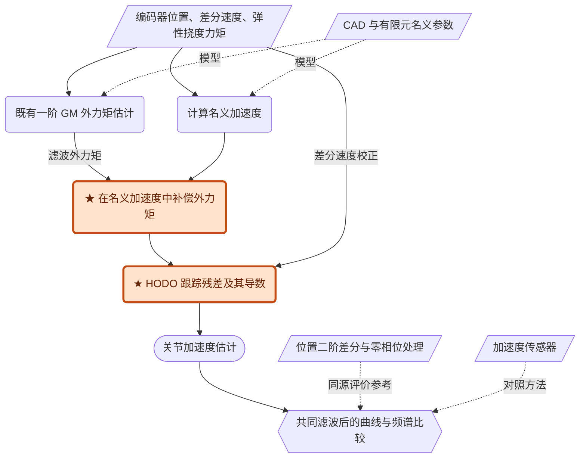

# A Joint Acceleration Estimation Method Based on a High-Order Disturbance Observer

> [PDF](Zhang_2022_JointAcceleration.pdf) · [原文转换](Zhang_2022_JointAcceleration_source.md) · [DOI](https://doi.org/10.1109/LRA.2022.3220501)。已核对 PDF 第 3 页动量公式及第 7—8 页附录；2026-10-23 整合补充符号表，明确状态、误差与量纲。UR5适配实验已完成，结论及实现另列，本文保持文献阅读口径。

复现入口：[UR5 / MuJoCo 复现方案](UR5_MuJoCo_Reproduction.md)、[代码与Docker入口](../../scripts/Zhang_2022_JointAcceleration/README.md)、[阶段结论](../../docs/conclusion/record/Zhang_关节加速度估计结论.md)。历史结果已清理；复现方案中的待选设计不自动视为已执行。

## 一句话结论

先用一阶动量观测器补偿较大的外力矩分量，再用高阶扰动观测器跟踪剩余加速度误差及其变化率，可以改善康复机器人上的加速度估计；实验参考来自位置差分，且有限时间证明存在需单独复核的环节。

## 问题与核心贡献

目标输出是**关节加速度**，外力矩估计只是辅助输入。直接差分两次会放大噪声，名义动力学计算会受模型误差和接触扰动影响，文中所用加速度传感器在低频表现也有限（§I—II）。

作者提出两个互补环节：广义动量外力矩补偿，减少大幅低频扰动；在 SOSML 型速度观测器上增加残余扰动导数状态，改善快变部分跟踪。作者还给出有限时间分析与三关节康复机器人实验（§III—V）。不应把使用既有 GM 或 SOSML 本身记为新算法。

## 关键符号速查

依据原文 §II—IV 与附录整理。笔记将原文的 $\mathcal T,\mathcal T_{\mathrm{ext}}$ 统一写为 $\tau,\tau_{\mathrm{ext}}$；帽号表示名义模型或估计值，星号表示经过 GM 补偿后的量。下表的单位按转动关节理解。

| 符号 | 定义与含义 | 量纲或阅读要点 |
|---|---|---|
| $q,\dot q,\ddot q$ | 关节位置、速度、加速度 | 分别为 rad、rad/s、rad/s²；均为 $n$ 维向量 |
| $M_r,C_r,g_r$；$\hat M_r,\hat C_r,\hat g_r$ | 实际动力学中的惯性矩阵、科氏/离心矩阵、重力向量；加帽者为名义模型对应量 | 动力学中速度项是 $C_r\dot q$，不是单独的 $C_r$ |
| $\tau,\tau_{\mathrm{ext}}$ | 关节驱动力矩、作用于机器人的外部力矩 | N·m；本文将外力矩以正号放在动力学右侧 |
| $f,f^*$ | 未补偿、加入 GM 外力矩估计后的名义加速度 | rad/s²；星号不表示真实加速度 |
| $w=\ddot q-f$ | 模型误差与外力共同造成的集总加速度扰动 | rad/s²，不是可以与外力矩直接相加的力矩量 |
| $w^*=\ddot q-f^*$ | GM 补偿后剩余的集总加速度扰动 | rad/s²；仍可能含模型误差和未补足的外力作用 |
| $p=M_r\dot q$ | 广义动量 | N·m·s；原文理论式使用实际模型，名义模型误差会影响实际估计 |
| $r=\hat\tau_{\mathrm{ext}}$ | GM 残差，作为外力矩的滤波估计 | N·m；不是精确外力矩或纯接触力真值 |
| $K_m$ | GM 的正定对角增益矩阵 | 对角元素单位为 s⁻¹，决定各通道一阶滤波带宽 |
| $x_1=\dot q,\ x_2=w^*,\ x_3=\dot w^*$ | HODO 的三个扩张状态；帽号表示相应估计 | 分别为 rad/s、rad/s²、rad/s³；$x_3$ 是残差加速度的变化率 |
| $e_1=x_1-\hat x_1,\ e_2=x_2-\hat x_2,\ e_3=x_3-\hat x_3$ | 速度、残余扰动、残余扰动导数的估计误差 | 分别与对应状态同单位；不能将三者都当成速度误差 |
| $u_1,u_2,u_3$ | 向三层状态方程注入的误差校正项 | 分别为 rad/s²、rad/s³、rad/s⁴；不是机器人执行器命令 |
| $K_1,\ldots,K_6$ | HODO 线性与非线性反馈的正定对角增益矩阵 | 不同项的量纲不同；仅“所有增益为正”不能替代稳定性条件 |
| $\kappa$ | 速度测量噪声，满足 $\dot q_{\mathrm{mes}}=\dot q+\kappa$ | rad/s；文中主要讨论位置数值差分带来的噪声 |
| $\sigma$ | 附录有限时间衰减不等式中的正系数 | 由 Lyapunov 矩阵决定，不是在线观测器的独立调节增益 |

理论上三层误差均参与稳定性分析；在线校正只需由速度测量构造 $e_1$。真实的 $w^*$ 和 $\dot w^*$ 未知，因此 $e_2,e_3$ 是分析量，不是额外要求测量的输入。

## 方法

### 名义预测、大扰动补偿、残差修正

名义加速度为

$$
f=\hat M_r^{-1}(\tau-\hat C_r\dot q-\hat g_r),\qquad
\ddot q=f+w.
$$

$w$ 包含动力学误差和外力的加速度等效作用。引入 GM 外力矩估计 $\hat\tau_{\mathrm{ext}}$ 后，改用

$$
f^*=\hat M_r^{-1}(\tau+\hat\tau_{\mathrm{ext}}-\hat C_r\dot q-\hat g_r),\qquad
\ddot q=f^*+w^*.
$$

这不是把未知外力变成已知真值：GM 仅提供一阶滤波估计，剩余接触变化及模型误差仍在 $w^*$ 内（式（19）—（20））。“外力矩补偿”发生在**估计器内部**，本文没有用它直接驱动机器人抵消接触。

取 $x_1=\dot q,x_2=w^*,x_3=\dot w^*$，估计器为

$$
\begin{aligned}
\dot{\hat x}_1&=f^*+\hat x_2+u_1,\\
\dot{\hat x}_2&=\hat x_3+u_2,\\
\dot{\hat x}_3&=u_3.
\end{aligned}
$$

令 $e_1=\dot q-\hat x_1$，采用逐关节线性与非线性反馈：

$$
\begin{aligned}
u_1&=K_1|e_1|^{1/2}\operatorname{sgn}(e_1)+K_2e_1,\\
u_2&=K_3\operatorname{sgn}(e_1)+K_4e_1,\\
u_3&=K_5\operatorname{sgn}(e_1)+K_6e_1.
\end{aligned}
$$

最终加速度取 $\dot{\hat x}_1$，所以包括误差注入 $u_1$，不是仅取 $f^*+\hat x_2$。观测器不需要在线输入加速度，但需要速度和名义惯性逆；速度由位置的一阶差分及滤波获取（§II-B、III-B）。

### 信息与证据图

本图为阅读重构。平行四边形为数据，圆角框为方法，体育场形为输出，六边形为验证；橙色★是作者提出的组合或扩展。实线为估计流，虚线为模型或评价参考。

### GM 与 HODO 不是重复估计同一份扰动

由 $f^*=f+\hat M_r^{-1}\hat\tau_{\mathrm{ext}}$ 可直接得到

$$
w^*=w-\hat M_r^{-1}\hat\tau_{\mathrm{ext}}.
$$

为理解频率分工，暂考虑模型准确、单关节惯量 $J$ 不变、唯一未知量为外力矩的情况。若 GM 增益为 $k_m$，则

$$
\hat\tau_{\mathrm{ext}}(s)=\frac{k_m}{s+k_m}\tau_{\mathrm{ext}}(s),
\qquad
w^*(s)=\frac1J\frac{s}{s+k_m}\tau_{\mathrm{ext}}(s).
$$

所以低频、大幅的接触分量主要先被 GM 纳入名义预测，HODO 再处理未补足部分。这是**简化模型下的解释**，不适用于直接描述整个多关节、时变惯量和有模型误差的系统。也不能把 $w^*$ 称为“纯高频接触力”：它还包括动力学模型误差。

增加导数状态后的真实扩张系统为

$$
\dot x_1=f^*+x_2,\qquad
\dot x_2=x_3,\qquad
\dot x_3=\ddot w^*.
$$

阶次增加只是把未知驱动移到更高阶导数，并没有删除未知驱动。对于同幅值的正弦残差，$\ddot w^*$ 的幅值随角频率平方增长，因此“提高阶数可以追踪快变信号”仍需同时给定参数、扰动界及采样条件。

### 为什么加速度输出仍然容易受速度噪声影响

令 $\phi(e)=|e|^{1/2}\operatorname{sgn}(e)$。在原文 §IV-B 采用的近似下，忽略噪声对名义模型和积分状态的影响，速度噪声 $\kappa$ 引起的加速度**增量**应写成

$$
\Delta\hat a\approx K_1\bigl[\phi(e_1+\kappa)-\phi(e_1)\bigr]+K_2\kappa.
$$

该式明确减去了无噪声输出；在 $e_1\approx0$ 时退化为 $K_1\phi(\kappa)+K_2\kappa$，对应原文图 4 所考察的情形。外侧函数虽然连续，但在原点附近斜率很大，所以“没有直接二次微分”不代表消除了噪声放大。更准确的速度输入和合适的 $K_1$ 同样关键。

这里估计器的 $u_1,u_2,u_3$ 是**误差校正项**，不是机器人实际执行器输入；真正测得或构造的驱动力矩是 $\tau$。另外，$\hat x_3$ 估计的是残差加速度的变化率，单位为 rad/s³，不是外力矩导数。

### 数据和评价参考必须区分

| 信息 | 获取方式 | 在方法中的角色 |
|---|---|---|
| 关节位置与力矩 | 电机侧、连杆侧 Netzer VLX-60 编码器；两端角度差乘关节刚度 | 在线输入；力矩不是末端 F/T 测量 |
| 名义动力学与刚度 | CAD 与有限元静态结构分析 | 预先参数；不是实机高精度动力学辨识 |
| 对照加速度 | 连杆上的 356A01 加速度传感器，按产品手册标定 | 对照方法，不是本文定义的 actual acceleration |
| “实际加速度”参考 | 关节位置二阶数值差分，再零相位滤波 | 与估计器共享位置来源；零相位处理不应算在线输入 |
| 展示的各方法输出 | 五阶 50 Hz Butterworth 低通；对各方法统一使用 | 控制滤波滞后差异；图中结果不等同未经滤波的原始输出 |

传感通信频率 1000 Hz。具体零相位滤波参数、记录总长度、重复次数及完整增益表未报告。没有训练/测试集划分问题，但独立评价参考和滤波定义仍影响可信度。

图中参考与估计器共享编码器信息，这不会自动使比较失效，但会限制“独立真值”这一说法：共同的标定误差可能同时影响参考和输入。相同的 50 Hz 后处理也只统一了外加滤波器，不能保证不同算法内部产生的延迟相同。幅度谱接近还不足以证明相位准确，需结合时域曲线；若以后用于加速度反馈，应另测完整在线链路延迟。

## 实验与证据

| 问题 | 设置与对照 | 结果 | 结论边界 |
|---|---|---|---|
| 增加扰动导数状态是否有用？ | 单关节 Simulink；惯量设为 5 kg·m²；1 kHz；扰动幅值 2 rad/s²，8 s 内由 6 Hz 变到 8 Hz；与关闭 $u_3$ 的结构比较 | 图 3：HODO 比低阶结构滞后小 | 证明给定参数下的仿真跟踪能力，不代表任意频率 |
| 实际加速度是否估得更好？ | 三关节坐式下肢康复机器人；关节 2 周期抬升、1/3 保持位置；无接触与人手施力两种情形；比较 HODO、动量方法 [19] 和加速度计 | 图 6—7：HODO 曲线更贴近位置差分参考，0–1 Hz 优于该加速度计 | 观察主要集中在关节 2；未提供 RMSE、统计重复或独立高精度加速度真值 |
| GM 补偿有贡献吗？ | 接触情形下去除/保留外力矩补偿 | 图 8：保留补偿后尤其在 0–5 Hz 改善 | 支持结构消融；并未证明 GM 分离出纯接触来源 |
| 快变残差能否被抑制？ | 接触数据条件下直接加入 6/7/8 Hz、幅值 1 rad/s² 的假设正弦扰动 | 图 9：相应谱峰被明显抑制 | 属于人为扰动注入；没有证明物理接触力在这些频率下被独立测量并准确重构 |

作者选择观测器增益时使两种估计方法的输出噪声水平相同。闭环加速度反馈控制在结论中列为下一步，本文证据仍为估计性能。

### 装配证据

任务是康复机器人周期运动及人手接触，并非装配。装配几何、公差、初始误差、成功判据、周期时间、力峰值与失败统计均**未报告**；真机试验有，但完整重复次数未报告，1000 Hz 为通信频率。

## 公式与证明核查

以下是本次阅读判断，不是作者已发布的勘误。

1. **式（18）符号问题已见于 PDF 第 3 页。**原文写 $\dot r=K_m(r-\tau_{\mathrm{ext}})$。从式（17）求导，应为

$$
\dot r=K_m(\tau_{\mathrm{ext}}-r).
$$

只有这个符号与正文“一阶低通”相符；原始打印式在 $K_m>0$ 时是不稳定形式。

2. **附录没有完整展示一般扰动项的处理。**式（23）第三行含残余扰动二阶导数；PDF 第 7 页式（28）的齐次矩阵表达未显示对应外部项或其界如何进入增益条件。
3. **变参数矩阵与 Lyapunov 论证还需复核。**附录矩阵 $A$ 随 $|e_1|$ 改变；逐点 Hurwitz 并不自动给出同一个正定矩阵 $P$。若使用随状态变化的 $P$，求导时还涉及其变化项。笔记保留作者的有限时间主张，但不将其记为已独立验证的定理。

为把第 2、3 点变成可检查的问题，针对单通道令 $\rho=|e_1|^{1/2}>0$，避免与 GM 残差 $r$ 混淆。由附录给出的矩阵计算，其特征多项式为

$$
\lambda^3+\tfrac12(k_1+k_2\rho)\lambda^2
+\tfrac12(k_3+k_4\rho^2)\lambda
+\tfrac12\rho(k_5+k_6\rho^2).
$$

即便所有增益均为正，三阶 Routh–Hurwitz 条件仍要求

$$
\tfrac12(k_1+k_2\rho)(k_3+k_4\rho^2)>\rho(k_5+k_6\rho^2)
$$

在所讨论的 $\rho$ 区间内成立。这是由原文矩阵得到的必要核查，不是新给出的一套完整增益设计。更一般地，式（23）变换到附录坐标后仍应保留加性项 $[0,0,\ddot w^*]^T$；如何在 Lyapunov 导数中控制该项，需要补充论证。

符号表中的 $\sigma$ 对应附录式（35）（PDF 第 8 页）：

$$
\dot V\leq-\sigma V^{1/2},\qquad
\sigma=\frac{\lambda_{\min}(P)^{1/2}\lambda_{\min}(Q)}{\lambda_{\max}(P)}>0.
$$

其中 $V$ 是 Lyapunov 函数，$P,Q$ 是作者在附录中使用的正定矩阵；$\lambda_{\min},\lambda_{\max}$ 分别表示最小、最大特征值。$\sigma$ 刻画该不等式成立时的衰减速率，不能脱离 $P,Q$ 和增益条件单独指定。前述扰动项与变参数矩阵问题尚需解决，因此这里是在解释作者的有限时间论证，而非给出已独立验证的收敛保证。

这些疑点不直接否定图中的实验结果，却意味着不能把论文公式逐行复制后便认为获得了已证明可靠的实现。

## 局限与研究关联

**作者指出：**速度噪声尤其经 $K_1$ 非线性项放大，需要在噪声与估计幅值间折中；加速度反馈控制尚待开展。

**我的判断：**本文最有用的是“大幅已知结构补偿 + 残差动态观测”的分工。它没有解决模型误差与接触力的物理来源辨识。面向装配可将加速度估计作为动力学补偿的候选辅助量，但应另行验证静摩擦换向、接触突变、共享编码器参考偏差和实际在线延迟。

与 Garofalo 2019 对读时，还应修正一种过强表述：SOSM/SOSML 已有针对满足导数界的时变扰动的理论结果，不能把它们笼统归为“只处理常值扰动”。本篇仿真展示的是所选增益和噪声约束下，增加状态对 6–8 Hz 测试信号的改善；它没有证明低阶滑模对所有快变信号都失效。反过来，本篇所选加速度计在 0–1 Hz 的不足也不能推广到所有类型的加速度传感器。

## 关联阅读

- [Garofalo 2019](../Garofalo_2019_SlidingMomentum/Garofalo_2019_SlidingMomentum_notes.md)：本文对照文献 [19]，主要估计动量与外力矩。
- [HOFTO 2022](../HOFTO_2022/HOFTO_2022_notes.md)：本文引用的高阶外力观测路线，但其状态定义和有限时间条件不同。
- [De Luca 2003](../DeLuca_2003_GeneralizedMomenta/DeLuca_2003_GeneralizedMomenta_notes.md)：GM 外力矩补偿的基础结构。
