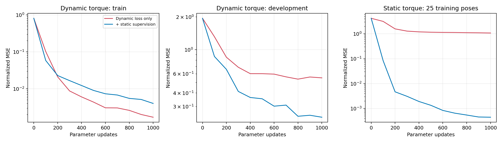
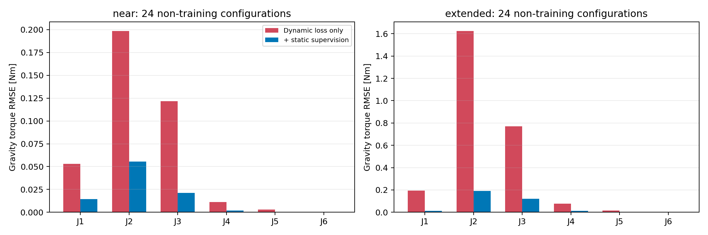
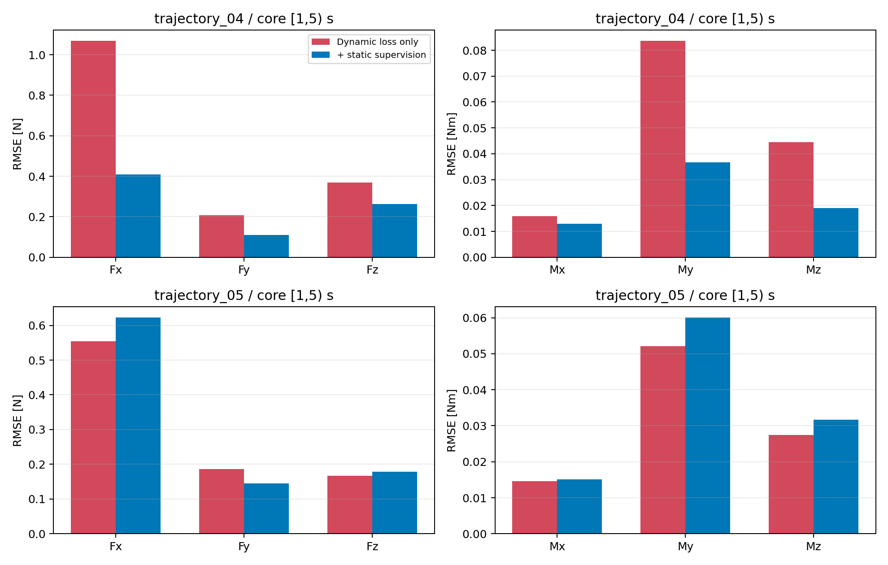
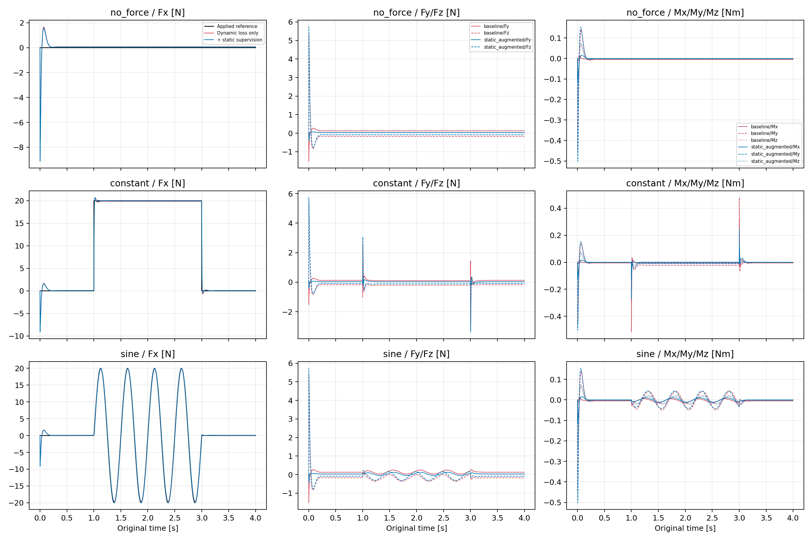
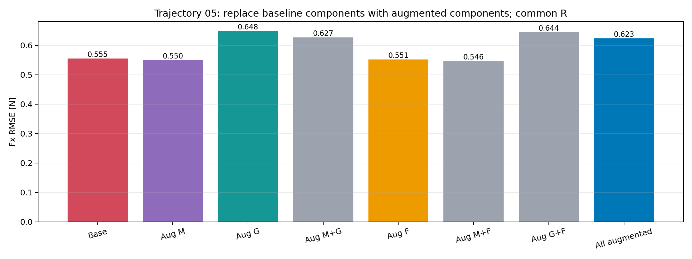
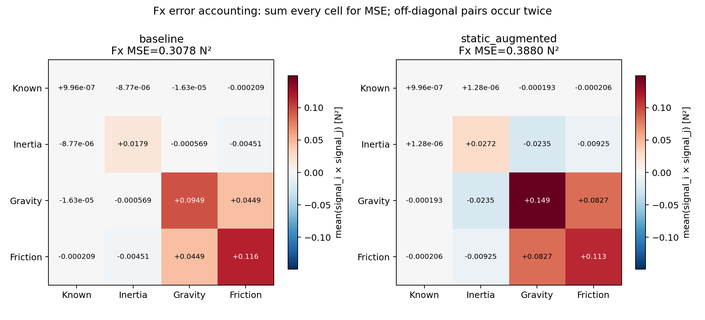

# PIAKF 结构化动力学与估力阶段摘要

本阶段使用现有 Docker／MuJoCo／UR5 重建了动力学网络与动量 KF，并检查模型学习和静止监督对估力的影响。网络已经搭建、训练并接通观测器，但尚未达到声明范围内的完整估力验收，也未完成论文全部模块。

## 实现和检查

| 工作 | 已完成内容 |
|---|---|
| 已知模型前置检查 | 23项基础核对，三条4秒加载仿真；匹配模型下链路可工作 |
| 结构化网络 | 3层128节点ReLU、正定惯性、直接重力头、非负黏性摩擦；21项网络检查 |
| 动态训练 | 六条各6秒轨迹，4训练／1开发／1诊断；差分加速度，固定1000次Adam更新 |
| 冻结估力评价 | 同一测量上的已知／初始化／训练模型；持续运动、启动与加载分开统计 |
| 静止监督配对 | 两组相同初始化、动态batch顺序与1000次预算；增强组额外25个合成静止平衡标签，权重1 |
| 退化诊断 | 轨迹05的15个冻结分量组合，共同协方差、原生端点回归和MSE交叉项核对 |

动力学输入为关节位置、速度与实际驱动力矩。无接触动态训练不使用真实惯性、重力或科氏项标签；静止增强组额外使用MuJoCo代数平衡生成的力矩，属于新增重力监督。wrench作用于tool0，以世界坐标表达，顺序为力在前、力矩在后。

## 训练拟合与泛化

| 归一化力矩MSE | 动态基线 | 加入静止监督 |
|---|---:|---:|
| 训练集 | 0.001708 | 0.004035 |
| 开发集 | 0.551065 | 0.239664 |

配对基线与原动态模型的参数回归差为0。训练误差小不能代替新轨迹和估力评价，1000次更新也没有被证明为充分收敛。

## 静态重力改善与运动取舍

主要静态评价为48个未加入静止监督的轴向偏移姿态，另把重合的中心姿态单列。所有评价记录已经用于分析，不是封存测试。

| 指标 | 动态基线 | 静止增强 |
|---|---:|---:|
| 静态48姿态J2重力RMSE，N·m | 1.15723 | 0.141634 |
| 静态48姿态J3重力RMSE，N·m | 0.551522 | 0.0864913 |
| 轨迹04核心Fx RMSE，N | 1.06796 | 0.408598 |
| 轨迹05核心Fx RMSE，N | 0.554835 | 0.622936 |

运动核心窗口固定为`[1,5)`秒，各4000帧，KF从0连续递推，不在核心段重置或平移时间。轨迹04六方向RMSE下降；轨迹05除Fy外的五方向RMSE上升，不能据此宣布整体估力合格。

## 已知外力响应

以下是已有固定参考加载日志中`loaded_after_transient`窗口的Fx误差，单位N；并非独立运动接触验证。

| 工况 | 动态基线RMSE | 静止增强RMSE |
|---|---:|---:|
| 无力 | 0.071244 | 0.055034 |
| 20 N阶跃 | 0.133246 | 0.032322 |
| 20 N／2 Hz正弦 | 0.531107 | 0.586697 |

两组阶跃10%至90%上升时间均为8 ms。正弦幅值比例从0.98637变为0.99724，但等效滞后从2.718增加至3.282 ms，RMSE也增加。幅值更接近不等于所有动态指标改善。

## 轨迹05退化诊断

下表固定共同的已知模型协方差递推，逐项将基线分量替换为静止增强模型的分量。惯性包括`M／Mdot／c`，共同R与混合分量均只作诊断。

| 替换 | 核心Fx RMSE，N |
|---|---:|
| 无替换 | 0.554792 |
| 仅惯性 | 0.549741 |
| 仅重力 | 0.648300 |
| 仅摩擦 | 0.551212 |
| 全部 | 0.622910 |

这条轨迹上的退化主要随重力分量变化出现。原生R和共同R下的差别很小；重力与摩擦误差信号的放大性交叉项增强，不宜简单解释为原有抵消被打破。静态重力总体改善也未使运动中各关节误差全部下降，例如轨迹05的J3重力RMSE从0.07114增加至0.08164 N·m。

原生端点回归最大差约`1.13e-12`，共同协方差差为0，信号重构最大差约`3.74e-13`。这些检查支持该固定诊断的数值一致性，不是模型物理精度或普遍因果解释的证明。

## 阶段边界和下一项决策

当前对象没有测量噪声、干摩擦或齿隙，仅使用理想关节侧力矩；没有实机电流标定、广泛姿态／速度覆盖或独立种子重复。TCN、Gaussian补偿、WMA与完整论文消融均未完成。结果保持EXPLORE有限工况观察，不提升为正式Claim。

下一步优先明确使用范围、设计更有辨识信息的数据和固定独立验收。逐关节追踪到Fx只在它能改变补充数据或模型选择时继续。E2NN与DeLaN可作为文献参照，当前没有复现E2NN或据此更换网络。

## 复查位置

- [原八个Run索引及历史请求](run_index.json)：历史路径只标识来源，不作为当前运行路径。
- [原动态训练](metrics/dynamic_training.json)、[静止配对](metrics/paired_evaluation.json)、[轨迹05诊断](metrics/paired_components.json)。
- [完整配对指标CSV](tables/paired_evaluation.csv)、[完整分量组合CSV](tables/paired_components.csv)、[MSE交叉项CSV](tables/paired_component_mse.csv)。
- [归档清单](../archive_manifest.json)、[代码与校验说明](../README.md)、[HANDOFF](../../../reproductions/PIAKF/HANDOFF.md)。
